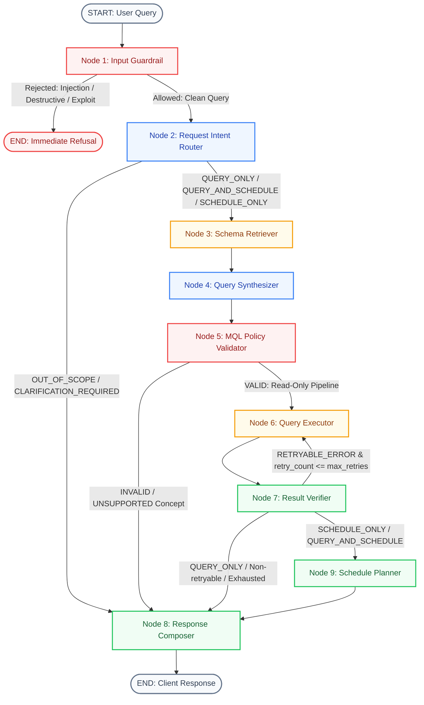

# FINTECH AGENT — COMPLETE SYSTEM ARCHITECTURE AND LANGGRAPH WORKFLOW EVIDENCE

**Document Classification:** Architectural Specification & Implementation Audit  
**Framework:** LangGraph (v1.2.20), LangChain-Core (v1.7.7), FastAPI (v0.162.2), Pydantic (v2.14.3)  
**Primary Source Code References:**
- Graph Definition: [`backend/app/agent/graph.py:1-478`](file:///c:/Users/guru2/Downloads/llm%20prj/backend/app/agent/graph.py#L1-L478)
- State Definition: [`backend/app/agent/state.py:1-158`](file:///c:/Users/guru2/Downloads/llm%20prj/backend/app/agent/state.py#L1-L158)
- Node Implementations: [`backend/app/agent/nodes/`](file:///c:/Users/guru2/Downloads/llm%20prj/backend/app/agent/nodes/)

---

## 1. Architectural Philosophy: Workflow vs. Autonomous Agents

A critical distinction must be established for the IEEE conference paper:

> [!IMPORTANT]
> **The FinTech Agent is NOT a Multi-Agent Swarm of Independent LLM Agents.**  
> It is an **instrumented, stateful, single-graph workflow** implemented with LangGraph's `StateGraph`. Of the 9 nodes in the pipeline, **only 2 nodes (Intent Router and Query Synthesizer)** invoke a Large Language Model. The remaining 7 nodes are **100% deterministic Python functions** providing AST validation, regex filtering, vector retrieval, cryptographic verification, and result sanitization.

### Why LangGraph is Used:
1. **Explicit State Encapsulation:** All 9 nodes share a single typed dictionary contract (`AgentState`). State mutates progressively and monotonically as the query moves through the graph.
2. **Conditional Branching without Callback Hell:** LangGraph's conditional edges (`add_conditional_edges`) cleanly route execution based on deterministic state evaluations (e.g., short-circuiting out-of-scope requests directly to the composer without invoking expensive synthesis or database steps).
3. **Bounded Cyclic Self-Correction:** When transient execution failures occur (e.g., transient network timeout), LangGraph allows a bounded cycle back to `query_executor` while preserving existing validated state without re-invoking the LLM.
4. **Deterministic Auditability:** Every stage transition emits structured telemetry into the shared `trace` field and logs to `logs/execution_events.jsonl`, enabling complete step-by-step auditability required in financial compliance.

---

## 2. Comprehensive Inventory of the Nine Workflow Nodes

The table below details every node in the compiled LangGraph pipeline:

| Node Name | Source File | Primary Responsibility | Input Fields | Output Fields | LLM Call? | DB Access? | Tools / Services Called | Next Node |
| :--- | :--- | :--- | :--- | :--- | :---: | :---: | :--- | :--- |
| **`input_guardrail`** | `input_guardrail.py` | Deterministic safety filtering: regex detection of injections, length, destructive operations | `natural_language_query`, `request_id` | `guardrail_status`, `rejection_reason`, `final_status`, `graph_response` | **No** (Pure Regex) | **No** | None (Built-in regex) | `intent_router` (if allowed) / `END` (if rejected) |
| **`intent_router`** | `request_intent_router.py` | Classify user intent into 5 discrete request modes; extract query description | `natural_language_query`, `conversation_history` | `request_mode`, `intent_reason`, `query_description`, `clarification_question` | **Yes** (or Mock) | **No** | `llm_service`, Pydantic `IntentClassification` | `schema_retriever` (data/sched) / `response_composer` (clarify/OOS) |
| **`schema_retriever`** | `schema_retriever.py` | Semantic vector search over schema catalog; retrieve relevant collections & fields | `query_description`, `natural_language_query` | `schema_context`, `collections_identified`, `schema_version`, `embedding_model` | **No** (ChromaDB / Mock Embeddings) | **No** (ChromaDB Vector Store only) | `ChromaSchemaStore`, `schema_catalog_builder` | `query_synthesizer` |
| **`query_synthesizer`** | `query_synthesizer.py` | Translate intent and retrieved schema context into candidate MQL aggregation pipeline | `query_description`, `schema_context`, `conversation_history` | `generated_pipeline`, `target_collection`, `pipeline_explanation`, `assumptions_made` | **Yes** (or Mock) | **No** | `llm_service`, Pydantic `PipelineSynthesisOutput` | `mql_policy_validator` |
| **`mql_policy_validator`** | `mql_policy_validator.py` | Deterministic security AST gate: validate collections, stages, operators, fields, limits | `generated_pipeline`, `target_collection`, `schema_context` | `validation_status`, `validation_errors`, `validation_warnings`, `is_pipeline_valid` | **No** (Deterministic AST) | **No** | `schema_catalog_builder`, Index artifact | `query_executor` (if valid) / `response_composer` (if invalid) |
| **`query_executor`** | `query_executor.py` | Gated read-only aggregation execution with server-side timeouts and payload bounds | `approved_pipeline`, `target_collection`, `test_db` | `raw_results`, `execution_time_ms`, `result_row_count`, `execution_status`, `execution_error` | **No** | **Yes (Gated)** (MongoDB read-only / test fixture) | `mongo_manager`, `PyMongo` | `result_verifier` |
| **`result_verifier`** | `result_verifier.py` | Classify results, verify bounds, sanitize BSON (Decimal128, ObjectId), track retry budget | `raw_results`, `execution_status`, `retry_count` | `result_status`, `verification_status`, `verified_results`, `interpretation_summary` | **No** | **No** | Data sanitizers | `query_executor` (retry), `schedule_planner` (sched), or `response_composer` |
| **`schedule_planner`** | `schedule_planner.py` | Parse natural-language recurrence, validate IANA timezone, compute next 3 runs, generate preview | `natural_language_query`, `request_mode`, `approved_pipeline` | `schedule_spec`, `schedule_preview`, `preview_id`, `next_run_times`, `schedule_approved` | **No** | **No** (Writes metadata DB only upon explicit API approval) | `recurrence_parser`, `APScheduler CronTrigger` | `response_composer` |
| **`response_composer`** | `response_composer.py` | Assemble final user response with pipeline explanation, execution metrics, or gate notices | All state fields | `formatted_response`, `final_response`, `graph_response`, `final_status` | **Optional** (LLM or deterministic template) | **No** | `llm_service` | `END` |

---

## 3. LangGraph Topology & Execution Paths

The topology compiled in `backend/app/agent/graph.py` implements the following exact control-flow paths:

---

## 4. Execution Flow Paths & Routing Logic

### Path 1: Immediate Safety Rejection (`route_after_guardrail`)
- **Condition:** `guardrail_status == "rejected"`.
- **Triggers:** Input > 2,000 chars, empty string, prompt injection phrases (`ignore previous instructions`, `DAN mode`), credential exfiltration attempts (`reveal api key`), or destructive database keywords (`db.customers.drop()`).
- **Graph Action:** Direct short-circuit to `END`. Nodes 2 through 9 are completely bypassed. Telemetry emits `NODE_SKIPPED` for all downstream nodes.
- **Verification Evidence:** [`backend/tests/test_phase4_agent.py:test_node1_injection_rejection`](file:///c:/Users/guru2/Downloads/llm%20prj/backend/tests/test_phase4_agent.py)

### Path 2: Conversational / Clarification Short-Circuit (`route_after_intent`)
- **Condition:** `request_mode` is `OUT_OF_SCOPE` or `CLARIFICATION_REQUIRED`.
- **Triggers:** General greetings ("Hello"), non-banking inquiries ("What is quantum physics?"), or ambiguous requests lacking entity context ("Find it").
- **Graph Action:** Bypasses Schema Retriever (Node 3), Query Synthesizer (Node 4), Validator (Node 5), Executor (Node 6), Verifier (Node 7), and Scheduler (Node 9). Routes directly to `response_composer` (Node 8).
- **Verification Evidence:** [`backend/tests/test_phase4_agent.py:test_node2_out_of_scope`](file:///c:/Users/guru2/Downloads/llm%20prj/backend/tests/test_phase4_agent.py)

### Path 3: Standard Analytical Query (`QUERY_ONLY`)
- **Sequence:** `input_guardrail` -> `intent_router` -> `schema_retriever` -> `query_synthesizer` -> `mql_policy_validator` -> `query_executor` -> `result_verifier` -> `response_composer` -> `END`.
- **Outcome:** Read-only aggregation synthesized, validated against AST rules, executed under 15,000 ms timeout against sandboxed DB, verified for bounds, formatted into tabular preview with explanation.

### Path 4: Scheduled Report Request (`QUERY_AND_SCHEDULE` or `SCHEDULE_ONLY`)
- **Sequence:** Follows Path 3 through `result_verifier`, then branches via `route_after_verifier` into `schedule_planner` (Node 9) before terminating at `response_composer` (Node 8).
- **Outcome:** In addition to executing or dry-running the query, Node 9 parses the recurrence pattern ("every Monday at 9am"), validates the timezone (`Asia/Kolkata`), projects the next 3 fire times via APScheduler's `CronTrigger`, and returns an interactive `SchedulePreviewCard` requiring explicit user approval (`POST /api/v1/schedules/approve`).

### Path 5: Bounded Retry Cycle (`route_after_verifier`)
- **Condition:** `result_status == "RETRYABLE_ERROR"` and `retry_count <= max_retries`.
- **Triggers:** Transient database connection loss (`AutoReconnect`), server selection timeout, or execution deadline interrupt.
- **Graph Action:** Loops back to `query_executor`.
- **Security Invariant:** The retry loop targets `query_executor` directly. It **never** loops back to `query_synthesizer` to modify the query. This guarantees that an already-validated MQL pipeline cannot be mutated into an unvalidated state during a retry attempt.

---

## 5. Architectural Contradictions & Discrepancies Register

During inspection of repository artifacts, two major architectural discrepancies were identified between early documentation/diagrams and actual executable code:

### Discrepancy 1: The "Synthesizer Feedback Loop" in Early Architecture Docs
- **Early Documentation Claim:** [`SYSTEM_ARCHITECTURE_UPDATED.md:1449`](file:///c:/Users/guru2/Downloads/llm%20prj/SYSTEM_ARCHITECTURE_UPDATED.md#L1449) and slide 6 in [`docs/codex/build_deck.py:104`](file:///c:/Users/guru2/Downloads/llm%20prj/docs/codex/build_deck.py#L104) show an arrow from `result_verifier` looping back to `query_synthesizer` labeled *"Error / result feedback conditional retry"*.
- **Implemented Code Reality:** In [`backend/app/agent/graph.py:370-384`](file:///c:/Users/guru2/Downloads/llm%20prj/backend/app/agent/graph.py#L370-L384), `route_after_verifier` routes retryable transient errors strictly back to `query_executor`. Validation rejections from `mql_policy_validator` route directly to `response_composer`.
- **Architectural Rationale:** The implemented approach is significantly safer. Re-prompting the LLM to fix syntax errors risks hallucinating new unsafe operators. Instead, validation errors immediately produce a structured refusal in the composer, while execution retries are reserved for idempotent, transient infrastructure faults.

### Discrepancy 2: Node 9 Implementation Status
- **Module Docstring Claim:** The top docstring of [`backend/app/agent/graph.py:17`](file:///c:/Users/guru2/Downloads/llm%20prj/backend/app/agent/graph.py#L17) states: *"Node 9 (schedule_planner) remains an inactive stub."*
- **Implemented Code Reality:** As implemented in Phase 7 ([`commit 5e446d5`](file:///c:/Users/guru2/Downloads/llm%20prj)), `schedule_planner.py` is a fully active, 160-line operational node wired into `graph.py:418, 464` and tested via `test_phase7_scheduling.py`. The top docstring was simply left un-updated from Phase 6.
