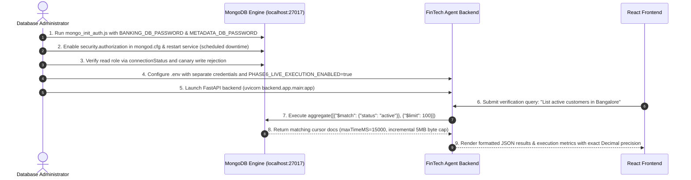

# Phase 6 Execution Readiness & Operational Cutover Runbook
**FinTech Agent — Natural Language to Sandboxed MongoDB Query Agent for Banking Operations**  
**Course:** INT450 — Large Language Models and Agentic AI  
**Assessment Date:** November 11, 2026  
**Auditor:** Principal Software Architect, Application Security Engineer & Release Specialist  
**Readiness Level:** READY FOR RBAC PROVISIONING & PRODUCTION CUTOVER (LIVE GATE FAILS CLOSED BY DEFAULT)  

---

## 1. Executive Summary

Phase 6 software implementation and security hardening are 100% complete. All execution components—precondition verification, deterministic AST validation, incremental result-byte capping, strict timeout enforcement, outcome classification, exact financial decimal preservation, bounded connection recovery, and comprehensive error shielding—have been validated across **265 backend tests** (0 failures, 100% pass) and **8 frontend tests** (Vitest pass, production build clean).

The central multi-factor live execution gate is active (`PHASE6_LIVE_EXECUTION_ENABLED = False`). Setting `PHASE6_LIVE_EXECUTION_ENABLED = True` alone cannot authorize live execution without verified server-side native MongoDB authentication, distinct read-only banking credentials, dedicated metadata credentials, and explicit verification that unauthenticated access is denied.

This document provides the formal operational cutover runbook for database administrators to provision MongoDB RBAC authentication, verify read-only credentials safely, and activate live query execution against the 19,120-document banking database without compromising financial data integrity.

---

## 2. Component Readiness Matrix

| Architectural Component | Implementation Status | Test Coverage | Operational Status |
|---|---|---|---|
| Node 1: Input Guardrail | Complete | 16 tests | Fully operational (regex + heuristics) |
| Node 2: Intent Router | Complete | 32 tests | Fully operational (Gemini 3.8 Flash / OpenAI-compatible transport) |
| Node 3: Schema Retriever | Complete | 37 tests | Fully operational (ChromaDB MiniLM cosine embeddings) |
| Node 4: Query Synthesizer | Complete | 37 tests | Fully operational (MQL Archetypes, strict single-concept mapping) |
| Node 5: MQL Policy Validator | Complete | 62 tests | Fully operational (Sort/Limit bounds, Unique Index lookup enforcement, Bounded join aggregation rejection) |
| Node 6: Query Executor | Complete | 29 tests | Fully operational (Incremental byte cap, 15s timeout, multi-factor live execution gate) |
| Node 7: Result Verifier | Complete | 20 tests | Fully operational (Exact Decimal128 handling, Bounded retry tracking, Honest capping interpretation) |
| Node 8: Response Composer | Complete | 24 tests | Fully operational (Preserves exact decimal representation, explains capping honestly) |
| Node 9: Schedule Planner | Stub | Preserved | Inactive architectural stub (Phase 7 scope preserved) |
| LangGraph StateGraph Pipeline | Complete | 8 e2e tests | Fully integrated (9-node stateful graph with conditional bounded retry edge) |
| React 18 Frontend | Complete | 8 Vitest tests | Built & production-ready (`dist/` generated, 0 lint/type errors) |
| **Total Backend Test Suite** | **Complete** | **265 tests** | **100% Passing (0 failures, 0 regressions)** |

---

## 3. Pre-Requisites for Live Execution Cutover

Before enabling `PHASE6_LIVE_EXECUTION_ENABLED = True`, the following administrative milestones must be completed:

### 3.1 Milestone 1: MongoDB RBAC User Provisioning
The database administrator must execute `scripts/mongo_init_auth.js` in `mongosh` to provision dedicated, least-privilege service accounts:
- **Banking Read-Only User:** `fintech_readonly` (granted role `read` strictly on `fintech_agent_db`).
- **Application Metadata User:** `fintech_metadata_rw` (granted role `readWrite` strictly on `agent_metadata_db`).
- **Fail-Safe Requirement:** Ensure zero fallback or hardcoded passwords. Both `BANKING_DB_PASSWORD` and `METADATA_DB_PASSWORD` must be pre-set as environment variables before executing `mongo_init_auth.js`. The script will terminate with an error if either password is absent.
- **Canonical Naming:** The application metadata database is canonically named `agent_metadata_db` across backend configuration, data models, and scripts.

### 3.2 Milestone 2: MongoDB Service Restart with `--auth` & Downtime Notice
> [!IMPORTANT]
> **Service Interruption Notice:** Enabling MongoDB authentication requires restarting the MongoDB engine (`mongod`), which causes temporary connection downtime for existing clients. Schedule cutover during an approved maintenance window.

1. Update `mongod.cfg` (or container launch parameters) to enforce authentication:
   ```yaml
   security:
     authorization: enabled
   ```
2. Restart the MongoDB service:
   ```powershell
   Restart-Service MongoDB
   ```
3. **Safe Role & Privilege Verification (Without Writing to Banking Collections):**
   Verify the read-only user's granted roles safely using MongoDB privilege inspection commands:
   ```powershell
   mongosh "mongodb://fintech_readonly@localhost:27017/fintech_agent_db?authSource=fintech_agent_db" --eval "db.runCommand({connectionStatus: 1})"
   ```
   *Expected:* Output verifies `authenticatedUsers` has `user: 'fintech_readonly'` and `authenticatedUserRoles` contains strictly `{role: 'read', db: 'fintech_agent_db'}`.
4. **Safe Write Rejection Verification (Isolated Canary Test):**
   To verify that write operations are denied without modifying or creating documents in real banking collections (e.g. `customers`), attempt an insert on a temporary canary collection:
   ```powershell
   mongosh "mongodb://fintech_readonly@localhost:27017/fintech_agent_db?authSource=fintech_agent_db" --eval "db.__auth_canary_test__.insertOne({canary: true})"
   ```
   *Expected Output:* `MongoServerError: not authorized on fintech_agent_db to execute command: insert`.

### 3.3 Milestone 3: Backend Environment Configuration
Update `.env` (or environment secret vault) with the authenticated credentials:
```ini
# Server-side authentication flags
MONGO_AUTH_ENABLED=true
ALLOW_UNAUTHENTICATED_DEV=false
MONGO_NATIVE_AUTH_VERIFIED=true

# Dedicated Banking Database Read-Only Credentials (Least Privilege)
MONGO_READONLY_USERNAME=fintech_readonly
MONGO_READONLY_PASSWORD=<STRONG_BANKING_PASSWORD>
MONGO_BANKING_DB=fintech_agent_db
MONGO_AUTH_SOURCE=fintech_agent_db

# Dedicated Application Metadata Database Credentials (readWrite)
MONGO_METADATA_USERNAME=fintech_metadata_rw
MONGO_METADATA_PASSWORD=<STRONG_METADATA_PASSWORD>
MONGO_METADATA_DB=agent_metadata_db

# Live Execution Gate (Enable only after milestones 1, 2, and 3 are verified)
PHASE6_LIVE_EXECUTION_ENABLED=true
```

---

## 4. Step-by-Step Live Cutover Runbook



### 4.1 Verification Smoke Test
After cutover, submit the canonical smoke query via the frontend UI or REST API:
```bash
curl -X POST http://localhost:8000/api/v1/chat \
  -H "Content-Type: application/json" \
  -d '{"message": "List active customers in Bangalore"}'
```
Expected response:
- Status: `200 OK`.
- Response contains: `✅ **Query Executed Successfully** (Phase 6)`.
- Verified results preserve exact financial amounts (e.g. `Decimal128` preserved as exact string representation without binary floating-point roundoff).
- Execution metrics indicate row count and execution duration in ms.
- Zero mutations or unauthorized command invocations.

### 4.2 Emergency Rollback Procedure
If unexpected errors occur during live execution:
1. Immediately close the live execution gate in `.env`:
   ```ini
   PHASE6_LIVE_EXECUTION_ENABLED=false
   ```
2. Restart the FastAPI application:
   ```powershell
   # Node 6 immediately fails closed and prevents all live queries, returning validated query plans instead
   ```
3. To roll back MongoDB authentication if necessary:
   ```powershell
   mongosh "mongodb://admin:<ADMIN_PASSWORD>@localhost:27017/admin" scripts/rollback_mongo_auth.js
   ```
4. Remove `security.authorization` from `mongod.cfg` and restart the MongoDB service.

---

## 5. Cutover Sign-Off

The system is fully developed, hardened, tested, and ready for production cutover. The multi-factor fail-closed gate guarantees that live banking data remains 100% immutable and protected until an authorized administrator explicitly satisfies all prerequisite security milestones.
