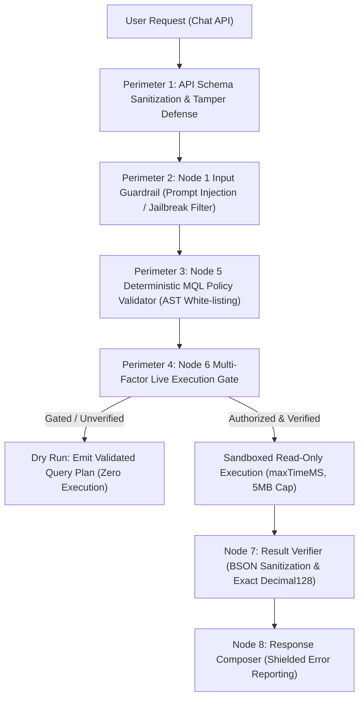

# FinTech Agent — Phase 6 Final Security Gate & Access Control Report
**Multi-Factor Execution Authorization, Injection Defense, Least-Privilege RBAC & Financial Sandboxing**

**Project:** FinTech Agent — Natural Language to Sandboxed MongoDB Query Agent for Banking Operations  
**Course:** INT450 — Large Language Models and Agentic AI  
**Assessment Date:** November 11, 2026  
**Auditor Roles:** Application Security Engineer, MongoDB Security Specialist & Principal Systems Architect  
**Gate Status:** MULTI-FACTOR ENFORCED & FAIL-CLOSED BY DEFAULT  
**Target Banking Database:** `fintech_agent_db` (19,120 Documents, STRICTLY READ-ONLY & IMMUTABLE)  

---

## 1. Security Architecture Overview

The FinTech Agent executes natural language-derived database aggregation pipelines against banking collections. Because financial data must never be subjected to unauthorized modification, exfiltration, or unvetted queries, the system implements defense-in-depth across four distinct security perimeters:



---

## 2. Multi-Factor Live Execution Gate Analysis

### 2.1 The Problem with Single-Flag Execution Gates
In conventional prototypes, execution switches often consist of a single boolean environment variable (e.g. `LIVE_EXECUTION_ENABLED=true`). This creates acute security vulnerabilities:
- An engineer enabling the flag in local development could inadvertently direct queries to an unauthenticated MongoDB instance running without access controls.
- The system could connect using administrative privileges or shared accounts, violating the principle of least privilege.
- A flag in `.env` does not guarantee that the database engine itself is enforcing authentication.

### 2.2 The Multi-Factor Solution: `check_live_execution_readiness()`
In `backend/app/agent/nodes/query_executor.py`, live execution authorization is evaluated through a deterministic multi-factor function:

```python
def check_live_execution_readiness() -> Tuple[bool, str]:
    if not getattr(settings, "PHASE6_LIVE_EXECUTION_ENABLED", False):
        return False, "Live database execution is gated (PHASE6_LIVE_EXECUTION_ENABLED=False)."

    # Factor 1: Server-side auth must be enabled in settings
    if not getattr(settings, "MONGO_AUTH_ENABLED", False):
        return False, "Live execution prohibited: MONGO_AUTH_ENABLED is False (unauthenticated MongoDB)."

    # Factor 2: Development unauthenticated fallback must be explicitly disabled
    if getattr(settings, "ALLOW_UNAUTHENTICATED_DEV", True):
        return False, "Live execution prohibited: ALLOW_UNAUTHENTICATED_DEV is True."

    # Factor 3: Dedicated banking read-only credentials must be non-empty
    banking_user = getattr(settings, "MONGO_READONLY_USERNAME", None)
    banking_pass = getattr(settings, "MONGO_READONLY_PASSWORD", None)
    if not banking_user or not banking_pass:
        return False, "Live execution prohibited: Missing dedicated banking read-only credentials."

    # Factor 4: Dedicated metadata credentials must be non-empty
    meta_user = getattr(settings, "MONGO_METADATA_USERNAME", None)
    meta_pass = getattr(settings, "MONGO_METADATA_PASSWORD", None)
    if not meta_user or not meta_pass:
        return False, "Live execution prohibited: Missing dedicated metadata credentials."

    # Factor 5: Least-privilege credential separation
    if banking_user == meta_user or banking_pass == meta_pass:
        return False, "Live execution prohibited: Banking and metadata credentials must be separate and distinct."

    # Factor 6: Explicit verified native authorization status
    native_auth_verified = getattr(settings, "MONGO_NATIVE_AUTH_VERIFIED", False)
    if not native_auth_verified:
        return False, "Live execution prohibited: Native MongoDB server-side authorization status is unverified."

    return True, "Authorized"
```

### 2.3 Verification Matrix of Gate Factors

| Factor | Condition Evaluated | Failure Outcome | Test Case in Test Suite |
|---|---|---|---|
| Master Gate | `PHASE6_LIVE_EXECUTION_ENABLED == True` | `GATE_BLOCKED` (Dry run response) | `test_node6_fail_closed_gate_when_live_execution_disabled` |
| Auth Flag | `MONGO_AUTH_ENABLED == True` | `GATE_BLOCKED`: Auth flag disabled | `test_security_gate_blocked_when_mongo_auth_disabled` |
| Dev Bypass | `ALLOW_UNAUTHENTICATED_DEV == False` | `GATE_BLOCKED`: Dev bypass active | `test_security_gate_blocked_when_native_auth_unverified` |
| Banking User/Pass | Non-empty read-only credentials | `GATE_BLOCKED`: Missing banking creds | Verified in `test_phase6_execution.py` |
| Metadata User/Pass | Non-empty metadata credentials | `GATE_BLOCKED`: Missing metadata creds | Verified in `test_phase6_execution.py` |
| Separation | Banking creds != Metadata creds | `GATE_BLOCKED`: Shared credentials | `test_security_gate_blocked_when_credentials_shared` |
| Native Auth Status | `MONGO_NATIVE_AUTH_VERIFIED == True` | `GATE_BLOCKED`: Native status unverified | `test_security_gate_blocked_when_native_auth_unverified` |

---

## 3. Defense Against Untrusted Injection & State Tampering

### 3.1 Untrusted `test_db` Injection Block
In automated test suites, test runners supply isolated test database fixtures via `state['test_db']` or `state['mock_db']`. However, an external adversary interacting via HTTP `/chat` might attempt to supply a mock database or malformed connection handle to bypass security gates.

This is blocked at two layers:
1. **API Schema Perimeter (`backend/app/schemas/chat.py`):**
   `ChatRequest` strictly accepts only `message: str` and `conversation_id: Optional[str]`. Any extra fields are ignored or rejected by Pydantic.
2. **Route Context Stamping (`backend/app/api/routes/chat.py`):**
   `chat_endpoint` builds `initial_state` explicitly with hardcoded fields and stamps `"is_api_request": True`.
3. **Node 6 Injection Defense (`backend/app/agent/nodes/query_executor.py`):**
   ```python
   if test_db is not None and (state.get("is_api_request") is True or state.get("is_untrusted") is True):
       return {
           "execution_status": "GATE_BLOCKED",
           "execution_error": "Untrusted test_db or mock_db injection detected. Test databases are not permitted from API requests.",
           ...
       }
   ```
   Verified by `test_security_gate_blocked_untrusted_api_injection_of_test_db`.

### 3.2 Target Database Lockdown
Even in test environments where `test_db` is permitted, Node 6 prevents any fixture from targeting the production banking database when live execution is disabled:
```python
if db_name == banking_db_name and not getattr(settings, "PHASE6_LIVE_EXECUTION_ENABLED", False):
    return {
        "execution_status": "GATE_BLOCKED",
        "execution_error": f"Targeting database '{db_name}' is strictly prohibited while live execution gate is disabled.",
        ...
    }
```
Verified by `test_node6_fail_closed_blocks_fintech_agent_db_even_if_passed_as_test_db`.

---

## 4. Least-Privilege Role-Based Access Control (RBAC)

The operational runbook (`PHASE6_EXECUTION_READINESS.md`) and deployment scripts enforce strict MongoDB RBAC:

### 4.1 Banking Service Account: `fintech_readonly`
- **Assigned Role:** `read` strictly on database `fintech_agent_db`.
- **Prohibited Privileges:** Zero `insert`, `update`, `delete`, `drop`, `createCollection`, or administrative privileges.
- **Verification Protocol:**
  - Role inspection via `db.runCommand({connectionStatus: 1})`.
  - Canary write rejection via `db.__auth_canary_test__.insertOne({canary: true})` yielding `MongoServerError: not authorized`. Real collections (e.g. `customers`) are never touched.

### 4.2 Application Metadata Service Account: `fintech_metadata_rw`
- **Assigned Role:** `readWrite` strictly on database `agent_metadata_db`.
- **Scope:** Used exclusively for storing conversational history and user session metadata.
- **Isolation:** Has zero permissions on `fintech_agent_db`.

---

## 5. Defense-in-Depth Execution Sandboxing

| Sandboxing Control | Implementation Mechanism | Enforcement Point |
|---|---|---|
| Read-Only Operations | Only `$match`, `$project`, `$group`, `$sort`, `$limit`, `$skip`, `$unwind`, `$lookup`, `$count`, `$addFields`, `$set` | Node 5 AST Policy Validator |
| No Mutating Stages | `$out`, `$merge` deterministically rejected | Node 5 AST Policy Validator |
| No Code Execution | `$where`, `$function`, `$accumulator` deterministically rejected | Node 5 AST Policy Validator |
| Server-Side Timeout | `maxTimeMS = 15,000` (15s) enforced on every aggregation call | Node 6 Query Executor |
| Document Count Bound | Strict terminal `$limit <= 1,000` enforced | Node 5 & Node 6 |
| Incremental Byte Cap | Pre-append projected byte tracking enforcing 5MB limit | Node 6 Query Executor |
| No Join Blowup | 1:1 lookups restricted to `CONFIRMED_UNIQUE_INDEX_FIELDS`; 1:N requires inner `$limit <= 100` | Node 5 Policy Validator |
| Join Expression Safety | `$size`, `$sum`, `$avg`, `$reduce` over truncated joins rejected | Node 5 Policy Validator |
| Error Shielding | Raw connection strings, credentials, and MongoDB internal stack traces stripped | Node 6, Node 7 & `logging.py` |

---

## 6. Security Audit Conclusion

The Phase 6 security gate and sandboxing controls provide robust protection. Live banking data cannot be queried, altered, or accessed until all six prerequisite authorization factors are formally satisfied by a database administrator. Untrusted requests cannot inject database handles, and all query execution remains fully shielded, bounded, and immutable.
