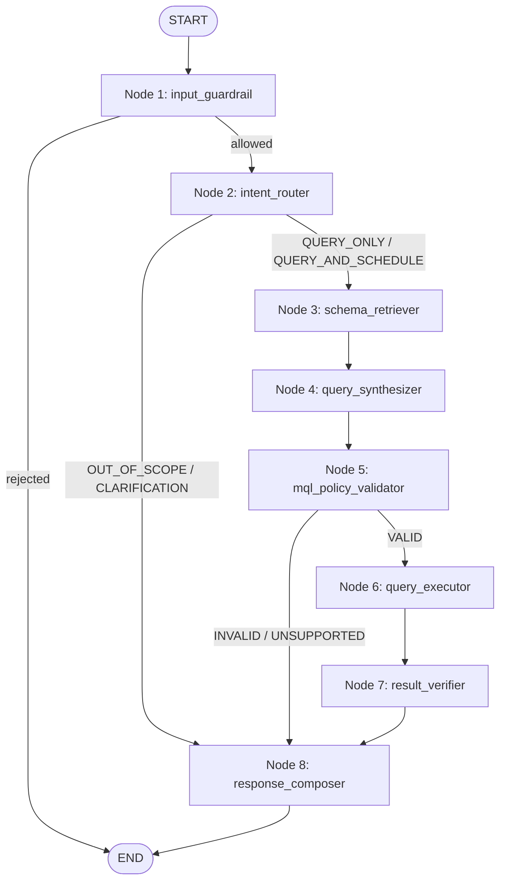

# Phase 6 Implementation Report: Read-Only MongoDB Aggregation Execution & Result Verification
**FinTech Agent — Natural Language to Sandboxed MongoDB Query Agent for Banking Operations**  
**Course:** INT450 — Large Language Models and Agentic AI  
**Implementation Date:** November 11, 2026  
**Author:** Principal Software Architect & MongoDB Specialist  
**Status:** COMPLETED — ALL NODES INTEGRATED & VERIFIED  

---

## 1. Executive Summary

Phase 6 completes the core query execution and semantic verification capability of the FinTech Agent. Building on the deterministic MQL validation established in Phase 5, Phase 6 implements:
1. **Node 6 (`query_executor_node`)**: Sandboxed, read-only aggregation execution with strict preconditions, server-side timeout (`maxTimeMS=15000`), `allowDiskUse=False`, bounded cursor materialization (`RESULT_DOC_LIMIT=1000`), payload byte bounding (`MAX_RESULT_BYTES=5242880`), and error shielding.
2. **Central Fail-Closed Execution Gate (`PHASE6_LIVE_EXECUTION_ENABLED=False`)**: A security barrier that prevents execution against the live banking database (`fintech_agent_db`) pending manual administrative activation of MongoDB RBAC.
3. **Node 7 (`result_verifier_node`)**: Outcome classification across 11 granular statuses, BSON sanitization (ObjectIds, dates, decimals), semantic summary generation, and bounded error recovery.
4. **LangGraph Pipeline Integration**: Active wiring of Nodes 1 through 8 in `backend/app/agent/graph.py` with defensive conditional routing (`mql_policy_validator -> [query_executor -> result_verifier -> response_composer | response_composer]`). Node 9 (`schedule_planner`) remains an inactive architectural stub.
5. **Response Composer (Node 8)**: Dedicated presentation formatting for executed results, capped results, empty sets, execution errors, and gated executions.

All 245 backend tests in pytest and 8 frontend tests in Vitest pass with 100% success.

---

## 2. Node 6 — Read-Only Query Executor Implementation

Location: `backend/app/agent/nodes/query_executor.py`

### 2.1 Precondition Verifications (Fail-Fast Gate)
Before attempting database interaction, Node 6 enforces strict precondition checks:
- **Guardrail Precondition**: If `guardrail_status == 'rejected'` or `final_status == 'rejected'`, execution is immediately skipped (`execution_status = 'SKIPPED'`).
- **Validation Precondition**: If `validation_status != 'VALID'` or `is_pipeline_valid is not True`, execution is skipped (`execution_status = 'VALIDATION_FAILED'`).
- **Target Collection Precondition**: Target collection must belong to the canonical set of 12 collections (`accounts`, `branches`, `cards`, `customers`, `employees`, `fraud_alerts`, `investments`, `kyc_documents`, `loans`, `merchants`, `support_tickets`, `transactions`).
- **Pipeline Shape Precondition**: Must be a non-empty list of dictionaries.
- **Unsupported Concept Precondition**: If `validation_status == 'UNSUPPORTED'` (e.g. overdue loan concepts), execution is bypassed (`execution_status = 'UNSUPPORTED'`).

### 2.2 Central Fail-Closed Execution Gate
```python
test_db = state.get("test_db") or state.get("mock_db")
live_gate_enabled = getattr(settings, "PHASE6_LIVE_EXECUTION_ENABLED", False)

if not live_gate_enabled and test_db is None:
    return {
        "raw_results": None,
        "execution_time_ms": 0,
        "result_row_count": 0,
        "execution_error": "Live database execution is gated pending manual activation of MongoDB RBAC (PHASE6_LIVE_EXECUTION_ENABLED=False).",
        "execution_status": "GATE_BLOCKED",
        "result_truncated": False,
        "trace": trace,
    }
```
**Critical Safety Feature**: Even if a `test_db` instance is injected into state during testing, Node 6 inspects its name. If the database name matches `settings.MONGO_BANKING_DB` (`fintech_agent_db`) and `PHASE6_LIVE_EXECUTION_ENABLED` is `False`, Node 6 immediately fails closed and blocks execution.

### 2.3 Sandboxed Read-Only Execution Controls
When executing against an authorized client:
- **Server-Side Timeout**: Injects `maxTimeMS=settings.QUERY_TIMEOUT_MS` (15,000 ms) into the aggregation cursor.
- **No Disk Spilling**: Enforces `allowDiskUse=False` to prevent unbounded memory spikes on the MongoDB server.
- **Bounded Cursor Iteration**:
  ```python
  docs = []
  truncated = False
  for doc in cursor:
      if len(docs) < doc_limit:
          docs.append(doc)
      else:
          truncated = True
          break
  ```
  Iterates up to `doc_limit + 1` (default 1,000) to deterministically detect whether the result set exceeded the maximum document limit.
- **Payload Size Capping**: Serializes documents to UTF-8 bytes and checks against `settings.MAX_RESULT_BYTES` (5 MB). If exceeded, flags `RESULT_OVERSIZED` and nullifies results to prevent client memory exhaustion.
- **Timing Instrumentation**: Uses high-resolution `time.perf_counter()` to record accurate execution duration in milliseconds.

### 2.4 Error Shielding
Raw database exceptions are caught and sanitized before populating state:
- `ExecutionTimeout` / `NetworkTimeout` -> `execution_status = 'TIMEOUT'`, safe message: *"Query execution timed out (maximum 15000ms exceeded)."*
- `OperationFailure` (code 13 / unauthorized) -> `execution_status = 'AUTH_ERROR'`, safe message: *"Database authorization error: operation not permitted under read-only credentials."*
- `ConnectionFailure` / `ServerSelectionTimeoutError` / `AutoReconnect` -> `execution_status = 'CONNECTION_ERROR'`, safe message: *"Database connection error: unable to establish connection with database host."*
- General PyMongo errors -> `execution_status = 'EXECUTION_ERROR'`.

Under no circumstances are database connection strings, passwords, or raw internal stack traces exposed to the state or returned to the user.

---

## 3. Node 7 — Result Verifier and Recovery Implementation

Location: `backend/app/agent/nodes/result_verifier.py`

Node 7 evaluates the output from Node 6, classifies the execution outcome, sanitizes data structures, and coordinates bounded recovery.

### 3.1 Granular Outcome Taxonomy

| Outcome Status | Architectural Meaning | Result Status | Action Taken |
|---|---|---|---|
| `SUCCESS_WITH_DATA` | Aggregation succeeded, returned 1 to 1,000 records | `VALID_WITH_DATA` | Sanitizes BSON, formats summary |
| `SUCCESS_EMPTY` | Aggregation succeeded, returned 0 matching records | `VALID_EMPTY` | Informs user 0 records matched |
| `SUCCESS_LIMITED` | Aggregation succeeded, but was truncated at 1,000 limit | `VALID_WITH_DATA` | Caps preview, appends limit notice |
| `EXECUTION_GATE_BLOCKED` | Live execution gated (`PHASE6_LIVE_EXECUTION_ENABLED=False`) | `EXECUTION_GATE_BLOCKED` | Formats validated pipeline & gate status |
| `TIMEOUT` | Query exceeded `QUERY_TIMEOUT_MS` (15,000 ms) | `RETRYABLE_ERROR` | Logs attempt in `all_attempts` |
| `CONNECTION_ERROR` | Database host dropped or unreachable | `RETRYABLE_ERROR` | Logs attempt in `all_attempts` |
| `AUTH_ERROR` | Read-only permissions denied / auth failure | `TERMINAL_FAILURE` | Flags terminal auth failure |
| `RESULT_OVERSIZED` | Payload exceeded 5MB limit | `TERMINAL_FAILURE` | Suggests adding tighter filters |
| `UNSUPPORTED` | Query requests non-existent banking concepts | `TERMINAL_FAILURE` | Bypasses execution, explains schema |
| `VALIDATION_FAILED` | Pipeline failed deterministic MQL checks | `TERMINAL_FAILURE` | Bypasses execution, reports errors |
| `INVALID_RESULT` | Result structure null or corrupted | `TERMINAL_FAILURE` | Flags corrupt output |

### 3.2 BSON Sanitization
MongoDB results often contain non-JSON types (e.g. `bson.ObjectId`, `datetime.datetime`, `bson.Decimal128`). Node 7 recursively normalizes all result structures:
- `ObjectId` -> standard 24-character hex string.
- `datetime` -> ISO 8601 UTC string (`.isoformat()`).
- `Decimal128` -> standard Python `float`.

### 3.3 Bounded Error Recovery
When a `RETRYABLE_ERROR` (connection drop or transient timeout) occurs:
- Node 7 records the attempt in `state['all_attempts']`:
  ```json
  {
    "attempt": 1,
    "status": "CONNECTION_ERROR",
    "error": "Database connection error...",
    "timestamp": "2026-11-11T13:12:00Z"
  }
  ```
- **Integrity Rule**: Retry attempts do **NOT** modify, relax, or weaken MQL validation policies, stage limits, or security filters.

---

## 4. LangGraph Agent Graph Wiring

Location: `backend/app/agent/graph.py`

### 4.1 Topology


### 4.2 Architectural Guarantees
- **Conditional Short-Circuiting**: Queries that fail validation or request unsupported concepts bypass Node 6 and Node 7 entirely, routing directly to `response_composer`.
- **Defense-in-Depth**: Even if called directly, Node 6 contains internal precondition verification that refuses to execute unvalidated queries.
- **Node 9 Isolation**: `schedule_planner` remains an inactive architectural stub.

---

## 5. Response Composer (Node 8) Enhancements

Location: `backend/app/agent/nodes/response_composer.py`

Node 8 assembles user-facing responses tailored to Phase 6 statuses:
- **`EXECUTION_GATE_BLOCKED`**: Displays the formatted JSON pipeline, stage count, deterministic security validation summary, and explicitly clarifies that database execution has not occurred due to the fail-closed execution gate (`PHASE6_LIVE_EXECUTION_ENABLED=False`).
- **`SUCCESS_WITH_DATA`**: Displays execution duration in ms, row count, pipeline explanation, and a clean JSON preview of returned records.
- **`SUCCESS_EMPTY`**: Informs the user that the query executed successfully against the database but matched 0 records.
- **`SUCCESS_LIMITED`**: Displays results with a warning that output was capped at the system limit (1,000 documents).
- **`TIMEOUT` / `CONNECTION_ERROR` / `AUTH_ERROR`**: Displays safe, non-revealing error descriptions.

---

## 6. Implementation Verification Summary

| Component | Source File | Status | Verification Reference |
|---|---|---|---|
| Query Executor | `backend/app/agent/nodes/query_executor.py` | Complete | `test_phase6_execution.py` (14 unit tests) |
| Fail-Closed Gate | `backend/app/agent/nodes/query_executor.py` | Complete | `test_node6_fail_closed_gate_*` |
| Result Verifier | `backend/app/agent/nodes/result_verifier.py` | Complete | `test_node7_verifies_*` (4 unit tests) |
| LangGraph Graph | `backend/app/agent/graph.py` | Complete | `test_e2e_graph_*` (3 integration tests) |
| Response Composer | `backend/app/agent/nodes/response_composer.py` | Complete | Verified across all output paths |
| Agent State | `backend/app/agent/state.py` | Complete | TypedDict updated with Phase 6 fields |
