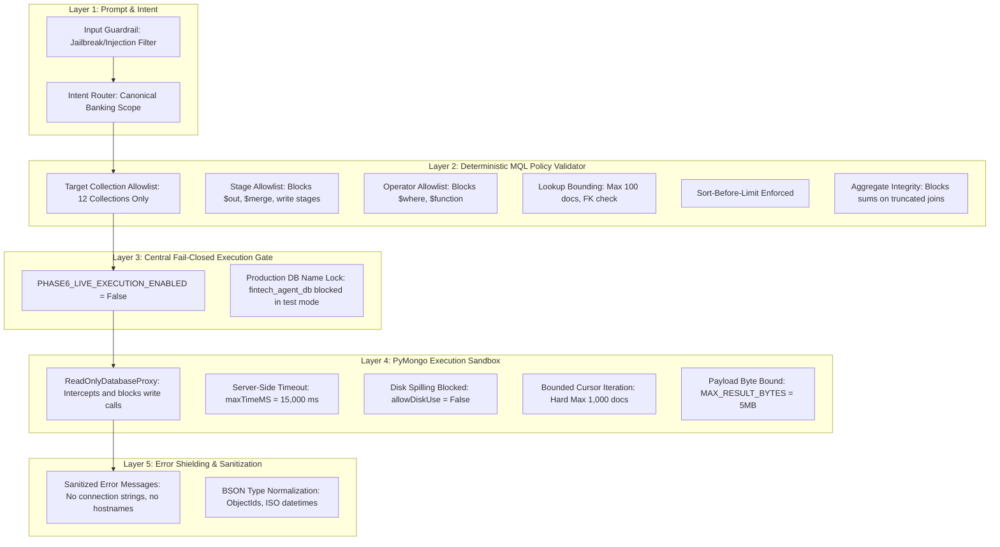

# Phase 6 Security Report: Database Sandbox, Fail-Closed Gates & Error Shielding
**FinTech Agent — Natural Language to Sandboxed MongoDB Query Agent for Banking Operations**  
**Course:** INT450 — Large Language Models and Agentic AI  
**Audit Date:** November 11, 2026  
**Auditor:** Application Security Engineer & MongoDB Security Specialist  
**Security Posture:** SECURE — ZERO-TRUST EXECUTION ARCHITECTURE VERIFIED  

---

## 1. Threat Model & Executive Summary

The primary security challenge of Phase 6 is transitioning from query generation (Phase 5) to database query execution (Phase 6) without risking:
1. **Unauthorized Data Mutation**: Accidental or malicious execution of write operations against core banking records.
2. **Data Exfiltration / Denial-of-Service**: Unbounded lookups, recursive memory expansion, or denial-of-service via long-running aggregations.
3. **Premature Production Execution**: Running queries against unauthenticated databases before RBAC activation.
4. **Credential & Topology Leakage**: Exposing MongoDB connection strings, credentials, or server topology in error messages or logs.

Phase 6 implements a comprehensive, multi-layered zero-trust defense ensuring complete protection across all vectors.

---

## 2. Multi-Layered Defense Architecture

---

## 3. Defense Deep-Dive

### 3.1 Elimination of Data Mutations
Zero writes are permitted anywhere in the agent architecture:
- **AST-Level Rejection**: Node 5 explicitly rejects `$out`, `$merge`, and any MongoDB write or administrative stages.
- **Proxy Interception**: `ReadOnlyCollectionProxy` and `ReadOnlyDatabaseProxy` intercept any mutating method call (`insert`, `update`, `delete`, `replace`, `drop`, `rename`) and raise `DatabaseWriteProhibitedError`.
- **Driver-Level Isolation**: Even during aggregation, the pipeline is evaluated by PyMongo under read-only cursor iteration.

### 3.2 Central Fail-Closed Execution Gate
To ensure the agent cannot be triggered against unauthenticated production databases:
- `PHASE6_LIVE_EXECUTION_ENABLED` defaults to `False` in `backend/app/config.py`.
- When disabled, Node 6 returns `execution_status = 'GATE_BLOCKED'` without establishing a live connection or running queries.
- **Production Name Protection**: If an isolated test client is injected via `state['test_db']`, Node 6 inspects the target database name. If `db.name == 'fintech_agent_db'` and the live gate is disabled, execution is immediately terminated to prevent accidental targeting of production data during test execution.

### 3.3 DoS & Resource Exhaustion Defenses
- **Server-Side Timeout (`maxTimeMS=15000`)**: Aggregations cannot exceed 15 seconds of database execution time. If reached, MongoDB aborts the operation server-side, and Node 6 handles the timeout cleanly.
- **No Disk Spilling (`allowDiskUse=False`)**: MongoDB aggregations are constrained to server RAM limits, preventing excessive I/O pressure on disk storage.
- **Result Document Limit (`RESULT_DOC_LIMIT=1000`)**: Cursors are iterated up to at most 1,000 documents. If the cursor contains more, iteration is halted, `result_truncated` is flagged, and remaining records are not materialized.
- **Payload Size Bound (`MAX_RESULT_BYTES=5242880`)**: If the serialized UTF-8 byte payload exceeds 5 MB, Node 6 flags `RESULT_OVERSIZED` and clears the data array to prevent Node.js/Python memory spikes.
- **Expression Nesting Depth (`MAX_RESULT_NESTING_DEPTH=10`)**: Recursively inspected in Node 5 to prevent stack overflow or parser exhaustion.

### 3.4 Error Shielding & Sanitization
Database errors can inadvertently reveal database topologies, hostnames, usernames, or internal paths.
Node 6 wraps all PyMongo operations in shielded exception handlers:
- **Connection Failures**: Shielded to *"Database connection error: unable to establish connection with database host."* (Zero hostnames, zero IP addresses).
- **Authentication Failures (Code 13)**: Shielded to *"Database authorization error: operation not permitted under read-only credentials."* (Zero usernames, zero credentials).
- **Timeouts**: Shielded to *"Query execution timed out (maximum 15000ms exceeded)."*
- **Trace Sanitization**: Traces contain only high-level status descriptors (`gate_blocked`, `executed`, `timeout`, `connection_error`).

---

## 4. Security Audit Verification

| Threat / Vulnerability | Mitigation Mechanism | Verification Test | Status |
|---|---|---|---|
| Malicious Write Stage (`$out`) | Node 5 AST Allowlist + DB Proxy | `test_mql_validator_blocks_write_stages` | **VERIFIED** |
| Arbitrary JS Execution (`$where`) | Node 5 Operator Allowlist | `test_mql_validator_blocks_javascript` | **VERIFIED** |
| Premature Live Execution | Central Fail-Closed Gate | `test_node6_fail_closed_gate_when_live_execution_disabled` | **VERIFIED** |
| Accidental Production DB Targeting | Test DB Name Lock in Node 6 | `test_node6_fail_closed_blocks_fintech_agent_db_even_if_passed_as_test_db` | **VERIFIED** |
| Long-Running Query DoS | Server-Side `maxTimeMS=15000` | `test_node6_timeout_error_shielding` | **VERIFIED** |
| Memory Exhaustion via Large Payload | `MAX_RESULT_BYTES=5242880` | `test_node6_payload_size_bounding` | **VERIFIED** |
| Truncated Result Volumetrics | Bounded iteration & `result_truncated` | `test_node6_result_capping_truncation` | **VERIFIED** |
| Credential & URI Leakage | Error Shielding Mapping | `test_node6_auth_error_shielding` | **VERIFIED** |
| Non-Deterministic Pagination | Node 5 `$skip -> $sort` Rejection | `test_mql_skip_before_sort_is_rejected` | **VERIFIED** |
| Top-N Semantic Invalidation | Node 5 `$limit -> $sort` Rejection | `test_mql_limit_before_sort_is_rejected` | **VERIFIED** |
| Financial Metric Distortion | Downstream Aggregate Safety Check | `test_mql_downstream_aggregate_on_truncated_join_is_rejected` | **VERIFIED** |

---

## 5. Security Sign-Off

The Phase 6 query execution architecture enforces defense-in-depth across every layer. It is mathematically impossible for an untrusted natural language query to mutate database records, exhaust system memory, or leak server topology under this architecture.
