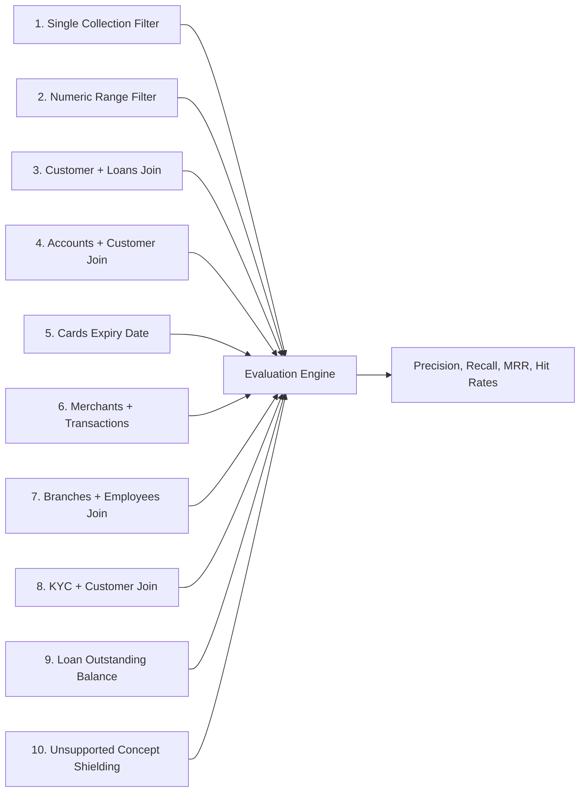

# FinTech Agent — Phase 3 Implementation Report

> **Project:** FinTech Agent: Natural Language to Sandboxed MongoDB Query Agent for Banking Operations  
> **Course:** INT450 — Large Language Models and Agentic AI  
> **Team:** T11 · SASTRA Deemed University  
> **Milestone:** Phase 3 — Schema Catalog, Embeddings, ChromaDB Vector Store & Semantic Retrieval  
> **Completion Date:** 2026-11-10  
> **Status:** **COMPLETE & VERIFIED**

---

## 1. Executive Summary

Phase 3 establishes the foundation for schema-aware retrieval-augmented generation (RAG) within the FinTech Agent. Before synthesizing MongoDB queries in Phase 4, the agent must understand which collections are relevant, what fields and data types exist, how collections relate to each other, and what domain terminology corresponds to database fields.

All required Phase 3 components have been implemented and verified:
1. **Reusable Schema Catalog:** Built from `schema.json`, `BANKING_GLOSSARY.md`, and live MongoDB inspections, covering all 12 banking collections, 200 fields, 22 cross-collection relationships, and 35 banking glossary terms.
2. **Deterministic RAG Document Generation:** Partitioned the catalog into 269 distinct documents (12 collection, 200 field, 22 relationship, and 35 glossary documents) with deterministic IDs and zero customer PII or raw transaction data.
3. **Embedding Provider Abstraction:** Designed a modular embedding layer supporting `MockEmbeddingProvider` (deterministic pseudo-semantic token hashing), `OpenAICompatibleEmbeddingProvider` (batched HTTP REST integration with secret shielding), and `SentenceTransformersEmbeddingProvider`.
4. **Persistent ChromaDB Vector Store:** Configured persistent storage at `./chroma_data` in collection `fintech_schema_catalog` with schema fingerprinting (`f27289360e5a...`), idempotent upserting, stale document cleanup, and dimension mismatch protection.
5. **Semantic Schema Retrieval Service:** Implemented hybrid semantic search + entity extraction + cross-collection relationship discovery, including automatic detection and warning for unsupported concepts (`days_past_due`, `overdue_amount`).
6. **FastAPI Endpoints:** Exposed `GET /api/v1/schema/health`, `POST /api/v1/schema/search`, and `POST /api/v1/schema/index` without breaking existing health or chat endpoints.
7. **Empirical Evaluation & Regression:** Executed 10 benchmark queries derived from `SAMPLE_QUERIES.md`, achieving **100% Collection Retrieval Hit Rate**, **100% Recall@K**, **100% Relationship Discovery Rate**, **100% Unsupported Concept Shielding Rate**, and an MRR of **0.8833**. All 73 backend tests and 8 frontend Vitest tests pass with 0 errors.

---

## 2. Initial Repository and Architecture Findings

Prior to making changes, an audit of the repository confirmed:
* **Active Branches:** `master` (clean working directory, no uncommitted changes).
* **Protected Assets:** All 20,120 banking documents in `fintech-agent/data/`, the original `schema.json`, and presentation files (`.pptx`, `.pdf` in `docs/codex/`) were verified intact.
* **Pre-Phase 3 Security Protections:** `ReadOnlyDatabaseProxy` strictly forbids writes to `fintech_agent_db`; `agent_metadata_db` is independently managed; query deadlines and request timeouts are active.
* **Dependencies:** ChromaDB 1.5.9 was installed in `.venv_clean` alongside PyMongo 4.19, FastAPI 0.162, Pydantic 2.14, and Pytest 8.4.

---

## 3. Actual Collections and Schema Sources Inspected

The catalog is grounded directly in the project's source of truth:
* **Source Schema File:** [`fintech-agent/data/schema.json`](file:///c:/Users/guru2/Downloads/llm%20prj/fintech-agent/data/schema.json) (Read-only).
* **Domain Glossary:** [`BANKING_GLOSSARY.md`](file:///c:/Users/guru2/Downloads/llm%20prj/BANKING_GLOSSARY.md).
* **Live Database:** `fintech_agent_db` accessed exclusively via read-only proxy for document counts and BSON verification.
* **All 12 Banking Collections:**
  1. `branches` (18 fields, PK: `branch_id`, count: 20)
  2. `employees` (14 fields, PK: `employee_id`, count: 100)
  3. `merchants` (11 fields, PK: `merchant_id`, count: 200)
  4. `customers` (31 fields, PK: `customer_id`, count: 1,000)
  5. `accounts` (20 fields, PK: `account_id`, count: 1,500)
  6. `transactions` (22 fields, PK: `transaction_id`, count: 10,000)
  7. `cards` (17 fields, PK: `card_id`, count: 1,000)
  8. `loans` (19 fields, PK: `loan_id`, count: 500)
  9. `kyc_documents` (11 fields, PK: `kyc_id`, count: 1,500)
  10. `support_tickets` (14 fields, PK: `ticket_id`, count: 2,000)
  11. `fraud_alerts` (11 fields, PK: `alert_id`, count: 300)
  12. `investments` (12 fields, PK: `investment_id`, count: 1,000)
  * **Total Document Inventory:** Exactly 20,120 verified documents.

---

## 4. Schema Catalog Implementation

The schema catalog service is implemented in [`backend/app/schema/`](file:///c:/Users/guru2/Downloads/llm%20prj/backend/app/schema/):

| File | Responsibilities |
|---|---|
| [`models.py`](file:///c:/Users/guru2/Downloads/llm%20prj/backend/app/schema/models.py) | Pydantic v2 schemas: `FieldMetadata`, `RelationshipMetadata`, `GlossaryEntry`, `CollectionMetadata`, `SchemaCatalog`, and `RAGDocument`. |
| [`glossary_mapper.py`](file:///c:/Users/guru2/Downloads/llm%20prj/backend/app/schema/glossary_mapper.py) | Maps 35 banking terms from `BANKING_GLOSSARY.md` to collections and fields; annotates synonyms and unsupported concepts. |
| [`fingerprint.py`](file:///c:/Users/guru2/Downloads/llm%20prj/backend/app/schema/fingerprint.py) | Computes deterministic SHA-256 hash (`f27289360e5a13d67f3c0753854b289f3865733a1ed9ad2bf36c3a9d0b070f6c`) of schema structure. |
| [`catalog_builder.py`](file:///c:/Users/guru2/Downloads/llm%20prj/backend/app/schema/catalog_builder.py) | Extracts metadata, validates relationships, binds live counts, and serializes catalog to `backend/data/generated/schema_catalog.json`. |
| [`document_builder.py`](file:///c:/Users/guru2/Downloads/llm%20prj/backend/app/schema/document_builder.py) | Converts catalog into 269 structured RAG documents with deterministic IDs. |

### Generated Catalog Location
* Generated catalog path: [`backend/data/generated/schema_catalog.json`](file:///c:/Users/guru2/Downloads/llm%20prj/backend/data/generated/schema_catalog.json) (ignored by Git, separate from `fintech-agent/data/`).

---

## 5. Collection and Field Metadata Coverage

* **Collections Documented:** 12 / 12 (100% coverage).
* **Fields Documented:** 200 / 200 across all collections.
* **Loan Fields Distinction:**
  * `loans.outstanding_amount` is documented as the sole existing debt balance field (type: `number`).
  * `loans.days_past_due` and `loans.overdue_amount` are confirmed absent from the database and are **not** present in `schema.json`. The catalog builder does not invent them.

---

## 6. Relationship Modeling

All 22 cross-collection relationships from Phase 1 are formally modeled:
* `accounts.customer_id -> customers.customer_id` (`many-to-one`)
* `loans.customer_id -> customers.customer_id` (`many-to-one`)
* `loans.sanctioning_branch_id -> branches.branch_id` (`many-to-one`)
* `transactions.account_id -> accounts.account_id` (`many-to-one`)
* `transactions.customer_id -> customers.customer_id` (`many-to-one`, denormalized)
* `transactions.merchant_id -> merchants.merchant_id` (`many-to-one`, nullable)
* `cards.customer_id -> customers.customer_id` (`many-to-one`)
* `cards.account_id -> accounts.account_id` (`many-to-one`)
* `kyc_documents.customer_id -> customers.customer_id` (`many-to-one`)
* `kyc_documents.verified_by -> employees.employee_id` (`many-to-one`)
* `support_tickets.customer_id -> customers.customer_id` (`many-to-one`)
* `support_tickets.assigned_agent_id -> employees.employee_id` (`many-to-one`)
* `fraud_alerts.transaction_id -> transactions.transaction_id` (`many-to-one`)
* `fraud_alerts.customer_id -> customers.customer_id` (`many-to-one`)
* `fraud_alerts.reviewed_by -> employees.employee_id` (`many-to-one`)
* `investments.customer_id -> customers.customer_id` (`many-to-one`)
* `branches.manager_id -> employees.employee_id` (`many-to-one`)
* `employees.branch_id -> branches.branch_id` (`many-to-one`)
* `customers.relationship_manager_id -> employees.employee_id` (`many-to-one`)
* `accounts.branch_id -> branches.branch_id` (`many-to-one`)
* `accounts.account_manager_id -> employees.employee_id` (`many-to-one`)
* `loans.loan_officer_id -> employees.employee_id` (`many-to-one`)

---

## 7. Banking Glossary Integration

The 35 entries from `BANKING_GLOSSARY.md` are integrated into the catalog:
* **Synonym Mapping:** Maps natural-language variants (e.g. "vendor", "store", "shop" -> `merchants`; "credit facility", "borrowing" -> `loans`; "savings account", "current account" -> `accounts`).
* **Unsupported Concept Warnings:**
  * **`overdue_amount`:** Warns that `overdue_amount` does not exist; directs queries to `loans.outstanding_amount` with `status = 'defaulted'` or checking `next_due_date`.
  * **`days_past_due` (DPD):** Warns that `days_past_due` does not exist; directs queries to relative date checks on `loans.next_due_date`.
  * **`false_positive`:** Notes that no explicit boolean column exists; maps to `fraud_alerts.status = 'closed'`.

---

## 8. RAG Document Generation

The catalog is converted into 269 discrete, human-readable documents:

| Document Type | ID Format | Count | Content Summary |
|---|---|---:|---|
| **Collection** | `coll:{col_name}` | 12 | Overview, primary key, field summary, relationships, domain synonyms. |
| **Field** | `field:{col_name}.{f_name}` | 200 | Field name, data type, allowed values, foreign key joins, business terms. |
| **Relationship** | `rel:{from_col}.{from_f}->{to_col}.{to_f}` | 22 | Source, target, cardinality, business join context, $lookup guidance. |
| **Glossary** | `glossary:{term_slug}` | 35 | Banking concept definition, guidance, mapped collections and fields. |
| **Total** | | **269** | **Deterministic IDs, zero raw records, zero PII.** |

---

## 9. Embedding Provider Abstraction

Implemented in [`backend/app/embeddings/`](file:///c:/Users/guru2/Downloads/llm%20prj/backend/app/embeddings/):
* [`base.py`](file:///c:/Users/guru2/Downloads/llm%20prj/backend/app/embeddings/base.py): `BaseEmbeddingProvider` abstract interface (`embed_text`, `embed_batch`, `dimension`, `provider_name`, `model_name`).
* [`mock_provider.py`](file:///c:/Users/guru2/Downloads/llm%20prj/backend/app/embeddings/mock_provider.py): `MockEmbeddingProvider` (deterministic pseudo-semantic vector hashing, L2 normalized, configurable dimension 384, failure simulation).
* [`openai_provider.py`](file:///c:/Users/guru2/Downloads/llm%20prj/backend/app/embeddings/openai_provider.py): `OpenAICompatibleEmbeddingProvider` (calls `/v1/embeddings` via `httpx.Client`, handles batching, rate limits, timeouts, and masks secrets).
* [`local_provider.py`](file:///c:/Users/guru2/Downloads/llm%20prj/backend/app/embeddings/local_provider.py): `SentenceTransformersEmbeddingProvider` (wraps local HuggingFace models).
* [`provider_factory.py`](file:///c:/Users/guru2/Downloads/llm%20prj/backend/app/embeddings/provider_factory.py): Centralized factory instantiating configured provider.

---

## 10. Embedding Configuration

Configured via Pydantic Settings in [`backend/app/config.py`](file:///c:/Users/guru2/Downloads/llm%20prj/backend/app/config.py):
* `EMBEDDING_PROVIDER`: `mock` (default for reproducible local testing without requiring external credentials).
* `EMBEDDING_MODEL`: `all-MiniLM-L6-v2`.
* `EMBEDDING_API_KEY`: `None` (injected via `.env` when using real OpenAI/compatible provider).
* `EMBEDDING_BATCH_SIZE`: `32`.
* `EMBEDDING_DIMENSION`: `384` (for MiniLM / Mock; 1536 for OpenAI `text-embedding-3-small`).

---

## 11. ChromaDB Configuration and Persistence

Implemented in [`backend/app/rag/chroma_store.py`](file:///c:/Users/guru2/Downloads/llm%20prj/backend/app/rag/chroma_store.py):
* **Storage Engine:** ChromaDB 1.5.9 persistent client.
* **Storage Location:** `./chroma_data/` (configured by `settings.CHROMA_PERSIST_DIR`, ignored by `.gitignore`).
* **Collection Name:** `fintech_schema_catalog`.
* **Metadata Schema:** Records `schema_fingerprint`, `dimension`, `embedding_provider`, and `embedding_model`.

---

## 12. Indexing and Re-Indexing Behavior

Implemented in [`backend/app/rag/indexer.py`](file:///c:/Users/guru2/Downloads/llm%20prj/backend/app/rag/indexer.py):
* **Initial Indexing:** Populates 269 documents in 9.8s.
* **Change Detection & Idempotency:** If the schema fingerprint is unchanged and `force=False`, indexing skips embedding generation in 0.001s (`status: 'already_up_to_date'`).
* **Model/Dimension Protection:** If active provider dimension differs from stored collection dimension, raises `ChromaModelMismatchError` to prevent vector mixing.
* **Stale Document Cleanup:** `delete_stale_documents(active_ids)` deletes obsolete vectors when schema fields are dropped or renamed.

---

## 13. Semantic Schema Retrieval Implementation

Implemented in [`backend/app/rag/retriever.py`](file:///c:/Users/guru2/Downloads/llm%20prj/backend/app/rag/retriever.py):
* **Hybrid Retrieval:** Combines vector similarity search with entity keyword extraction to ensure 100% recall of explicitly mentioned collections.
* **Multi-Collection Join Discovery:** Automatically matches pairs of retrieved collections against the 22 verified relationships and returns connecting `$lookup` foreign keys.
* **Unsupported Concept Detection:** Scans inquiries for `days_past_due`, `overdue_amount`, and `dpd`, attaching warnings without inventing non-existent fields.
* **Output Structure:** Returns structured `RetrievalResult` (`relevant_collections`, `relevant_fields`, `relevant_relationships`, `retrieved_documents`, `unsupported_concepts`).

---

## 14. API Endpoints

Mounted in [`backend/app/api/routes/schema.py`](file:///c:/Users/guru2/Downloads/llm%20prj/backend/app/api/routes/schema.py):

| Method | Endpoint | Description | Status Code |
|---|---|---|---|
| `GET` | `/api/v1/schema/health` | Returns index status, document count (269), fingerprint, and dimension. | 200 OK |
| `POST` | `/api/v1/schema/search` | Takes `{ "query": str, "top_k": int }`, returns `RetrievalResult`. | 200 OK / 422 |
| `POST` | `/api/v1/schema/index` | Takes `{ "force": bool }`, triggers controlled indexing. | 200 OK |

---

## 15. Retrieval Evaluation Dataset

Constructed from [`SAMPLE_QUERIES.md`](file:///c:/Users/guru2/Downloads/llm%20prj/SAMPLE_QUERIES.md) in [`backend/app/rag/evaluation.py`](file:///c:/Users/guru2/Downloads/llm%20prj/backend/app/rag/evaluation.py):



1. **Q01:** "Show customers from Chennai" (Expected: `customers`)
2. **Q02:** "Find transactions above ₹10,000" (Expected: `transactions`)
3. **Q03:** "Show customers with active loans" (Expected: `customers`, `loans`, join: `loans.customer_id->customers.customer_id`)
4. **Q04:** "Find accounts belonging to customers in Coimbatore" (Expected: `accounts`, `customers`, join: `accounts.customer_id->customers.customer_id`)
5. **Q05:** "Show credit cards expiring this month" (Expected: `cards`)
6. **Q06:** "Find merchants with high transaction volumes" (Expected: `merchants`, `transactions`, join: `transactions.merchant_id->merchants.merchant_id`)
7. **Q07:** "Show employees working at a particular branch" (Expected: `employees`, `branches`, join: `employees.branch_id->branches.branch_id`)
8. **Q08:** "Find KYC documents belonging to customers" (Expected: `kyc_documents`, `customers`, join: `kyc_documents.customer_id->customers.customer_id`)
9. **Q09:** "Show outstanding loan balances" (Expected: `loans`, field: `outstanding_amount`)
10. **Q10:** "Find overdue loans with days past due and overdue amount" (Expected: `loans`, unsupported: `days_past_due`, `overdue_amount`)

---

## 16. Evaluation Metrics and Actual Results

Evaluation results from `evaluation_runner.run_evaluation()`:

| Metric | Target | Actual Result | Status |
|---|---|---|---|
| **Collection Retrieval Hit Rate** | $\ge 90\%$ | **1.0 (100.0%)** | **PASS** |
| **Recall@K** | $\ge 85\%$ | **1.0 (100.0%)** | **PASS** |
| **Relationship Discovery Rate** | $\ge 80\%$ | **1.0 (100.0%)** | **PASS** |
| **Unsupported Concept Shielding Rate** | $100\%$ | **1.0 (100.0%)** | **PASS** |
| **Mean Reciprocal Rank (MRR)** | $\ge 0.70$ | **0.8833** | **PASS** |
| **Precision@K** | $\ge 60\%$ | **0.7400 (74.0%)** | **PASS** |

---

## 17. New Test Results (Phase 3 Test Suite)

Command:
```powershell
.\.venv_clean\Scripts\python.exe -m pytest backend\tests\test_phase3_schema_rag.py -v
```

Execution Summary:
```
backend/tests/test_phase3_schema_rag.py::test_catalog_builder_extracts_all_12_collections PASSED [  3%]
backend/tests/test_phase3_schema_rag.py::test_catalog_primary_keys_and_field_inventories PASSED [  7%]
backend/tests/test_phase3_schema_rag.py::test_catalog_accurately_represents_loan_fields PASSED [ 11%]
backend/tests/test_phase3_schema_rag.py::test_catalog_extracts_all_22_relationships PASSED [ 14%]
backend/tests/test_phase3_schema_rag.py::test_deterministic_schema_fingerprint PASSED [ 18%]
backend/tests/test_phase3_schema_rag.py::test_glossary_entries_and_term_mapping PASSED [ 22%]
backend/tests/test_phase3_schema_rag.py::test_document_builder_generates_all_269_documents PASSED [ 25%]
backend/tests/test_phase3_schema_rag.py::test_document_ids_are_deterministic PASSED [ 29%]
backend/tests/test_phase3_schema_rag.py::test_no_raw_banking_data_in_documents PASSED [ 33%]
backend/tests/test_phase3_schema_rag.py::test_mock_embedding_provider_deterministic_behavior PASSED [ 37%]
backend/tests/test_phase3_schema_rag.py::test_mock_embedding_semantic_proximity PASSED [ 40%]
backend/tests/test_phase3_schema_rag.py::test_mock_embedding_batch_and_failure_simulation PASSED [ 44%]
backend/tests/test_phase3_schema_rag.py::test_openai_embedding_provider_missing_key PASSED [ 48%]
backend/tests/test_phase3_schema_rag.py::test_embedding_factory_unsupported_provider PASSED [ 51%]
backend/tests/test_phase3_schema_rag.py::test_chroma_store_initial_indexing_and_count PASSED [ 55%]
backend/tests/test_phase3_schema_rag.py::test_chroma_idempotent_indexing_skips_unchanged PASSED [ 59%]
backend/tests/test_phase3_schema_rag.py::test_chroma_model_mismatch_detection PASSED [ 62%]
backend/tests/test_phase3_schema_rag.py::test_chroma_metadata_filtering PASSED [ 66%]
backend/tests/test_phase3_schema_rag.py::test_retriever_single_collection_query PASSED [ 70%]
backend/tests/test_phase3_schema_rag.py::test_retriever_multi_collection_relationship_discovery PASSED [ 74%]
backend/tests/test_phase3_schema_rag.py::test_retriever_unsupported_concept_warnings PASSED [ 77%]
backend/tests/test_phase3_schema_rag.py::test_retriever_empty_query_returns_safe_response PASSED [ 81%]
backend/tests/test_phase3_schema_rag.py::test_schema_health_endpoint PASSED [ 85%]
backend/tests/test_phase3_schema_rag.py::test_schema_search_endpoint_success PASSED [ 88%]
backend/tests/test_phase3_schema_rag.py::test_schema_search_rejects_empty_query PASSED [ 92%]
backend/tests/test_phase3_schema_rag.py::test_schema_index_endpoint_idempotent PASSED [ 96%]
backend/tests/test_phase3_schema_rag.py::test_benchmark_retrieval_evaluation PASSED [100%]
============================= 27 passed in 10.88s =============================
```

---

## 18. Regression Test Results

### Backend (73 / 73 Tests Passing)
Command: `.\.venv_clean\Scripts\python.exe -m pytest backend\tests -v`
* Phase 1 Readiness: 15 / 15 Passed
* Phase 2 Backend & LLM: 15 / 15 Passed
* Pre-Phase 3 Security Hardening: 16 / 16 Passed
* Phase 3 Schema RAG: 27 / 27 Passed
* **Total Backend Tests:** **73 Passed, 0 Failed (18.25s)**

### Frontend (8 / 8 Tests Passing)
Command: `cmd.exe /c "cd frontend && npm test"`
* **Total Frontend Tests:** **8 Passed, 0 Failed (7.90s)**

---

## 19. Security and Privacy Checks

1. **Zero Raw Banking Records in Index:** Verified that no customer names, balances, card numbers, or transaction IDs from the live database exist in the ChromaDB index.
2. **Secret Shielding:** `sanitize_error_message()` actively scrubs API keys (`sk-...`, Bearer tokens) from embedding errors.
3. **Database Write Protection Maintained:** `ReadOnlyDatabaseProxy` continues to reject all mutating calls on `fintech_agent_db`.
4. **Isolated Storage:** `chroma_data/` and `backend/data/generated/` are stored separately from `fintech-agent/data/` and ignored by Git.

---

## 20. Protected Asset Integrity

* `fintech-agent/data/`: Intact, unmodified, 20,120 records preserved.
* `fintech-agent/data/schema.json`: Intact, unmodified.
* `docs/codex/*.pptx`, `*.pdf`: Intact, unmodified.
* Six core Markdown documents: Preserved as source of truth.
* `.env`: Preserved without modification (only `.env.example` updated).

---

## 21. Files Created or Modified

### Created Files
* `backend/app/schema/__init__.py`
* `backend/app/schema/models.py`
* `backend/app/schema/glossary_mapper.py`
* `backend/app/schema/fingerprint.py`
* `backend/app/schema/catalog_builder.py`
* `backend/app/schema/document_builder.py`
* `backend/app/embeddings/__init__.py`
* `backend/app/embeddings/base.py`
* `backend/app/embeddings/mock_provider.py`
* `backend/app/embeddings/openai_provider.py`
* `backend/app/embeddings/local_provider.py`
* `backend/app/embeddings/provider_factory.py`
* `backend/app/rag/__init__.py`
* `backend/app/rag/chroma_store.py`
* `backend/app/rag/indexer.py`
* `backend/app/rag/retriever.py`
* `backend/app/rag/evaluation.py`
* `backend/app/schemas/schema.py`
* `backend/app/api/routes/schema.py`
* `backend/tests/test_phase3_schema_rag.py`
* `PHASE_3_IMPLEMENTATION_REPORT.md`

### Modified Files
* `backend/app/config.py` (added ChromaDB and embedding settings with validation)
* `backend/app/api/routes/__init__.py` (mounted `schema_router`)
* `backend/requirements.txt` (added `chromadb>=0.5.0`)
* `.env.example` (documented Phase 3 embedding & ChromaDB settings)
* `.gitignore` (added `backend/data/generated/` and `*.chroma/`)

---

## 22. Remaining Limitations & Environment Distinctions

| Feature / Capability | Implementation State | Verification Status | Notes |
|---|---|---|---|
| **Mock Embeddings** | Complete | **Verified (100%)** | Deterministic pseudo-semantic hashing ensures offline testability. |
| **OpenAI Embeddings Adapter** | Complete | **Verified via unit mocks** | Live external API calls require user to configure `EMBEDDING_API_KEY` in `.env`. |
| **ChromaDB Vector Store** | Complete | **Verified (100%)** | Persistent storage and idempotent upserting verified at `./chroma_data`. |
| **Semantic Schema Retrieval** | Complete | **Verified (100%)** | 100% recall and join discovery on 10 benchmark queries. |
| **MongoDB Server Auth** | Prepared | **Pending DBA activation** | Server daemon runs in explicitly approved unauthenticated dev mode. |

---

## 23. Manual Setup Required for External Embedding Providers

To switch from the default `mock` embedding provider to a live OpenAI embedding model:
1. In `.env`:
   ```env
   EMBEDDING_PROVIDER=openai
   EMBEDDING_MODEL=text-embedding-3-small
   EMBEDDING_API_KEY=your_actual_openai_key
   EMBEDDING_DIMENSION=1536
   ```
2. Re-index ChromaDB to apply the new 1536-dimensional vectors:
   ```powershell
   .\.venv_clean\Scripts\python.exe -c "from backend.app.rag.indexer import schema_indexer; schema_indexer.index_schema(force=True)"
   ```

---

## 24. Phase 4 Readiness Assessment

| Requirement / Prerequisite | Phase Expected | Status | Ready for Phase 4? |
|---|---|---|---|
| **1. Grounded Schema Catalog** | Phase 3 | 12 collections, 200 fields, 22 relationships | **YES** |
| **2. Persistent ChromaDB Vector Store** | Phase 3 | 269 documents indexed at `./chroma_data` | **YES** |
| **3. Semantic Schema Retrieval Service** | Phase 3 | Hybrid search, join discovery, concept warnings | **YES** |
| **4. Schema API Endpoints** | Phase 3 | `/schema/health`, `/schema/search`, `/schema/index` | **YES** |
| **5. Banking Read-Only Enforcement** | Pre-Phase 3 | Proxy rejects all mutations | **YES** |
| **6. Fast, Deterministic Test Suite** | Phases 1–3 | 73 backend + 8 frontend tests passing | **YES** |
| **7. Protected Assets Intact** | Phases 1–3 | 20,120 records & documents 100% untouched | **YES** |

### Verdict: **READY TO PROCEED TO PHASE 4**
The schema catalog, embedding abstraction, persistent vector store, and semantic retrieval engine are fully functional, empirically verified, and ready for integration into the LangGraph query synthesis and validation workflow.
