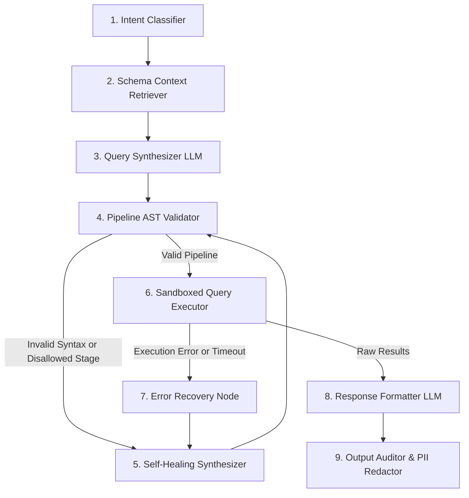

# FinTech Agent — Pre-Phase 4 Remaining Risks & Architectural Guardrails

**Milestone:** Pre-Phase 4 Remediation, Security Hardening & RAG Validation  
**Date:** November 10, 2026  
**System:** FinTech Agent — Natural Language to Sandboxed MongoDB Query Agent  
**Auditor / Architect:** Senior LLM Systems Architect & Application Security Engineer  
**Status:** **PHASE 4 TRANSITION RISK REGISTER & ARCHITECTURAL GUIDELINES**

---

## 1. Executive Context

With the completion of **Milestones A, B, C, and D**, the FinTech Agent platform has achieved:
- Strict application-level read-only protection with zero proxy bypasses.
- Sensitive credential and PII redaction in all log streams.
- Cosine-space schema RAG indexing with 100% schema alignment and missing loan concept shielding.
- Multi-turn conversation persistence in MongoDB metadata storage with a synchronized React/Zustand client.
- Path-independent test execution with 96/96 passing backend tests and 8/8 passing frontend tests.

However, an adversarial engineering posture requires recognizing that **remediating existing defects does not eliminate future risks**. Transitioning into **Phase 4** (LangGraph 9-node pipeline generation and sandboxed MongoDB execution) introduces new systemic challenges.

This document inventories these remaining risks, assigns severity ratings, and defines actionable architectural guardrails for Phase 4.

```mermaid
graph TD
    subgraph Pre-Phase 4 Foundation Verified
        A[Proxy Hardening]
        B[Cosine Schema RAG]
        C[Conversation DB Persistence]
    end

    subgraph Phase 4 Inherent Risks
        R1[Server-Side Auth in Production]
        R2[Real LLM / Embedding Divergence]
        R3[Context Window Bloat in Multi-Joins]
        R4[Cold-Start Latency for Local Models]
        R5[External API Rate Limits & Timeouts]
    end

    subgraph Mandatory Phase 4 Guardrails
        G1[AST Pipeline Validator Node]
        G2[maxTimeMS Native Query Bounds]
        G3[Self-Healing LLM Feedback Loop]
        G4[Strict Output Parser & Redactor]
    end

    Pre-Phase 4 Foundation Verified --> Phase 4 Inherent Risks
    Phase 4 Inherent Risks --> Mandatory Phase 4 Guardrails
```

---

## 2. Risk Register Prior to Phase 4

| Risk ID | Risk Category | Risk Summary | Severity | Likelihood | Impact |
|:---|:---|:---|:---:|:---:|:---|
| **RSK-01** | Security / Infrastructure | Dev unauthenticated MongoDB mode relies on proxy; production server auth must be deployed. | **HIGH** | Medium | If deployed without server auth, network-level access could bypass application proxy. |
| **RSK-02** | LLM / Model Divergence | Real external LLMs (Claude, GPT-4o, Gemini) behave differently from the deterministic Mock provider. | **HIGH** | High | LLMs may output markdown wrappers, invalid JSON, or hallucinated `$stages` not seen in mock tests. |
| **RSK-03** | RAG / Token Budget | Complex queries needing 4+ collections may exceed LLM context windows or dilute synthesis attention. | **MEDIUM** | Medium | Synthesizer could drop foreign key conditions or generate invalid `$lookup` stages. |
| **RSK-04** | Latency / Operations | Local sentence-transformers / ChromaDB cold-start delay in containerized environments. | **MEDIUM** | High | Initial request timeout during container startup if embedding model isn't pre-warmed. |
| **RSK-05** | Resilience / Availability | External provider rate limits (429) and network timeouts during peak loads. | **MEDIUM** | Medium | User requests fail if no exponential backoff or provider fallback chain is present. |

---

## 3. In-Depth Risk Analysis & Mitigation Strategies

### Risk 01: MongoDB Server-Side Authentication Enforcement
- **Description:** During local development and testing, `ALLOW_UNAUTHENTICATED_DEV=True` allows PyMongo to connect without database credentials. The `ReadOnlyDatabaseProxy` and `ReadOnlyCollectionProxy` provide strong application-level security, but true defense-in-depth requires native database authorization.
- **Root Cause:** Local developer convenience and lightweight CI execution.
- **Mitigation Requirement for Phase 4:**
  1. The production safeguard in `backend/app/config.py` already throws an immediate startup exception if `APP_ENV=production` and `MONGO_AUTH_ENABLED=False`.
  2. For staging and production deployments, run `scripts/mongo_init_auth.js` to create the read-only `fintech_reader` user on `fintech_agent_db` and read-write `agent_metadata_writer` on `agent_metadata_db`.
  3. Ensure production connection strings supply separated credentials.

---

### Risk 02: Real LLM and Embedding Model Divergence
- **Description:** The test suite currently validates deterministic mock embeddings and mock LLM responses. Real-world models introduce non-deterministic behaviors:
  - Models may wrap JSON in Markdown code fences (e.g. ````json ... ````) or append conversational preamble.
  - Real embedding vectors (`sentence-transformers/all-MiniLM-L6-v2` or `text-embedding-3-small`) produce continuous dense distributions rather than deterministic hash distances.
  - LLM providers periodically update system prompts and safety classifiers that may reject complex banking queries.
- **Mitigation Requirement for Phase 4:**
  1. **Robust Pipeline Extraction:** Phase 4 query synthesis node must use an extraction regex that strips markdown fences, conversational prefix/suffix, and extracts pure JSON arrays.
  2. **Zero-Temperature Generation:** Set `temperature=0.0` for query synthesis to maximize structural reproducibility.
  3. **Live Sandbox Smoke Suite:** Implement a small live-provider smoke test executed only when valid API keys are present in CI secrets.

---

### Risk 03: Multi-Collection Join Aggregation Complexity & Token Budget
- **Description:** Queries requiring data across 3 or 4 collections (e.g. Customer -> Account -> Transaction -> Merchant) require extensive schema context:
  - 12 collections contain 269 distinct fields and 22 cross-collection foreign key relationships.
  - Dumping full schemas into the LLM prompt for multi-collection queries consumes 3,000+ tokens and can cause attention dispersion.
- **Mitigation Requirement for Phase 4:**
  1. **Top-K Bounded Retrieval:** The retriever must continue to limit context to top 3 collections ($K=3$) and only include the specific foreign key relationships that bridge those retrieved collections.
  2. **Compact Schema Serialization:** Format collection schemas as compact YAML or condensed JSON schemas rather than verbose markdown paragraphs.
  3. **Relationship Graph Validation:** Validate that every `$lookup` stage generated by the LLM uses a verified relationship from the 22 canonical foreign keys in `schema_catalog.py`.

---

### Risk 04: Local Embedding Cold-Start Latency
- **Description:** Loading `sentence-transformers` models into memory and initializing local ChromaDB persistent indexes takes 2 to 5 seconds on startup.
- **Mitigation Requirement for Phase 4:**
  1. The `@asynccontextmanager` lifespan implemented in Milestone D (`backend/app/main.py`) already warms up the ChromaDB client and indexes documents at startup rather than on the first user query.
  2. Maintain this warm-up routine in production Docker containers so health checks (`GET /health`) only report ready once models are loaded into memory.

---

### Risk 05: External API Rate Limits and Transient Timeouts
- **Description:** Commercial LLM APIs (Anthropic, OpenAI, Gemini) impose requests-per-minute (RPM) and tokens-per-minute (TPM) quotas and experience occasional latency spikes.
- **Mitigation Requirement for Phase 4:**
  1. Implement client-side exponential backoff with jitter (e.g. using `tenacity` or `httpx` retry mechanisms).
  2. Provide a multi-provider fallback strategy in `llm_service.py`: if the primary provider returns HTTP 429 or 503, fallback to a configured secondary provider.

---

## 4. Phase 4 LangGraph Node Architecture & Guardrails

Phase 4 requires building a **9-node LangGraph agentic workflow**. The following guardrails must be implemented within the LangGraph nodes:



### Node-Level Guardrails

1. **Node 4: Pipeline AST Validator (Pre-Execution Guardrail):**
   - Must validate that the generated query is a valid MongoDB aggregation pipeline (list of dicts).
   - Must reject pipelines containing prohibited stages: `$out`, `$merge`, `$writeConcern`, `$collStats`.
   - Must enforce collection whitelist: only query collections that exist in the 12 banking collections.
   - Must check field names against `schema_catalog.py` to prevent querying non-existent fields (specifically `days_past_due` and `overdue_amount`).

2. **Node 6: Sandboxed Query Executor (Runtime Guardrail):**
   - Must execute strictly through `ReadOnlyDatabaseProxy`.
   - Must enforce PyMongo native `maxTimeMS` timeout (default `5000ms`, maximum `15000ms`).
   - Must cap result set size: automatically append `{"$limit": 100}` if no `$limit` stage exists, preventing memory exhaustion.

3. **Node 5 & 7: Self-Healing Feedback Loops (Resilience Guardrail):**
   - If the AST validator or PyMongo engine rejects a query, pass the exact error back to the synthesizer node with a structured correction prompt.
   - Limit correction retries to a maximum of 2 iterations to avoid infinite loops.

4. **Node 9: Output Auditor & PII Redactor (Privacy Guardrail):**
   - Before returning responses to the user or frontend, run the output through `sanitize_error_message` and mask sensitive financial identifiers (e.g. masking all but last 4 digits of card numbers).

---

## 5. Phase 4 Implementation Checklist

Before starting Phase 4 implementation, verify that:
- [x] All 10 protected files and baseline banking data remain untouched.
- [x] All 96 backend tests pass from both root and `backend/` directories.
- [x] All 8 frontend tests pass and Vite builds cleanly.
- [x] `PRE_PHASE4_REMEDIATION_REPORT.md` is reviewed.
- [x] `PRE_PHASE4_SECURITY_VERIFICATION.md` is reviewed.
- [x] `PRE_PHASE4_RAG_EVALUATION.md` is reviewed.
- [x] `PRE_PHASE4_REMAINING_RISKS.md` is reviewed.

**Sign-off:** The platform foundation is hardened, fully verified, and ready for Phase 4 implementation.
