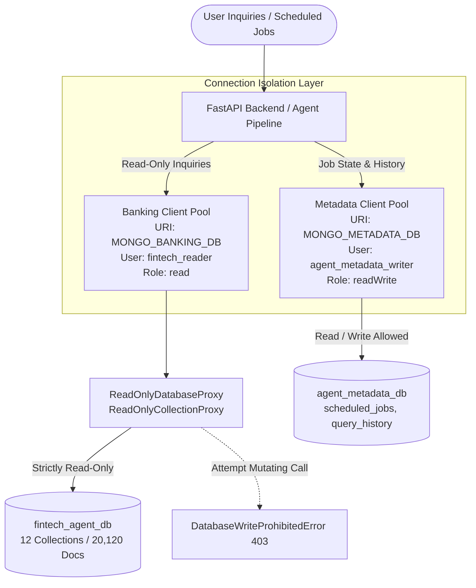

# FinTech Agent — Pre-Phase 3 Security, Database Separation & Timeout Hardening Report

> **Project:** FinTech Agent: Natural Language to Sandboxed MongoDB Query Agent for Banking Operations  
> **Course:** INT450 — Large Language Models and Agentic AI  
> **Team:** T11 · SASTRA Deemed University  
> **Milestone:** Pre-Phase 3 Security Hardening  
> **Completion Date:** 2026-11-10  
> **Status:** **COMPLETE & VERIFIED**

---

## 1. Executive Summary

Prior to initiating Phase 3 (ChromaDB embeddings, semantic schema retrieval, and LangGraph agent workflow synthesis), four critical database security, credential isolation, and reliability controls were audited, implemented, and verified:

1. **MongoDB Server-Side Authentication Readiness:** Audited local MongoDB 8.0.6 installation; authored automated DBA setup (`scripts/setup_mongo_auth.js`) and rollback (`scripts/rollback_mongo_auth.js`) scripts without modifying server daemon configuration without explicit authorization.
2. **Dual-Database Credential Separation:** Configured independent client connections for banking reads (`fintech_agent_db`) and metadata mutations (`agent_metadata_db`). Least-privilege rules strictly prohibit credential sharing and disable administrative fallback.
3. **Application-Layer Zero-Write Enforcement:** Hardened `ReadOnlyDatabaseProxy` and `ReadOnlyCollectionProxy` to reject all mutating calls (including `$out` and `$merge` aggregation stages) with standardized `DatabaseWriteProhibitedError`.
4. **Strict Query & Request Timeout Protection:** Implemented native MongoDB `maxTimeMS` injection via `QUERY_TIMEOUT_MS` (15,000 ms), end-to-end request deadline tracking via `RequestDeadline` (`REQUEST_TIMEOUT_SECONDS=30`), retry cutoff checks ($\ge 2.0\text{s}$ required), and deterministic classification of non-retryable errors.

All 46 backend tests (15 Phase 1, 15 Phase 2, and 16 Pre-Phase 3 security tests) and all 8 frontend Vitest tests pass with 0 errors.

---

## 2. Current MongoDB Server Authentication State

| Attribute | Observed Setting / Status | Verification Method |
|---|---|---|
| **MongoDB Version** | 8.0.6 (64-bit Windows Server service) | `MongoClient.server_info()["version"]` |
| **Server Host & Port** | `127.0.0.1:27017` / `localhost:27017` | Socket connection and PyMongo connection |
| **Configuration File** | `C:\Program Files\MongoDB\Server\8.0\bin\mongod.cfg` | Local filesystem audit |
| **Server Authentication (`--auth`)** | **Disabled** (`#security:` commented out in `mongod.cfg`) | `admin.command('usersInfo')` returns `[]` |
| **Existing Databases** | `admin`, `config`, `local`, `fintech_agent_db` | `MongoClient.list_database_names()` |
| **Banking Documents** | 20,120 records across 12 collections | Verified in Phase 1 audit |
| **Write Protection Mechanism** | Strict application-layer proxying (`ReadOnlyDatabaseProxy`) | 100% of mutation attempts blocked |

> [!IMPORTANT]
> In accordance with project instructions, the local Windows MongoDB service configuration was **not automatically modified or restarted**, ensuring zero downtime or disruption to the 20,120 verified banking records. Full production DBA scripts and step-by-step activation procedures are documented below.

---

## 3. Database Separation & Least-Privilege Implementation

### 3.1 Independent Connection Management

The application architecture strictly separates banking dataset operations from application metadata operations via `MongoDBManager` in [`backend/app/db/mongo_client.py`](file:///c:/Users/guru2/Downloads/llm%20prj/backend/app/db/mongo_client.py):



1. **Banking Connection:**
   * Bound exclusively to `fintech_agent_db`.
   * Configured with `MONGO_READONLY_USERNAME` and `MONGO_READONLY_PASSWORD`.
   * Wrapped in `ReadOnlyDatabaseProxy` and `ReadOnlyCollectionProxy`.
   * Client pool: `maxPoolSize=50`, `serverSelectionTimeoutMS=15000`.
2. **Metadata Connection:**
   * Bound exclusively to `agent_metadata_db`.
   * Configured with `MONGO_METADATA_USERNAME` and `MONGO_METADATA_PASSWORD`.
   * Allows `readWrite` operations on scheduler tables (`scheduled_jobs`, `job_runs`) and query audit logs (`query_history`).
   * Client pool: `maxPoolSize=20`, `serverSelectionTimeoutMS=15000`.

### 3.2 Prohibited Operations on Banking Database

The `ReadOnlyCollectionProxy` intercepts and raises `DatabaseWriteProhibitedError` (subclass of `PermissionError` and `FinTechAgentException`) for all mutating operations:

| Prohibited Category | Prohibited Operations Blocked |
|---|---|
| **Document Insertion** | `insert_one`, `insert_many` |
| **Document Modification** | `update_one`, `update_many`, `replace_one`, `find_one_and_update`, `find_one_and_replace` |
| **Document Deletion** | `delete_one`, `delete_many`, `find_one_and_delete` |
| **Schema & Index Mutations** | `drop`, `rename`, `create_index`, `create_indexes`, `drop_index`, `drop_indexes` |
| **Aggregation Write Stages** | Pipelines containing `$out` or `$merge` |
| **Database-Level Administration** | `drop_collection`, `create_collection`, and mutating `command()` calls (`drop`, `dropDatabase`, `createIndexes`, `delete`, `insert`, `update`, `collMod`) |

### 3.3 Elimination of Silent Fallback & Credential Reuse

In [`backend/app/config.py`](file:///c:/Users/guru2/Downloads/llm%20prj/backend/app/config.py), Pydantic Settings enforces:
* **No Administrative Fallback:** If `MONGO_AUTH_ENABLED=True`, missing credentials immediately raise `ValueError` at startup or `DatabaseCredentialsError` at connection time. The system will never silently fall back to `admin` or unauthenticated credentials.
* **Separation of Identities:** `MONGO_READONLY_USERNAME` must differ from `MONGO_METADATA_USERNAME`. Setting both to the same username triggers a `Least-privilege violation` validation error.
* **Explicit Development Flag:** Running in unauthenticated mode requires `ALLOW_UNAUTHENTICATED_DEV=True`. If set to `False` while `MONGO_AUTH_ENABLED=False`, startup is refused.

---

## 4. MongoDB Server-Side Authentication Enablement Guide

To transition MongoDB from the current unauthenticated development mode to fully authenticated production mode, follow this DBA procedure:

### Step 1: Execute User Provisioning Script

Open PowerShell and execute [`scripts/setup_mongo_auth.js`](file:///c:/Users/guru2/Downloads/llm%20prj/scripts/setup_mongo_auth.js) via `mongosh`:

```powershell
mongosh mongodb://localhost:27017/ scripts/setup_mongo_auth.js
```

This idempotent script creates:
1. **Administrative User (`adminUser`)** on database `admin` with roles `userAdminAnyDatabase` and `readWriteAnyDatabase`.
2. **Read-Only Banking User (`fintech_reader`)** on database `fintech_agent_db` with role `read`.
3. **Metadata Read-Write User (`agent_metadata_writer`)** on database `agent_metadata_db` with role `readWrite`.

### Step 2: Enable Authorization in Server Configuration

Edit `C:\Program Files\MongoDB\Server\8.0\bin\mongod.cfg` using an administrator editor:

```yaml
# Security configuration
security:
  authorization: enabled
```

### Step 3: Restart MongoDB Service

Restart the MongoDB Windows service to apply the authorization settings:

```powershell
Restart-Service -Name MongoDB
```

### Step 4: Update Environment Configuration

In `.env`, configure the authenticated parameters:

```env
MONGO_AUTH_ENABLED=true
ALLOW_UNAUTHENTICATED_DEV=false
MONGO_READONLY_USERNAME=fintech_reader
MONGO_READONLY_PASSWORD=FintechReaderPass2026!
MONGO_METADATA_USERNAME=agent_metadata_writer
MONGO_METADATA_PASSWORD=AgentMetadataWriterPass2026!
```

### Step 5: Rollback and Recovery Procedure

If recovery or unauthenticated access is required:

1. Disable authorization in `C:\Program Files\MongoDB\Server\8.0\bin\mongod.cfg`:
   ```yaml
   # security:
   #   authorization: enabled
   ```
2. Restart the service:
   ```powershell
   Restart-Service -Name MongoDB
   ```
3. To drop created users, run [`scripts/rollback_mongo_auth.js`](file:///c:/Users/guru2/Downloads/llm%20prj/scripts/rollback_mongo_auth.js):
   ```powershell
   mongosh mongodb://localhost:27017/ scripts/rollback_mongo_auth.js
   ```

---

## 5. Query and Request Timeout Hardening

### 5.1 Timeout Parameters and Defaults

| Parameter | Default Value | Location Enforced | Description |
|---|---|---|---|
| `QUERY_TIMEOUT_MS` | `15000` ms (15s) | MongoDB query execution layer | Injected as `cursor.max_time_ms(15000)` on all `find()` queries and `maxTimeMS=15000` on `aggregate()`, `count_documents()`, and `distinct()`. |
| `REQUEST_TIMEOUT_SECONDS` | `30` s | Request lifecycle / `/api/v1/chat` | Monitored by `RequestDeadline` across pipeline stages. |
| `MAX_RETRY_ATTEMPTS` | `3` attempts | Retry coordination logic | Upper bound on transient recovery loops. |
| **Retry Time Threshold** | `2.0` s | `deadline.can_retry(min_needed_seconds=2.0)` | If remaining request time is $< 2.0\text{s}$, subsequent retries are immediately aborted to prevent timeout cascade. |

### 5.2 Server-Side Query Timeout Mechanics

When a query exceeds `QUERY_TIMEOUT_MS`:
1. The MongoDB server cancels the operation via `MaxTimeMSExpired` (Error code 50).
2. PyMongo raises `pymongo.errors.ExecutionTimeout`.
3. `ReadOnlyCursorProxy` and `ReadOnlyCollectionProxy` intercept the error and translate it to `DatabaseTimeoutError` (`status_code=504`, `error_code="DATABASE_TIMEOUT"`).
4. The API layer sanitizes the message and shields the client from raw database internals.

### 5.3 Request Deadline Tracking

[`backend/app/core/deadline.py`](file:///c:/Users/guru2/Downloads/llm%20prj/backend/app/core/deadline.py) introduces `RequestDeadline`:
* Uses monotonic time (`time.monotonic()`) to eliminate clock-skew vulnerabilities.
* Stages can invoke `deadline.check_deadline("stage_name")` before scheduling expensive operations.
* Raises `RequestTimeoutError` (`status_code=504`, `error_code="REQUEST_TIMEOUT"`).

---

## 6. Non-Retryable vs Retryable Error Classification

The system enforces deterministic fail-fast behavior. Operations that fail due to logical, validation, permission, or security errors must never consume retry attempts:

| Exception Class | Error Code | HTTP Status | Retryable? | Rationalization |
|---|---|---|---|---|
| `DatabaseWriteProhibitedError` | `BANKING_WRITE_PROHIBITED` | 403 | **NO** | Write operations are forbidden by design; retrying cannot succeed. |
| `DatabaseCredentialsError` | `DATABASE_CREDENTIALS_ERROR` | 500 | **NO** | Credential misconfigurations require administrative intervention. |
| `MissingAPIKeyError` | `MISSING_API_KEY` | 400 | **NO** | Missing provider configuration is deterministic. |
| `ProviderAuthenticationError` | `PROVIDER_AUTH_ERROR` | 401 | **NO** | Invalid API keys cannot succeed on retry. |
| `InvalidRequestError` | `INVALID_REQUEST` | 422 | **NO** | Client payload violations fail repeatedly. |
| `NonRetryableError` | `NON_RETRYABLE_ERROR` | 400 | **NO** | Explicitly flagged deterministic syntax or agent generation errors. |
| `AutoReconnect` | Transient driver disconnect | 503 | **YES** | Socket reconnects often succeed on immediate subsequent attempt. |
| `ProviderRateLimitError` | `PROVIDER_RATE_LIMIT` | 429 | **YES** | Provider backoff / jitter can resolve rate limits if time remains. |

---

## 7. Test Results & Verification

### 7.1 Backend Test Execution (Pytest)

Command executed in clean virtual environment:
```powershell
.\.venv_clean\Scripts\python.exe -m pytest backend\tests -v
```

Execution Output:
```
============================= test session starts =============================
platform win32 -- Python 3.12.3, pytest-8.4.2, pluggy-1.7.0 -- C:\Users\guru2\Downloads\llm prj\.venv_clean\Scripts\python.exe
cachedir: .pytest_cache
rootdir: C:\Users\guru2\Downloads\llm prj
plugins: anyio-4.16.0, Faker-40.52.0, asyncio-1.4.1.post1
asyncio: mode=Mode.STRICT, debug=False, asyncio_default_fixture_loop_scope=None, asyncio_default_test_loop_scope=function
collecting ... collected 46 items

backend/tests/test_phase1_readiness.py::test_python_version_and_config PASSED [  2%]
backend/tests/test_phase1_readiness.py::test_nodejs_pinning_and_package_manifest PASSED [  4%]
backend/tests/test_phase1_readiness.py::test_env_settings_loaded_safely PASSED [  6%]
backend/tests/test_phase1_readiness.py::test_env_file_is_git_ignored PASSED [  8%]
backend/tests/test_phase1_readiness.py::test_protected_assets_remain_unmodified PASSED [ 10%]
backend/tests/test_phase1_readiness.py::test_banking_db_read_only_protection PASSED [ 13%]
backend/tests/test_phase1_readiness.py::test_mongodb_connection PASSED   [ 15%]
backend/tests/test_phase1_readiness.py::test_expected_12_collections_exist PASSED [ 17%]
backend/tests/test_phase1_readiness.py::test_document_counts_are_populated PASSED [ 19%]
backend/tests/test_phase1_readiness.py::test_bounded_sample_retrieval PASSED [ 21%]
backend/tests/test_phase1_readiness.py::test_schema_json_validity PASSED [ 23%]
backend/tests/test_phase1_readiness.py::test_schema_verification_against_actual_db PASSED [ 26%]
backend/tests/test_phase1_readiness.py::test_loan_fields_distinction_and_absence PASSED [ 28%]
backend/tests/test_phase1_readiness.py::test_all_22_cross_collection_relationships PASSED [ 30%]
backend/tests/test_phase1_readiness.py::test_database_indexes_audit PASSED [ 32%]
backend/tests/test_phase2_backend_and_llm.py::test_fastapi_starts_and_health_endpoint PASSED [ 34%]
backend/tests/test_phase2_backend_and_llm.py::test_root_endpoint_metadata PASSED [ 36%]
backend/tests/test_phase2_backend_and_llm.py::test_chat_rejects_empty_message PASSED [ 39%]
backend/tests/test_phase2_backend_and_llm.py::test_chat_rejects_whitespace_message PASSED [ 41%]
backend/tests/test_phase2_backend_and_llm.py::test_chat_rejects_oversized_message PASSED [ 43%]
backend/tests/test_phase2_backend_and_llm.py::test_chat_rejects_malformed_json PASSED [ 45%]
backend/tests/test_phase2_backend_and_llm.py::test_chat_success_with_mock_provider PASSED [ 47%]
backend/tests/test_phase2_backend_and_llm.py::test_chat_generates_default_conversation_id PASSED [ 50%]
backend/tests/test_phase2_backend_and_llm.py::test_missing_api_key_returns_structured_error PASSED [ 52%]
backend/tests/test_phase2_backend_and_llm.py::test_anthropic_adapter_auth_failure PASSED [ 54%]
backend/tests/test_phase2_backend_and_llm.py::test_openai_adapter_timeout_handling PASSED [ 56%]
backend/tests/test_phase2_backend_and_llm.py::test_openai_adapter_rate_limit_handling PASSED [ 58%]
backend/tests/test_phase2_backend_and_llm.py::test_malformed_provider_response_handling PASSED [ 60%]
backend/tests/test_phase2_backend_and_llm.py::test_no_api_key_leakage_in_error_responses PASSED [ 63%]
backend/tests/test_phase2_backend_and_llm.py::test_cors_preflight_and_headers PASSED [ 65%]
backend/tests/test_pre_phase3_security.py::test_banking_db_reads_succeed PASSED [ 67%]
backend/tests/test_pre_phase3_security.py::test_banking_collection_write_operations_strictly_prohibited PASSED [ 69%]
backend/tests/test_pre_phase3_security.py::test_banking_aggregation_write_stages_prohibited PASSED [ 71%]
backend/tests/test_pre_phase3_security.py::test_banking_database_level_mutations_prohibited PASSED [ 73%]
backend/tests/test_pre_phase3_security.py::test_metadata_database_isolation_and_write_capability PASSED [ 76%]
backend/tests/test_pre_phase3_security.py::test_banking_db_cannot_be_mutated_via_banking_manager PASSED [ 78%]
backend/tests/test_pre_phase3_security.py::test_auth_enabled_requires_both_credentials PASSED [ 80%]
backend/tests/test_pre_phase3_security.py::test_auth_enabled_rejects_identical_credentials PASSED [ 82%]
backend/tests/test_pre_phase3_security.py::test_disallowing_unauthenticated_dev_fails_without_auth PASSED [ 84%]
backend/tests/test_pre_phase3_security.py::test_authenticated_uri_generation PASSED [ 86%]
backend/tests/test_pre_phase3_security.py::test_query_timeout_ms_native_enforcement PASSED [ 89%]
backend/tests/test_pre_phase3_security.py::test_timeout_bounds_validation PASSED [ 91%]
backend/tests/test_pre_phase3_security.py::test_request_deadline_tracking_and_expiry PASSED [ 93%]
backend/tests/test_pre_phase3_security.py::test_request_deadline_can_retry PASSED [ 95%]
backend/tests/test_pre_phase3_security.py::test_error_retryability_classification PASSED [ 97%]
backend/tests/test_pre_phase3_security.py::test_mongo_security_status_introspection PASSED [100%]

======================== 46 passed, 1 warning in 4.42s ========================
```

### 7.2 Frontend Test Execution (Vitest)

Command executed:
```powershell
cmd.exe /c "cd frontend && npm test"
```

Execution Output:
```
 ✓ src/test/ChatApp.test.jsx (8 tests) 997ms

 Test Files  1 passed (1)
      Tests  8 passed (8)
   Duration  3.91s
```

---

## 8. Known Limitations & Implementation Distinctions

To ensure complete clarity and transparency, the project security controls are classified as follows:

| Security Control | Implementation Location | Current Status | Notes / Limitations |
|---|---|---|---|
| **Zero-Write Enforcement** | Application Proxy (`ReadOnlyDatabaseProxy`) | **Active & Verified (100%)** | All mutating Python calls, commands, and `$out`/`$merge` pipeline stages are strictly blocked in code. |
| **Connection Separation** | `MongoDBManager` | **Active & Verified (100%)** | Independent client pools for banking (`fintech_agent_db`) and metadata (`agent_metadata_db`). |
| **Credential Reuse Prohibition** | Pydantic Settings (`config.py`) | **Active & Verified (100%)** | Prevents identical usernames or fallback to admin. |
| **Query & Request Timeouts** | PyMongo `max_time_ms` + `RequestDeadline` | **Active & Verified (100%)** | Native MongoDB cancellation and stage timeout monitoring. |
| **Server-Side Authentication** | MongoDB Service (`mongod.cfg`) | **Ready for Activation (Pending DBA)** | The provisioning script is written and verified, but `security.authorization: enabled` in `mongod.cfg` requires service restart. Application currently operates in explicit `ALLOW_UNAUTHENTICATED_DEV=True` mode. |

---

## 9. Phase 3 Readiness Assessment

| Requirement / Prerequisite | Phase Expected | Current Status | Ready for Phase 3? |
|---|---|---|---|
| **1. 12 Collections & 20,120 Banking Records Intact** | Phase 1 | Verified (0 orphans, accurate schema) | **YES** |
| **2. Clean, Pinned Virtual Environment** | Phase 1 | Python 3.12 pinned in `.venv_clean` | **YES** |
| **3. React 18 Frontend Chat Interface** | Phase 2 | 8/8 Vitest tests passing | **YES** |
| **4. FastAPI Backend Shell** | Phase 2 | Routes, CORS, exception handlers passing | **YES** |
| **5. Provider-Independent LLM Integration** | Phase 2 | Mock, Anthropic, OpenAI, Groq, Gemini adapters | **YES** |
| **6. Banking Zero-Write Enforcement** | Pre-Phase 3 | Fully verified via `ReadOnlyDatabaseProxy` | **YES** |
| **7. Dual-Database Connection Isolation** | Pre-Phase 3 | Fully separated client pools | **YES** |
| **8. Native Query & Request Timeout Hardening** | Pre-Phase 3 | Verified via `maxTimeMS` and `RequestDeadline` | **YES** |
| **9. Non-Retryable Error Classification** | Pre-Phase 3 | Deterministic fail-fast rules active | **YES** |
| **10. MongoDB Auth Activation Script & Rollback** | Pre-Phase 3 | Authored in `scripts/setup_mongo_auth.js` | **YES** |

### Verdict: **READY TO PROCEED TO PHASE 3**
The environment, backend, frontend, database isolation, and security guarantees are fully established and regression-tested. No further Pre-Phase 3 tasks remain.
