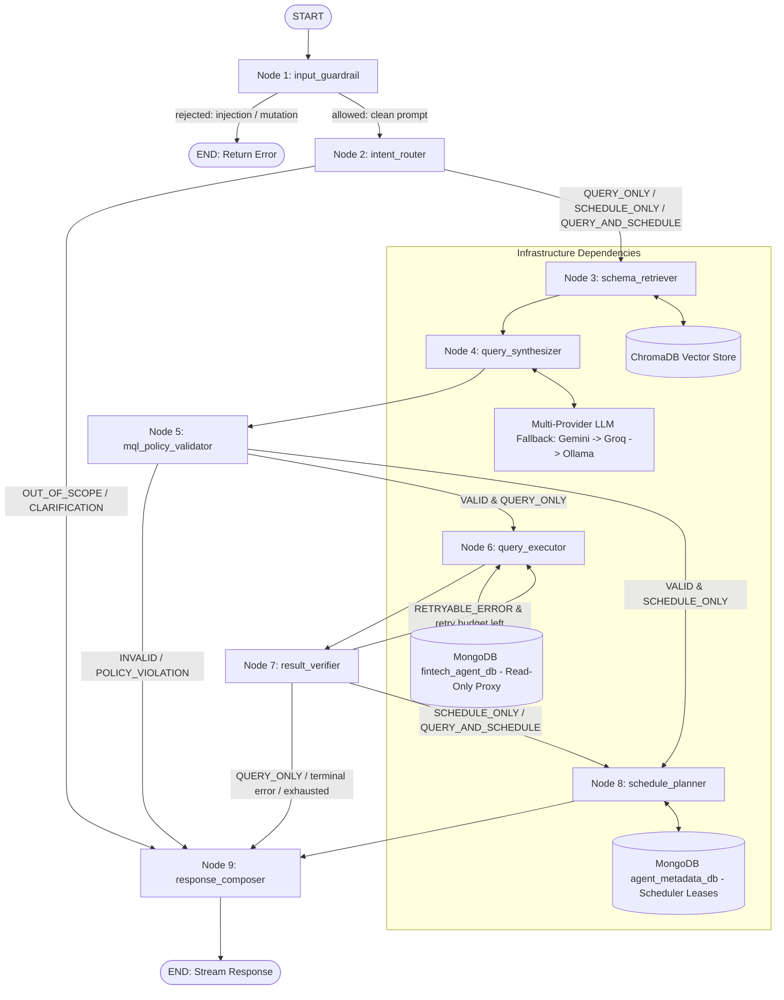

# FinTech Agent: Natural Language to Sandboxed MongoDB Query Agent

[](https://www.python.org/downloads/)
[](https://fastapi.tiangolo.com)
[](https://langchain-ai.github.io/langgraph/)
[](https://react.dev)
[]()
[]()

> **Project Classification:** Academic Capstone Research Prototype  
> **Course:** INT450 — Large Language Models and Agentic AI  
> **Institution:** School of Computing, SASTRA Deemed University, Thanjavur, Tamil Nadu, India  
> **Team:** T11 | **Academic Term:** Fall 2026

---

## 1. Project Overview

**FinTech Agent** is an academic research prototype and capstone project exploring the translation of natural language financial questions into deterministic, sandboxed MongoDB Query Language (MQL) aggregation pipelines. Designed around a synthetic 12-collection banking database (19,120 records), the system provides non-technical operators with analytical visibility while applying multi-tier defensive guardrails against data mutation, injection attacks, and hallucinated schema joins.

The core orchestration is implemented as a **stateful, 9-node LangGraph pipeline** coupled with a **ChromaDB vector store** for semantic schema chunk retrieval, a **deterministic Abstract Syntax Tree (AST) policy validator**, a **multi-provider LLM fallback engine** (Google Gemini 3.8 Flash $\rightarrow$ Groq GPT-OSS 120B $\rightarrow$ Local Ollama), and an **APScheduler-backed recurring query engine** with cryptographic HMAC-SHA256 user authentication.

---

## 2. Problem Statement

Querying semi-structured core banking ledgers presents significant operational challenges:

1. **Complex Syntax Requirements:** Calculating financial metrics (such as weighted default rates across loan products, credit card velocity spikes, or multi-collection KYC compliance status) requires multi-stage aggregation pipelines with nested joins (`$lookup`), groupings (`$group`), and conditional accumulators.
2. **Database Mutation Risks:** Allowing arbitrary or generative queries directly on financial databases introduces catastrophic security risks: arbitrary code execution (`$where`, `$accumulator`), accidental database writes (`$out`, `$merge`), and destructive operations (`drop()`, `deleteMany()`).
3. **LLM Hallucinations:** Unbounded Large Language Models frequently invent fictitious collection names, invalid field paths, or unsupported joins without grounding.
4. **Availability & Latency Bottlenecks:** External LLM API rate limits, timeouts, or transient outages disrupt reporting unless bounded by deterministic failovers and strict execution deadlines.

---

## 3. Key Architectural Features

- **9-Node Deterministic LangGraph Pipeline:** Explicit state transitions with fail-closed gates, input guardrails, and deterministic query validation before any database execution.
- **Fail-Closed MQL AST Policy Validator (Node 5):** Inspects aggregation syntax trees to enforce a strict collection allowlist (12 canonical collections), read-only aggregation stage allowlist, operator allowlists, field existence checks, foreign-key join validation, and mandatory terminal `$limit` capping (default 1,000 docs).
- **Triple-Layer Read-Only Enforcement:**
  1. AST-level prohibition of `$out`, `$merge`, and mutating operators.
  2. Python-level `ReadOnlyDatabaseProxy` and `ReadOnlyCollectionProxy` blocking mutating PyMongo calls with `DatabaseWriteProhibitedError`.
  3. Native MongoDB user-level RBAC (`read` role exclusively on `fintech_agent_db`).
- **Semantic RAG Schema Grounding (Node 3):** ChromaDB cosine vector search (`hnsw:space = cosine`) indexing 269 schema chunks with automated banking glossary expansion (translating concepts like *OD*, *FD*, *NPA*, *KYC* into exact schema fields).
- **Multi-Provider LLM Fallback Service:** Resilient failover chain spanning **Google Gemini 3.8 Flash** (primary) $\rightarrow$ **Groq GPT-OSS 120B** (secondary) $\rightarrow$ **Local Ollama** (`K2-Horizon-3.7B`), bounded by a 24.0s hard operation deadline.
- **Background Query Scheduling (Node 8 & Runner):** Natural language recurrence scheduling (daily, weekly, monthly, cron expressions) via APScheduler with IANA timezone validation (`zoneinfo`), next-3-run dry-run previews, monotonic fencing tokens, and distributed leases.
- **Cryptographic Authentication & Tenant Isolation:** HMAC-SHA256 URL-safe Bearer tokens with constant-time verification, role-based access control (`analyst`, `admin`, `auditor`), and tenant-isolated schedule registration.
- **Operator Web Interface:** React 18 / TailwindCSS / Zustand interface with query execution telemetry badges, interactive data tables, schema guides, and schedule approval cards.

---

## 4. System Architecture & Node Graph

The agent execution flow is compiled into a single LangGraph state machine with conditional routing and execution telemetry:



### Accurate Node Responsibilities

| Node | Name | Execution Responsibilities |
| :---: | :--- | :--- |
| **1** | `input_guardrail` | Deterministic regex-enforced detection of empty inputs, length overruns (>2,000 chars), prompt injection patterns, and destructive database commands (`drop`, `deleteMany`, `remove`). LLM-free. |
| **2** | `intent_router` | Classifies request mode into `QUERY_ONLY`, `QUERY_AND_SCHEDULE`, `SCHEDULE_ONLY`, `CLARIFICATION_REQUIRED`, or `OUT_OF_SCOPE`. |
| **3** | `schema_retriever` | Semantic cosine search over 269 pre-indexed schema chunks in ChromaDB with financial synonym expansion and regex loan-concept shielding. |
| **4** | `query_synthesizer` | Generates candidate MongoDB aggregation pipelines conforming strictly to retrieved schema definitions via Pydantic output validation. |
| **5** | `mql_policy_validator` | Deterministic AST traversal enforcing collection allowlists (12 collections), stage allowlists, operator restrictions, field checks, and terminal `$limit`. |
| **6** | `query_executor` | Sandboxed execution with 7-point fail-closed gate. Development mode intercepts live execution with `GATE_BLOCKED` (`PHASE6_LIVE_EXECUTION_ENABLED=false`). |
| **7** | `result_verifier` | Sanitizes BSON types (`ObjectId`, `datetime`, exact `Decimal128`), classifies outcomes (`VALID_WITH_DATA`, `VALID_EMPTY`, `RETRYABLE_ERROR`), and initiates bounded retries. |
| **8** | `schedule_planner` | Parses recurrence strings (daily, weekly, monthly, cron), validates IANA timezones, calculates next 3 execution timestamps via APScheduler, and builds schedule previews. |
| **9** | `response_composer` | Generates structured markdown responses with query explanation, execution telemetry badge, and gate status notices. |

---

## 5. Technology Stack

| Layer | Technologies |
| :--- | :--- |
| **Backend Framework** | Python 3.12, FastAPI 0.162.2, Pydantic v2, Uvicorn |
| **Agent Orchestration** | LangGraph 1.2.20, LangChain Core |
| **Database & Vector Store** | MongoDB Community 7.0+ (PyMongo 4.9.2), ChromaDB 1.5.9 (HNSW Cosine Index) |
| **LLM Providers** | Google Gemini (`gemini-3.8-flash`), Groq (`openai/gpt-oss-120b`), Local Ollama (`K2-Horizon-3.7B`) |
| **Scheduling Engine** | APScheduler 3.10.4, Python `zoneinfo` (IANA Timezones) |
| **Security & Auth** | HMAC-SHA256, URL-safe Base64, Constant-Time Signature Comparison |
| **Frontend Framework** | React 18.3.1, Vite 6.0, TailwindCSS 3.4, Zustand 5.0, Axios, Lucide Icons |
| **Testing Suites** | Pytest 8.3.2 (393 tests), pytest-asyncio, Vitest 2.1 (30 tests) |

---

## 6. Project Directory Structure

```
FinTech-Agent/
├── README.md                      # Academic project documentation
├── .gitignore                     # Hardened version control ignore rules
├── .env.example                   # Environment configuration template
├── .python-version                # Python 3.12 pinned version
├── .nvmrc                         # Node.js pinned version
├── pytest.ini                     # Pytest runner configuration
│
├── backend/                       # FastAPI application & LangGraph 9-node agent
│   ├── app/
│   │   ├── agent/                 # LangGraph graph compilation, state models, prompts
│   │   │   ├── nodes/             # 9 architectural node implementations
│   │   │   ├── prompts/           # Intent & synthesis templates
│   │   │   ├── graph.py           # Compiled state machine wiring
│   │   │   └── state.py           # AgentState definition
│   │   ├── api/routes/            # auth, chat, health, schedules, schema endpoints
│   │   ├── core/                  # HMAC auth, deadlines, telemetry monitor, rate limiter
│   │   ├── db/                    # Mongo connection manager, ReadOnlyProxy, indexes
│   │   ├── embeddings/            # Embedding provider abstraction & factory
│   │   ├── rag/                   # ChromaDB store, indexer, retriever, and evaluation
│   │   ├── schema/                # Catalog builder, document builder, glossary mapper
│   │   ├── schemas/               # Pydantic request/response schemas
│   │   └── services/              # LLM fallback service, APScheduler runner
│   ├── data/generated/            # Pre-indexed schema_catalog.json (included in repo)
│   ├── tests/                     # 17 pytest suites (393 passing unit/integration tests)
│   └── requirements.txt           # Python dependency freeze
│
├── frontend/                      # React 18 Web UI
│   ├── src/
│   │   ├── components/            # Chat, Table, Modal, SchedulesDashboard, SchemaGuide
│   │   ├── services/api.js        # Axios API client
│   │   ├── store/useChatStore.js  # Zustand state store
│   │   └── test/                  # Vitest test suite (30 passing tests)
│   ├── package.json               # Node.js dependencies
│   └── vite.config.js             # Vite configuration
│
├── fintech-agent/                 # Canonical Synthetic Banking Dataset (19,120 records)
│   ├── data/
│   │   ├── exports/csv/           # 12 CSV collections
│   │   ├── exports/json/          # 12 JSON collections
│   │   ├── generate_dataset.py    # Seed-based Faker synthetic data generator
│   │   ├── schema.json            # 12-collection schema definition
│   │   ├── test_questions.json    # 55 benchmark questions
│   │   └── validate_dataset.py    # Schema conformance checker
│   └── README_DATASET.md          # Dataset documentation
│
├── scripts/                       # Management and automation scripts
│   ├── setup_mongo_auth.js        # MongoDB user provisioner
│   ├── rollback_mongo_auth.js     # [DEVELOPMENT ONLY] MongoDB user cleanup script
│   ├── run_55_benchmark.py        # 55-query automated benchmark runner
│   ├── start_fintech_agent.ps1    # PowerShell service orchestrator
│   └── stop_fintech_agent.ps1     # Clean shutdown script
│
├── docs/                          # Presentation decks, architecture guides, phase reports
│   ├── codex/                     # Final presentation (.pptx, 685KB .pdf) & speaker notes
│   ├── phase_reports/             # All 53 historical phase, audit & security reports
│   ├── approach_and_design.md
│   ├── problem_and_justification.md
│   └── input_output_examples.md
│
├── IEEE_REPORT_EVIDENCE/          # Curated academic research evidence package
│   ├── 55_QUERY_BENCHMARK/        # Benchmark raw results, JSONs, execution summary
│   ├── ARCHITECTURE_EVIDENCE.md   # Architectural proofs and node contracts
│   ├── EVALUATION_EVIDENCE.md     # Accuracy metrics, latency, and guardrail stats
│   ├── FAILURE_ANALYSIS.md        # Detailed breakdown of synthesis failures & recovery
│   └── PROJECT_MASTER_SUMMARY.md  # Comprehensive system audit report
│
├── benchmark_results/             # 55-Query reproducible benchmark logs
│   ├── benchmark_55_final_report.md
│   ├── benchmark_55_detailed_results.csv
│   ├── benchmark_55_latency_analysis.csv
│   └── benchmark_55_metrics.json
│
├── start_project.bat              # One-click Windows application launcher
├── start_scheduler.bat            # One-click background scheduler runner
├── run_tests.bat                  # Full regression test suite (Backend + Frontend)
├── FINAL_RUN_GUIDE.md             # In-depth operational handbook
├── BANKING_GLOSSARY.md            # Financial term dictionary
├── PROJECT_REQUIREMENTS.md        # Academic requirements specification
└── SYSTEM_ARCHITECTURE_UPDATED.md # In-depth technical specification
```

---

## 7. Installation Instructions

### Prerequisites
- **Python:** 3.12.x installed and added to `PATH`
- **Node.js:** 18.x or 20.x LTS with `npm`
- **MongoDB:** MongoDB Community Server 7.0+ running locally on port `27017`
- **Git:** Version 2.40+

### Step 1: Clone Repository
```bash
git clone https://github.com/your-org/fintech-agent.git
cd fintech-agent
```

### Step 2: Python Backend Environment Setup
```bash
# Create Python virtual environment
python -m venv .venv

# Activate virtual environment (Windows PowerShell)
.venv\Scripts\Activate.ps1
# (Linux / macOS)
# source .venv/bin/activate

# Upgrade pip and install backend dependencies
python -m pip install --upgrade pip
pip install -r backend/requirements.txt
```

### Step 3: Frontend Environment Setup
```bash
cd frontend
npm install
cd ..
```

---

## 8. Environment Configuration

Copy [.env.example](.env.example) to `.env` in the root directory:
```bash
copy .env.example .env
```

Open `.env` and configure your credentials. At minimum, configure one LLM provider:
```ini
# Core Environment
APP_ENV=development

# MongoDB URIs
MONGO_URI=mongodb://localhost:27017/
MONGO_BANKING_DB=fintech_agent_db
MONGO_METADATA_DB=agent_metadata_db
ALLOW_UNAUTHENTICATED_DEV=true

# Primary LLM Provider (Google Gemini)
LLM_PROVIDER=gemini
LLM_MODEL=gemini-3.8-flash
GEMINI_API_KEY=your_google_gemini_api_key_here

# Resilient Fallback Chain
LLM_FALLBACK_ENABLED=true
LLM_FALLBACK_ORDER=gemini,groq,ollama
GROQ_API_KEY=your_groq_api_key_here
GROQ_MODEL=openai/gpt-oss-120b

# Local Ollama Fallback (Optional)
LOCAL_LLM_ENABLED=false
LOCAL_LLM_PROVIDER=ollama
LOCAL_LLM_MODEL=hf.co/mradermacher/K2-Horizon-3.7B-i1-GGUF:Q3_K_M
LOCAL_LLM_BASE_URL=http://localhost:11434/v1

# ChromaDB Vector Store
CHROMA_PERSIST_DIR=./chroma_data
CHROMA_COLLECTION_NAME=fintech_schema_catalog_cosine
```

---

## 9. Database Setup & Dataset Ingestion

The repository includes a verified synthetic banking dataset comprising **19,120 records** across 12 relational collections.

### Step 1: Populate MongoDB Collections
```bash
python -c "
import json, pymongo, glob, os
client = pymongo.MongoClient('mongodb://localhost:27017/')
db = client['fintech_agent_db']
for path in glob.glob('fintech-agent/data/exports/json/*.json'):
    col = os.path.splitext(os.path.basename(path))[0]
    with open(path, 'r', encoding='utf-8') as f:
        data = json.load(f)
    if data:
        db[col].drop()
        db[col].insert_many(data)
        print(f'Imported {len(data)} documents into {col}')
"
```

### Step 2: Initialize the ChromaDB Vector Index
The repository includes the compiled schema catalog at `backend/data/generated/schema_catalog.json`. Index the catalog chunks into the local ChromaDB vector store:
```bash
python -m backend.app.rag.indexer
```

---

## 10. Running the Application

### Option A: One-Click Windows Launcher (Recommended)
Double-click [start_project.bat](start_project.bat) or execute:
```cmd
start_project.bat
```
This launcher checks prerequisites, validates MongoDB connectivity on port `27017`, launches the FastAPI backend on port `8001`, and opens the Vite React frontend on port `5173`.

### Option B: Manual Execution
**Terminal 1 — Backend API Server:**
```powershell
.venv\Scripts\Activate.ps1
uvicorn backend.app.main:app --host 127.0.0.1 --port 8001 --reload
```

**Terminal 2 — Frontend Development Server:**
```powershell
cd frontend
npm run dev
```

**Terminal 3 — Background Query Scheduler (Optional):**
```powershell
.venv\Scripts\Activate.ps1
python -m backend.app.services.scheduler_runner
# Or run: start_scheduler.bat
```

Access the web application at: **`http://localhost:5173`**  
Backend Swagger documentation at: **`http://127.0.0.1:8001/docs`**

---

## 11. Running the Automated Test Suite

### Run All Tests via Windows Batch
```cmd
run_tests.bat
```

### Run Backend Pytest Suite (393 Tests)
```powershell
.venv\Scripts\Activate.ps1
pytest backend/tests/ -v
```

### Run Frontend Vitest Suite (30 Tests)
```powershell
cd frontend
npm test -- --run
```

---

## 12. Evaluation Results & Empirical Limitations

### Important Academic Distinction: Execution Rate vs. Answer Correctness
An essential finding of our academic evaluation is that **pipeline execution success must not be conflated with semantic ground-truth correctness**:

1. **55-Question Pipeline Traversal Benchmark (`benchmark_55_metrics.json`):**
   - **Evaluated Questions:** 55 queries spanning 5 complexity levels.
   - **Successful Executions:** 31 queries (56.4%) successfully executed against MongoDB returning data.
   - **Policy-Rejected / Shielded:** 17 queries (30.9%) cleanly intercepted by Node 5 (blocking unsupported loan concepts, non-existent collections, or excessive complexity).
   - **Out of Scope:** 6 queries (10.9%) appropriately classified by Node 2.
   - **Clarifications Requested:** 1 query (1.8%) triggered clarification mode.
   - **Pipeline Completion Rate:** 100% (0 runtime crashes, 0 timeouts).
   - **Answer Accuracy Note:** *Not measured against gold output records* because `test_questions.json` provides natural language prompts and complexity hints, but does not provide authoritative ground-truth output records.

2. **18-Case RAG Subsystem Benchmark (`PRE_PHASE4_RAG_EVALUATION.md` & `VERIFIED_RESULTS.csv`):**
   - **Collection Hit Rate:** 100.0%
   - **Recall@5:** 97.22%
   - **Mean Reciprocal Rank (MRR):** 90.74%
   - **Precision@5:** 77.78%
   - **Loan Concept Shield Rate:** 100.0% (Zero false leaks of unsupported loan concepts)

3. **18 Banking Archetype Query Synthesis Suite (`PHASE5_RAG_AND_QUERY_EVALUATION.md`):**
   - **Syntactic & AST Policy Compliance:** 100% across all 18 representative banking archetypes.

4. **Zero-Mutation Data Integrity:**
   - **100% Verified:** All 19,120 documents across the 12 banking collections remained strictly unmodified across all benchmark executions and test runs.

### Known Limitations
1. **Uncertain Field Projections:** Complex natural language queries requiring multi-collection outer joins across >3 collections occasionally experience field-path resolution retries.
2. **Predictive Analytics:** The agent answers historical and statistical queries (e.g. *“List accounts with >3 overdraft fees this quarter”*), but rejects forward-looking predictive requests (e.g. *“Predict which customer will default next month”*) as out-of-scope.
3. **Execution Gate:** Under default development configuration (`PHASE6_LIVE_EXECUTION_ENABLED=false`), live aggregation pipelines are displayed and verified in a sandboxed gate, requiring explicit configuration toggle for live execution against unmocked databases.

---

## 13. Interface Preview & Screenshots

The application provides an interactive web workspace for banking analysts:
- **Chat Interface:** Interactive conversational query builder with natural language understanding.
- **Query Verification Table:** Paginated data display with exact BSON Decimal128 currency formatting.
- **Security Badge:** Pipeline status indicating AST validation passes, stage count, and execution time.
- **Schedules Dashboard:** Management view for recurring queries with timezone display and pause/resume controls.

*(Visual captures and previews are located in `docs/inspect_slides/` and `docs/codex/`)*

---

## 14. Team Contributions (Team T11)

- **Principal Architect & LangGraph Specialist:** Stateful 9-node pipeline design, state schema definitions, error boundary handling, and LangGraph graph orchestration.
- **Database & Security Engineer:** MQL Abstract Syntax Tree (AST) validator, collection and operator allowlisting, MongoDB RBAC configuration, and `ReadOnlyDatabaseProxy`.
- **RAG & Search Engineer:** ChromaDB cosine embedding indexer, financial glossary expansion engine, and schema catalog document builder.
- **Full-Stack & Systems Engineer:** React 18 / Zustand frontend, FastAPI REST routing, APScheduler runner with distributed leasing, and automated test suites.

---

## License & Academic Disclaimer
This project was developed strictly for academic evaluation in course **INT450 (Large Language Models and Agentic AI)** at SASTRA Deemed University. All banking datasets are deterministically generated synthetic data containing no real customer PII.
