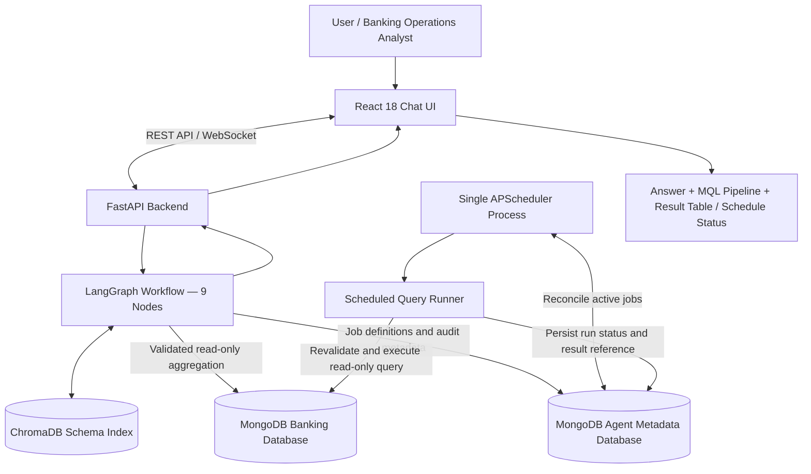
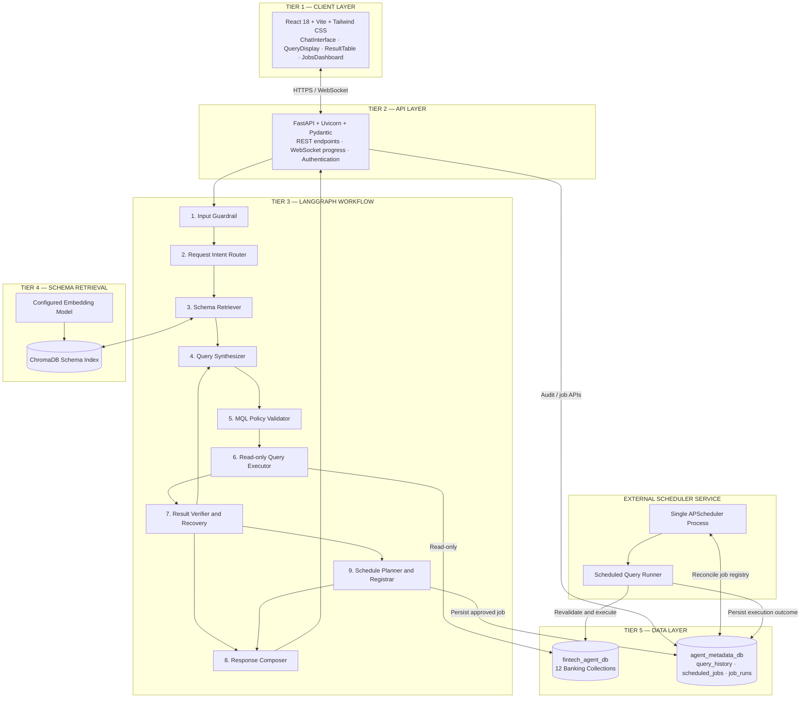
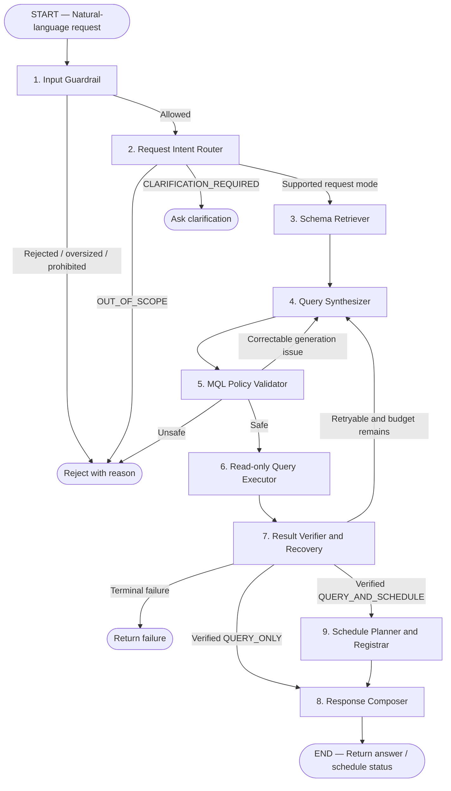
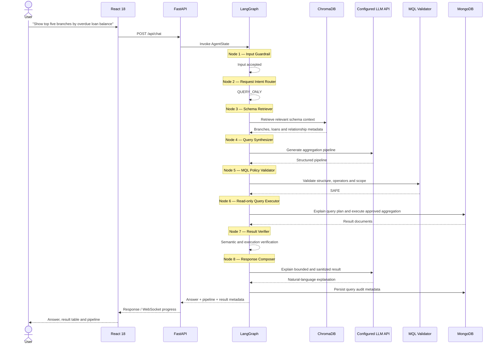
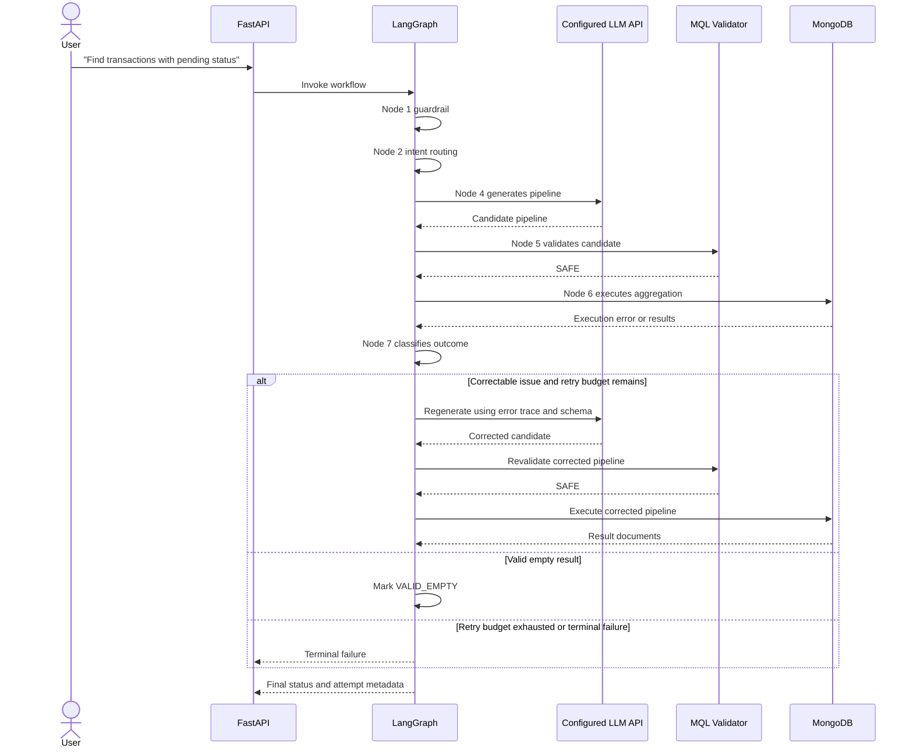
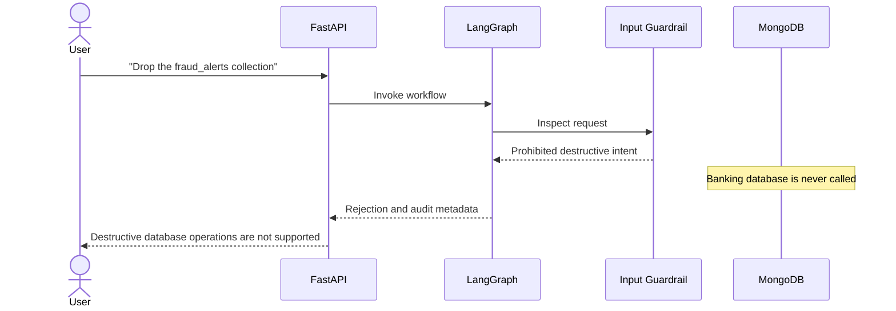
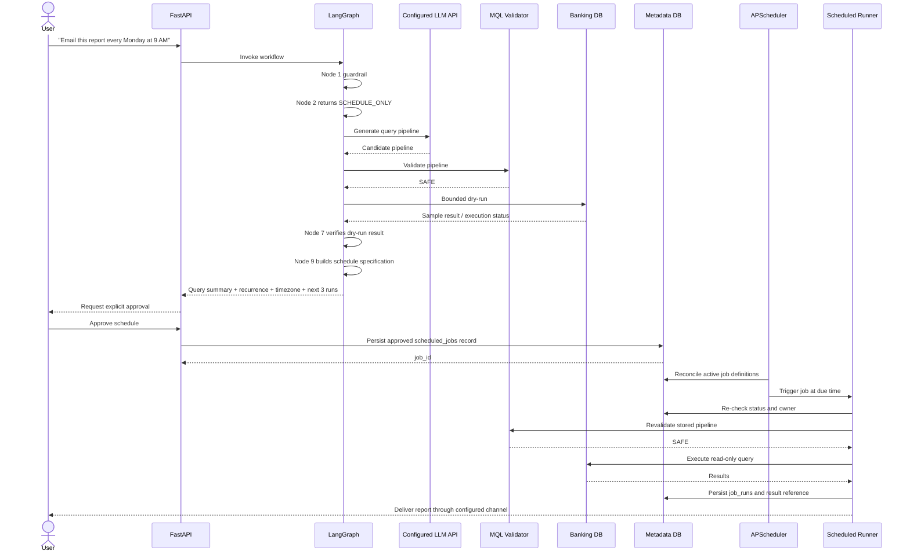
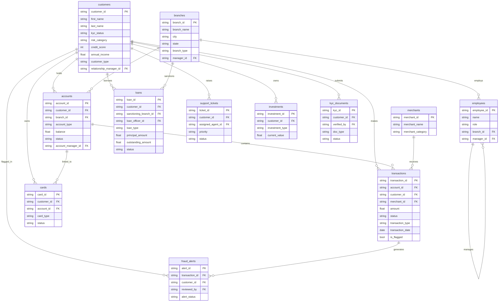

# FinTech Agent — System Architecture

> **Project:** FinTech Agent: Natural Language to Sandboxed MongoDB Query Agent  
> **Course:** INT450 – Large Language Models and Agentic AI  
> **Team:** T11 · SASTRA Deemed University · Dr. K. Ramkumar  
> **Advisor:** Goldman Sachs Engineer (Financial Services AI Domain)  
> **Stack:** LangGraph · FastAPI · React 18 · MongoDB 7 · ChromaDB · APScheduler

---

## Table of Contents

1. [Simple System Architecture](#1-simple-system-architecture)
2. [Detailed System Architecture](#2-detailed-system-architecture)
3. [Technology Stack](#3-technology-stack)
4. [LangGraph Agent Pipeline](#4-langgraph-agent-pipeline)
5. [Information Flow — Sequence Diagrams](#5-information-flow--sequence-diagrams)
6. [Database Schema & Collections](#6-database-schema--collections)
7. [Schema Retrieval & RAG Pipeline](#7-schema-retrieval--rag-pipeline)
8. [Safety & Security Architecture](#8-safety--security-architecture)
9. [Job Scheduling Architecture](#9-job-scheduling-architecture)
10. [Agent State Definition](#10-agent-state-definition)
11. [Project Folder Structure](#11-project-folder-structure)
12. [Environment Variables Reference](#12-environment-variables-reference)
13. [Evaluation & Benchmarking Strategy](#13-evaluation--benchmarking-strategy)

---

## 1. Simple System Architecture

This diagram shows the system at the highest level — what goes in, what happens inside, and what comes out.



**In one sentence:** A user submits a natural-language banking request → deterministic input guardrails inspect it → the LangGraph workflow classifies the request, retrieves the relevant MongoDB schema, generates and validates a read-only aggregation pipeline, executes and verifies the result, and returns an explanation or prepares a scheduled report.

The banking dataset is **semi-structured data stored in MongoDB**. Its documents contain identifiable fields, nested values, and relationships, while the document model allows records to vary without requiring a rigid relational table schema.

The architecture separates query intelligence, query safety, and scheduled operations.

---

## 2. Detailed System Architecture

The system is organized into five logical tiers. The scheduler is a separate application service and is not counted as a LangGraph workflow node.



### 2.1 Layer Responsibilities Summary

| Tier | Technology | Primary Responsibility |
| :---: | :--- | :--- |
| **1** | React 18 + Vite + Tailwind CSS + Zustand + Axios | Conversational UI, pipeline display, result table, and schedule dashboard |
| **2** | FastAPI + Uvicorn + Pydantic | REST API gateway, authentication, request validation, and WebSocket progress streaming |
| **3** | LangGraph + configured LLM API | Nine-node stateful workflow, query generation, validation routing, result verification, and scheduling |
| **4** | ChromaDB + configured embedding model | Schema retrieval and relevant collection/field context selection |
| **5** | MongoDB 7 | Semi-structured banking documents and durable agent metadata |
| **External service** | APScheduler | Single-process scheduling and dispatch of recurring query jobs |

### 2.2 Request Modes

Node 2 classifies each request into one of five structured modes after Node 1 has applied deterministic input checks.

| Request mode | Meaning | Workflow behaviour |
| :--- | :--- | :--- |
| `QUERY_ONLY` | Answer the question now. | Validate, generate, execute, verify, and respond. |
| `QUERY_AND_SCHEDULE` | Answer now and create a recurring job. | Complete the query path, dry-run the report, obtain approval, then register the schedule. |
| `SCHEDULE_ONLY` | Create a future recurring job without running the report as an immediate user query. | Validate, dry-run with a bounded sample, obtain approval, then register the job. |
| `CLARIFICATION_REQUIRED` | A required detail is missing or ambiguous. | Ask the user; persist resumable state; do not execute or register a job. |
| `OUT_OF_SCOPE` | Request is outside supported banking-query capabilities. | Reject with a concise explanation. |

Examples:

- “Show the top five branches by overdue loan balance.” → `QUERY_ONLY`
- “Show the report now and email it every Monday at 9 AM.” → `QUERY_AND_SCHEDULE`
- “Email this report every Monday at 9 AM.” → `SCHEDULE_ONLY`
- “Schedule this report in the morning.” → `CLARIFICATION_REQUIRED` when the time cannot be resolved safely.

The presence of a time expression does not by itself mean the user wants both an immediate query and a scheduled query.

### 2.3 Authentication and Request Ownership

Every API request must be associated with an authenticated user identity.

- Validate the authentication token before invoking the graph.
- Derive `user_id` from the authenticated session, not user-supplied request data.
- Associate scheduled jobs and query history with their owner.
- Verify ownership for listing, pausing, resuming, deleting, and viewing jobs.
- Apply rate limits and LLM usage budgets per authenticated user.
- Do not treat a job ID or conversation ID as proof of authorization.

**Data-scope limitation:** Per-user row-level banking-data isolation is not claimed unless the synthetic dataset, role model, and deterministic authorization filters actually support it. If the MVP uses a shared synthetic banking dataset, document that limitation explicitly.

---

## 3. Technology Stack

### 3.1 Complete Stack Reference

| # | Technology | Version / Selection | Category | Role in This Project |
| :---: | :--- | :--- | :--- | :--- |
| 1 | **LangGraph** | Pin tested version | Workflow orchestration | Stateful graph with nine nodes, typed state, conditional routing, and bounded retry paths |
| 2 | **LLM provider SDK** | Provider/model configured by environment | LLM integration | Intent classification, MongoDB pipeline generation, optional error diagnosis, and response composition |
| 3 | **Pydantic** | 2.x | Data validation | API contracts, structured intent output, and configuration validation |
| 4 | **ChromaDB** | Pin tested version | Vector database | Stores schema descriptions and supports semantic retrieval |
| 5 | **Embedding model** | Configurable | Embeddings | Embeds schema descriptions and user queries |
| 6 | **FastAPI** | Pin tested version | API framework | REST API and WebSocket progress streaming |
| 7 | **Uvicorn** | Pin tested version | ASGI server | Runs the FastAPI application |
| 8 | **PyMongo** | Pin tested version | MongoDB driver | Read-only aggregation execution and metadata persistence |
| 9 | **MongoDB** | 7.x | Document database | Banking dataset and durable agent metadata |
| 10 | **APScheduler** | Pin tested version | Job scheduler | Single scheduler process for MVP |
| 11 | **croniter** | Pin tested version | Schedule validation | Optional cron syntax validation; not authoritative for APScheduler next-run calculations |
| 12 | **React** | 18.x | UI framework | Chat interface, results, and job dashboard |
| 13 | **Vite** | 5.x | Build tool | Frontend development and build pipeline |
| 14 | **Tailwind CSS** | 3.x | CSS framework | Responsive UI styling |
| 15 | **Zustand** | 4.x | State management | Frontend auth, current query, and WebSocket event state |
| 16 | **Axios** | 1.x | HTTP client | REST calls to FastAPI |
| 17 | **pytest** | Pin tested version | Testing | Unit, integration, security, and benchmark tests |
| 18 | **Docker / Compose** | Pin installed version | DevOps | Reproducible local development |
| 19 | **Faker** | Pin tested version | Data generation | Generates synthetic Indian banking records |

**Model configuration:** Earlier drafts name Claude 3.5 Sonnet while project discussions reference other model options. Do not hard-code a model name here. Set `LLM_PROVIDER`, `LLM_MODEL`, and the provider-specific API key to the model actually used and tested. Verify provider availability before deployment.

**Embedding configuration:** Keep the embedding model configurable. The model used for query embeddings must match the model used when the schema index was built. Record the selected model and embedding dimension.

### 3.2 Why LangGraph Is Used

| Criterion | Simple `for` loop | LangChain chain | **LangGraph (Chosen)** |
| :--- | :---: | :---: | :---: |
| Typed shared state across steps | Manual | Depends on implementation | Yes |
| Conditional request routing | Manual | Limited | Yes |
| Retry and self-correction cycles | Manual | Limited | Yes |
| Node-level testing | Manual | Yes | Yes |
| Workflow tracing | Custom | Framework-dependent | Yes |

LangGraph is used because the workflow contains branching request modes, safety gates, conditional scheduling, and bounded correction loops. Describe this as **one agentic workflow with nine workflow nodes**, not nine independent autonomous agents.

### 3.3 Is LangChain Necessary?

The full LangChain framework is not inherently required. LangGraph performs workflow orchestration. The selected provider's official SDK can call the LLM, and Pydantic can validate structured output. Add a LangChain integration package only if the implementation imports and uses its provider adapters, prompt abstractions, or other utilities.

### 3.4 Redis and Celery — MVP versus Future Scale

| Concern | MVP approach | Phase 2 option |
| :--- | :--- | :--- |
| Schema cache | ChromaDB and optional in-process cache | Redis shared cache |
| Session state | Authenticated session and MongoDB metadata where required | Redis shared session/revocation state |
| WebSocket state | FastAPI process-local connection manager | Redis pub/sub |
| Scheduled jobs | APScheduler + MongoDB job registry | Celery workers with deliberate scheduler design |
| Task result history | MongoDB `job_runs` | MongoDB remains durable source of truth |

**Redis and Celery are not required for the MVP.** Start with one APScheduler process and MongoDB-backed job definitions. Add Redis and Celery only when distributed workers, cross-instance communication, or measured throughput requirements justify them. Do not run Celery Beat and APScheduler as competing scheduling authorities for the same jobs.

---

## 4. LangGraph Agent Pipeline

### 4.1 State Graph Topology

The LangGraph workflow contains **exactly nine nodes**. The input guardrail is deliberately placed before LLM-assisted intent classification. Raw user input must pass deterministic checks before it is sent to an external LLM.



**Routing rules:**

- `QUERY_ONLY`: Nodes 1–8. Node 9 is skipped.
- `QUERY_AND_SCHEDULE`: Nodes 1–7 → Node 9 → Node 8.
- `SCHEDULE_ONLY`: Nodes 1–5 → Node 6 dry-run → Node 7 verification → Node 9 → Node 8.
- Clarification and out-of-scope requests terminate without banking database execution or job registration.
- A schedule must not be registered until the user explicitly approves the schedule confirmation.

The schedule-only dry-run is a controlled test execution, not an immediate report delivery. It uses a small result limit and the same query policy controls as normal execution.

A prohibited request must never be sent back to the LLM for repair. Only correctable syntax, schema, type, or generation issues may enter the retry path.

### 4.2 Node Responsibilities Matrix

| Node | Name | LLM Involved | MongoDB Access | Responsibility |
| :---: | :--- | :---: | :---: | :--- |
| **1** | Input Guardrail | No | No | Deterministic input-size, domain, prompt-injection, and prohibited-intent pre-checks |
| **2** | Request Intent Router | Yes, structured output | No | Classifies query-only, query-plus-schedule, schedule-only, clarification, or out-of-scope intent |
| **3** | Schema Retriever | Embedding model | Schema metadata | Retrieves collections, fields, BSON types, indexes, enums, and relationships |
| **4** | Query Synthesizer | Yes | No | Generates a MongoDB aggregation pipeline from the request and retrieved schema |
| **5** | MQL Policy Validator | No | No | Recursively validates pipeline structure, operators, collection targets, and complexity |
| **6** | Read-only Query Executor | No | Read-only banking DB | Executes approved aggregation with limits; supports bounded dry-run |
| **7** | Result Verifier and Recovery | Optional diagnosis | No | Checks execution and semantic correctness; determines whether retry is justified |
| **8** | Response Composer | Yes | No | Explains verified results and formats tables, currency, and pipeline explanations |
| **9** | Schedule Planner and Registrar | Optional temporal extraction | Metadata DB only | Builds final schedule specification, dry-run confirmation, and approved job registration |

### 4.3 LLM-Assisted Nodes versus Deterministic Nodes

- **LLM-assisted:** Node 2 (intent extraction), Node 4 (MQL generation), Node 7 (optional diagnosis), Node 8 (response composition), and Node 9 (optional natural-language schedule extraction).
- **Primarily deterministic:** Node 1 (guardrails), Node 3 (retrieval orchestration), Node 5 (MQL policy validation), and Node 6 (query execution).
- LLM output is never the security boundary. Deterministic validation, authorization, and MongoDB permissions decide whether a query or schedule is allowed.

### 4.4 Retry and Time-Budget Policy

Every retry path must use shared state:

- `retry_count`
- `max_retries`
- `request_started_at`
- `request_deadline`
- `remaining_time_ms`
- `all_attempts`

The retry counter and total request deadline must be checked on **every edge returning to Node 4**, including the Node 5 → Node 4 validation-repair path.

Retry only when the issue is potentially correctable, the retry limit has not been reached, the overall deadline has not expired, and the request remains within the original authorization and safety constraints. Do not reset the retry counter when moving between nodes.

---

## 5. Information Flow — Sequence Diagrams

### 5.1 Standard Ad-Hoc Query (Happy Path)



### 5.2 Self-Correction Flow



A zero-record result is not automatically an error. It must not trigger a retry unless there is independent evidence of a query-generation or semantic mismatch.

### 5.3 Safety Interception Flow



A separate read-only MongoDB account remains mandatory even when the guardrail rejects the request before execution.

### 5.4 Scheduled Job Registration and Execution Flow



---

## 6. Database Schema & Collections

### 6.1 Database Overview

The application uses MongoDB documents to represent banking entities. The dataset is **semi-structured**, not wholly unstructured. Documents contain identifiable fields and values, nested objects or arrays where applicable, and cross-collection relationship keys. MongoDB's flexible document model allows fields to vary between records without requiring every document to follow a rigid relational table definition.

| Property | Value |
| :--- | :--- |
| **Banking database** | `fintech_agent_db` |
| **Collections** | 12 banking collections |
| **Total documents** | Pending verification against the dataset generator and live MongoDB counts |
| **Listed collection-count sum** | 19,120 based on the current development-count reference; not a verified live count |
| **Currency** | INR (Indian Rupee) |
| **Locale** | India (`en_IN` Faker) |
| **Date range** | 2010–2026 as specified in the original dataset description; verify generated data |
| **Random seed** | `42` as specified in the original dataset description; verify generator configuration |
| **Metadata database** | `agent_metadata_db` |
| **Metadata collections** | `query_history`, `scheduled_jobs`, `job_runs` |

**Database access separation:** Query executor uses a dedicated read-only MongoDB identity on `fintech_agent_db`. API and scheduler use a separate least-privilege identity for approved writes to `agent_metadata_db`. Credentials must never be exposed to the frontend or included in LLM prompts. If the current implementation still stores metadata alongside banking collections, treat this separation as a target design until the database configuration is updated.

### 6.2 Collection Reference

The following values are the existing development-count reference, not verified live counts.

| # | Collection | Purpose | Dev Count | Key Indexes |
| :---: | :--- | :--- | ---: | :--- |
| 1 | `branches` | Physical bank branches | 20 | `branch_id` unique, `city`, `state` |
| 2 | `employees` | Bank staff and hierarchy | 100 | `employee_id` unique, `branch_id`, `department` |
| 3 | `merchants` | Payment destination merchants | 200 | `merchant_id` unique, `merchant_category` |
| 4 | `customers` | Customer master records | 1,000 | `customer_id` unique, `kyc_status`, `risk_category` |
| 5 | `accounts` | Bank accounts per customer | 1,500 | `account_id` unique, `customer_id`, `branch_id`, `status` |
| 6 | `transactions` | Financial transactions | 10,000 | `transaction_id` unique, `account_id`, `customer_id`, `transaction_date`, `status` |
| 7 | `cards` | Debit and credit cards | 1,000 | `card_id` unique, `customer_id`, `account_id` |
| 8 | `loans` | Loan disbursals and repayments | 500 | `loan_id` unique, `customer_id`, `status`, `sanctioning_branch_id` |
| 9 | `kyc_documents` | KYC identity documents | 1,500 | `kyc_id` unique, `customer_id` |
| 10 | `support_tickets` | Customer support tickets | 2,000 | `ticket_id` unique, `customer_id`, `priority` |
| 11 | `fraud_alerts` | Fraud and suspicious activity flags | 300 | `alert_id` unique, `transaction_id`, `customer_id` |
| 12 | `investments` | Investment portfolio records | 1,000 | `investment_id` unique, `customer_id` |

### 6.3 Dataset Scale Plan

Keep the development dataset and full-scale benchmark dataset separate.

| Dataset | Purpose | Record-count status |
| :--- | :--- | :--- |
| Development dataset | Functional development, debugging, and UI integration | Existing reference counts; verify actual database |
| Benchmark dataset | Accuracy, latency, query-planning, and scalability evaluation | Target scale to be generated and measured |
| Full-scale target | Demonstrate behaviour with large collections | Approximately 500,000 records per selected high-volume collection, subject to hardware and storage feasibility |

The assignment's scale expectations must not be presented as achieved until the dataset is generated and verified.

Recommended scale-up procedure:

1. Keep a reproducible development dataset using a fixed seed.
2. Increase high-volume collections such as `transactions` and other relevant entities.
3. Preserve valid foreign-key relationships during generation.
4. Add and verify indexes before benchmarking.
5. Record actual counts using MongoDB `count_documents({})`.
6. Measure database size, generation time, index size, and query latency.
7. Keep benchmark dataset counts separate from development counts.

### 6.4 Schema Completeness and Semi-Structured Demonstration

Validate `schema.json` against the actual generated documents.

- Each collection should have a documented field inventory.
- Aim for the assignment's expected 20–30 fields per collection where appropriate.
- Distinguish required and optional fields.
- Include nested objects and arrays where supported by the data model.
- Record observed BSON types.
- Record low-cardinality categorical values.
- Record relationship keys and index definitions.

Illustrative nested document shape (not a claim that these exact fields already exist):

```json
{
  "customer_id": "CUST001",
  "address": {
    "city": "Chennai",
    "state": "Tamil Nadu",
    "pincode": "600001"
  },
  "nominees": [
    {
      "name": "Example Nominee",
      "relationship": "Sibling"
    }
  ]
}
```

### 6.5 Entity Relationship Diagram



The ERD includes all 12 banking collections, including `merchants`, which is referenced by `transactions.merchant_id`.

### 6.6 Cross-Collection Relationship Keys

```text
branches
  employees.branch_id                → branches.branch_id
  branches.manager_id                → employees.employee_id
  accounts.branch_id                 → branches.branch_id
  loans.sanctioning_branch_id        → branches.branch_id

employees
  branches.manager_id                → employees.employee_id
  employees.manager_id               → employees.employee_id [self-reference]
  customers.relationship_manager_id  → employees.employee_id
  accounts.account_manager_id        → employees.employee_id
  loans.loan_officer_id              → employees.employee_id
  kyc_documents.verified_by          → employees.employee_id
  support_tickets.assigned_agent_id  → employees.employee_id
  fraud_alerts.reviewed_by           → employees.employee_id

customers
  accounts.customer_id               → customers.customer_id
  transactions.customer_id           → customers.customer_id [denormalized]
  cards.customer_id                  → customers.customer_id
  loans.customer_id                  → customers.customer_id
  kyc_documents.customer_id          → customers.customer_id
  support_tickets.customer_id        → customers.customer_id
  fraud_alerts.customer_id           → customers.customer_id
  investments.customer_id            → customers.customer_id

accounts
  transactions.account_id            → accounts.account_id
  cards.account_id                   → accounts.account_id

merchants
  transactions.merchant_id            → merchants.merchant_id [nullable]

transactions
  fraud_alerts.transaction_id         → transactions.transaction_id
```

> **Note:** `transactions.customer_id` is intentionally denormalized in the current design. It stores the account's owning customer directly, avoiding a mandatory `$lookup` for every customer-level transaction query. The dataset validator should verify that the denormalized relationship matches the owning account.

**Schema verification requirement:** Fields such as `loans.days_past_due` and `loans.overdue_amount` must not be assumed to exist. Verify them against `schema.json` and generated documents before adding them to the ERD or using them in benchmark questions. If absent, document them as future dataset enhancements.

---

## 7. Schema Retrieval & RAG Pipeline

### 7.1 Offline Indexing Phase

```text
Schema Catalog Builder
  |
  +-- For each banking collection:
  |   +-- Read collection metadata and representative documents
  |   +-- Discover field names and observed BSON types
  |   +-- Record nested objects and arrays
  |   +-- Record required and optional fields
  |   +-- Record categorical values for selected fields
  |   +-- Read existing index definitions
  |   +-- Record cross-collection relationship keys
  |
  +-- Produce a versioned schema description
  +-- Embed descriptions using configured embedding model
  +-- Store vectors and collection metadata in ChromaDB
  +-- Record schema and embedding model versions
```

Keep the ground-truth schema catalog in a version-controlled JSON/YAML file or regenerate it deterministically from the dataset. Do not rely only on a small sample of documents to infer rare or optional fields.

### 7.2 Online Retrieval Phase

```text
User request
    |
    v
Generate query embedding using indexing-compatible model
    |
    v
ChromaDB similarity search + metadata filtering
    |
    v
Select relevant collection schemas
    |
    v
Expand through known relationship map when joins are required
    |
    v
Attach field names, BSON types, enums, indexes and join keys
    |
    v
Pass schema context to Node 4 — Query Synthesizer
```

Retrieved schema text is data used to ground query generation; it must not be treated as executable instructions.

### 7.3 Schema Retrieval Evaluation

Compare full-schema injection, deterministic metadata filtering, ChromaDB semantic retrieval, and hybrid semantic retrieval plus relationship expansion.

Measure relevant collection retrieval accuracy, relevant field retrieval accuracy, retrieval latency, prompt token usage, and query-generation accuracy after retrieval. Do not claim vector retrieval is essential or that it reduces token usage by a particular percentage until experiments have been completed.

### 7.4 Schema Cache

Redis is not required for the MVP. Begin with ChromaDB and a versioned schema catalog. Add a small in-process TTL cache only if measurements show repeated schema loading is a bottleneck. The authoritative schema definition must remain versioned and recoverable independently of the cache.

---

## 8. Safety & Security Architecture

### 8.1 Defense-in-Depth

```text
LAYER 1 — DETERMINISTIC INPUT GUARDRAIL (Node 1)
  +-- Enforce input length and format limits
  +-- Detect unsupported or prohibited intent patterns
  +-- Apply domain and prompt-injection pre-checks
  +-- Do not send rejected raw input to the LLM

LAYER 2 — INTENT AND AUTHORIZATION (Node 2 + API)
  +-- Classify supported request modes
  +-- Verify authenticated user identity
  +-- Enforce ownership and applicable data scopes
  +-- Never use LLM classification as the sole authorization control

LAYER 3 — RECURSIVE MQL POLICY VALIDATOR (Node 5)
  +-- Accept structured pipeline data only
  +-- Require one recognized stage operator per stage object
  +-- Recursively inspect nested expressions and pipelines
  +-- Enforce stage, expression, collection and nesting allowlists
  +-- Block $out, $merge and server-side code/custom execution

LAYER 4 — DATABASE PRIVILEGES AND EXECUTION
  +-- Dedicated read-only identity for fintech_agent_db
  +-- Separate metadata writer for agent_metadata_db
  +-- Apply query deadlines and result caps
  +-- Inspect query plans for expensive operations
  +-- Apply deterministic authorization filters where supported

LAYER 5 — BOUNDED RECOVERY, AUDIT AND MONITORING
  +-- Shared retry counter and total request deadline
  +-- No retry for prohibited intent or authorization failures
  +-- Audit request ID, user ID, mode, pipeline hash, policy result,
      timing, retry count, job ID and final status
  +-- Avoid logging unnecessary sensitive banking result contents
```

### 8.2 Allowed Read-Only MQL Operator Whitelist

The validator operates on the structured Python list/dictionary representation of the aggregation pipeline. **Do not use Python `ast.parse()` as the MongoDB pipeline security validator.** Python AST parses Python source code; it does not validate the semantics of a BSON/JSON-style MongoDB aggregation structure.

```python
ALLOWED_STAGE_OPERATORS = {
    "$match", "$group", "$project", "$sort", "$limit", "$skip",
    "$lookup", "$unwind", "$addFields", "$set", "$unset",
    "$replaceRoot", "$replaceWith", "$count", "$facet",
    "$bucket", "$bucketAuto", "$sortByCount"
}

BLOCKED_STAGE_OPERATORS = {
    "$out", "$merge"
}

BLOCKED_EXPRESSION_OPERATORS = {
    "$where", "$function", "$accumulator", "$eval"
}

BLOCKED_DATABASE_OPERATIONS = {
    "insert", "update", "replace", "delete", "drop",
    "dropDatabase", "createIndex", "dropIndex", "renameCollection"
}
```

This is a starting policy, not a complete validator implementation. The production allowlist must be checked against operators actually needed by the benchmark questions.

**Important `$set` distinction:** `$set` inside an aggregation pipeline is a read-only transformation stage that adds or replaces fields in pipeline output. It is not the same as an update command such as `updateOne` or `updateMany`. Therefore, aggregation `$set` may be allowed while database write commands remain blocked. Apply the same context-aware treatment to `$unset`.

### 8.3 Recursive Structural Validation

The `mql_policy_validator.py` module should:

1. Require the pipeline to be a list of dictionaries.
2. Require each stage dictionary to contain exactly one recognized stage operator.
3. Reject unknown stages and unsupported expressions.
4. Recursively inspect nested expressions, `$lookup.pipeline`, and `$facet` branches.
5. Validate `$lookup.from` against the explicit banking collection allowlist.
6. Reject `$out`, `$merge`, server-side JavaScript, and custom-code execution operators.
7. Enforce maximum stage count, nesting depth, result cap, collection scope, and complexity limits.
8. Reject attempts to call update, delete, insert, drop, or administrative database APIs.
9. Inject required authorization filters in trusted backend code where the data model supports them.
10. Return structured validation errors.
11. Never silently rewrite prohibited intent into a different query.
12. Validate all scheduled pipelines again before execution.

### 8.4 Query Broadness and Execution-Plan Safeguards

`maxTimeMS` and a result cap are necessary but not sufficient.

- Inspect query plans using `explain` with `queryPlanner` verbosity.
- Do not use `executionStats` as the default preflight mechanism because it executes the query workload.
- Detect `COLLSCAN` and potentially expensive plan shapes.
- Detect unbounded `$lookup` operations and joins without suitable indexed join keys.
- Require useful filters, bounded output, or explicit user confirmation for expensive queries.
- Ask for clarification when a broad query over a large collection has no meaningful filter or limit.
- Enforce maximum stages and nested pipeline depth.
- Validate `$lookup.from` against the approved collection allowlist.
- Require appropriate indexes for frequently used join and filter keys where practical.

A query planner warning is a risk signal, not proof that a query is safe or unsafe. Combine plan inspection, deterministic complexity limits, execution deadlines, and database permissions.

### 8.5 Execution Limits and Result Verification

| Control | Initial default | Notes |
| :--- | :--- | :--- |
| MongoDB `maxTimeMS` | `15000` ms | Server-side operation limit |
| Returned document cap | `1000` | Application-enforced result cap; include truncation indicator |
| Dry-run result cap | `10` | Small bounded sample for schedule confirmation |
| Maximum correction attempts | `3` | Shared across all retry edges |
| Outer API deadline | Configurable; initial target 20–30 seconds | Includes model, retrieval, and database operations |
| Maximum pipeline stages | Configurable | Enforced by recursive validator |
| Maximum nested depth | Configurable | Enforced by recursive validator |

These are proposed MVP defaults and must be tuned against the implemented dataset and hardware. `maxTimeMS` limits MongoDB operation execution, not the entire API request. Configure separate model/client and API deadlines.

### 8.6 Semantic Result Verification

Node 7 must check more than whether MongoDB returned an error.

- Verify generated fields against retrieved schema.
- Verify filter values against known categorical values.
- Apply case normalization or known synonyms only when grounded in verified metadata.
- Verify that banking terminology maps to the intended field or concept.
- Verify aggregation output fields against the user's requested metric.
- Verify joins use the correct relationship keys.
- Check result values against the requested interpretation.

Use a verified banking glossary or data dictionary for terms such as NPA, DPD, overdue amount, outstanding balance, delinquency, and repayment status. Do not invent mappings when the data dictionary does not support them.

A valid empty result is a valid outcome. An empty result may be suspicious if the requested category does not match any known enum values. Do not force retries merely because no records were returned. Retry only when a semantic mismatch is grounded in schema or verified glossary evidence.

### 8.7 Result Privacy and LLM Boundaries

Raw banking query results must not be passed wholesale to an external LLM.

Node 8 should receive only the minimum information required to generate the explanation: aggregate summaries, bounded and redacted samples where necessary, column names and types, result counts, truncation indicators, and verified query interpretation.

- Treat database result content as untrusted data, not instructions.
- Do not enable tools or database access for the response-composer LLM call.
- Enforce a response token budget.
- Redact or omit unnecessary personal identifiers.
- Avoid sending up to 1,000 raw result documents to an external provider.
- Keep audit logs separate from full banking result payloads.

### 8.8 Clarification and State Resumption

When a request needs clarification:

1. Save pending request and relevant graph state using a LangGraph checkpointer.
2. Associate the checkpoint with an authenticated session/conversation `thread_id`.
3. Return the clarification question to the frontend.
4. When the user replies, resume the graph using the same authorized thread.
5. Revalidate resumed state and user ownership before continuing.
6. Do not trust stale or user-modified state as an authorization source.

A resumed request must not bypass the input guardrail, query validator, or authorization checks.

### 8.9 Authorization and Rate Limits

The API should implement authenticated user identity, owner checks for job/history endpoints, per-user request rate limits, per-user LLM usage budgets, request-size limits, and role/scope enforcement where the data model supports it.

If the synthetic MVP does not implement row-level banking authorization, state this as an explicit limitation rather than claiming per-user data isolation.

---

## 9. Job Scheduling Architecture

### 9.1 Component Interaction

Scheduling is handled by **APScheduler as an external service**, not as a LangGraph node. Node 9 owns the final schedule specification and registration workflow. MongoDB `scheduled_jobs` is the durable source of truth. APScheduler maintains an in-memory representation reconciled against that source.

```text
User: "Email me the top 5 NPA loans every Monday at 9 AM"
                |
                v
         Node 1 — Input Guardrail
                |
                v
         Node 2 — Request Intent Router
         +-- Classifies as SCHEDULE_ONLY
                |
                v
         Nodes 3–5
         +-- Retrieve schema
         +-- Generate report pipeline
         +-- Validate MQL policy
                |
                v
         Node 6 — Bounded Dry-run
         +-- Execute with small result cap
         +-- Check query plan and execution time
                |
                v
         Node 7 — Result Verifier
         +-- Verify result semantics
         +-- Reject or correct invalid pipeline
                |
                v
         Node 9 — Schedule Planner and Registrar
         +-- Normalize recurrence
         +-- Validate timezone and delivery
         +-- Calculate next 3 run times
         +-- Present confirmation summary
         +-- Wait for explicit user approval
                |
                v
         MongoDB scheduled_jobs
         +-- Persist approved job definition
                |
                v
         Single APScheduler process
         +-- Reconcile MongoDB job registry every 30–60 seconds
         +-- Add, update, pause, resume or remove triggers
                |
                v
         Scheduled Query Runner
         +-- Re-check job status and owner permissions
         +-- Revalidate stored pipeline
         +-- Resolve relative date parameters
         +-- Execute read-only query
         +-- Persist job_runs outcome and result reference
         +-- Deliver through configured supported channel
```

### 9.2 Schedule Confirmation and Approval

Before registering a schedule, show the user:

1. Report title and natural-language description.
2. Query/pipeline summary.
3. Recurrence expressed in plain English.
4. IANA timezone, such as `Asia/Kolkata`.
5. Delivery destination.
6. Next three scheduled run times.
7. Relevant dry-run warning or result summary.

The user must explicitly approve the schedule. Do not register a job merely because the LLM generated a valid cron expression.

### 9.3 APScheduler Weekday and Cron Correctness

Do not assume numeric weekday values have identical meanings across cron parsers and APScheduler versions.

For APScheduler 3.x, use explicit weekday names in the `CronTrigger`, such as:

```python
CronTrigger(
    day_of_week="mon",
    hour=9,
    minute=0,
    timezone="Asia/Kolkata"
)
```

The implementation must pin the installed APScheduler version, verify runtime behaviour, use explicit weekday names, calculate the next three run times from the actual registered trigger, display those times, and test Monday, weekday, month-boundary, leap-year, and timezone cases.

Do not rely solely on `croniter` to calculate next-run times for an APScheduler trigger. The registered trigger is authoritative.

### 9.4 Natural Language → Schedule Examples

| User Says | APScheduler Trigger Concept | Timezone |
| :--- | :--- | :--- |
| “Every Monday at 9 AM” | `day_of_week="mon", hour=9, minute=0` | `Asia/Kolkata` |
| “Daily at midnight” | `hour=0, minute=0` | `Asia/Kolkata` |
| “Every hour” | `minute=0` | `Asia/Kolkata` |
| “First of every month at 8 AM” | `day=1, hour=8, minute=0` | `Asia/Kolkata` |
| “Every weekday at 6 PM” | `day_of_week="mon-fri", hour=18` | `Asia/Kolkata` |

These are trigger concepts, not a claim that every expression has already been implemented or tested.

### 9.5 Relative Date Handling

For requests such as “last week's transactions every Monday,” “yesterday's failed payments every morning,” or “this month's overdue loans on the first day of next month,” do not freeze relative dates when the job is created.

1. Store a structured date specification.
2. Store the IANA timezone.
3. Pass the current timestamp and timezone to the temporal parser.
4. Resolve relative date ranges in deterministic code at every scheduled run.
5. Generate runtime query parameters from the resolved date range.
6. Revalidate the resulting pipeline before execution.

The scheduled job should store the report definition, not a permanently frozen interpretation of a relative date phrase.

### 9.6 Schedule Registry and Reconciliation

MongoDB `scheduled_jobs` is the **only durable source of truth** for job definitions and status.

The single APScheduler process should load active jobs at startup and reconcile the registry every 30–60 seconds. It must detect newly created jobs, apply changed recurrence/timezone settings, remove deleted/cancelled jobs, pause jobs marked paused, resume active jobs, and recover after restarts.

Do not rely on startup-only loading. For the MVP, run one scheduler process. If multiple scheduler processes are introduced, implement a distributed lock or leader-election mechanism to prevent duplicate execution.

### 9.7 Natural-Language Job Management

| User action | Expected behaviour |
| :--- | :--- |
| List my scheduled jobs | Return only jobs owned by the authenticated user |
| Pause a job | Set status to `paused`; scheduler reconciliation pauses/removes its trigger |
| Resume a job | Set status to `active`; scheduler reconciles and re-registers the trigger |
| Cancel/delete a job | Mark cancelled or delete according to retention policy; stop future runs |
| View job history | Return authorized `job_runs` records |
| View last report | Retrieve stored result reference if retained and authorized |

Every operation must perform a backend owner check. A job ID alone is not authorization.

### 9.8 Delivery and Job Run Records

Delivery must be explicitly implemented and configured. A possible MVP design is email to the owner's verified email address only, with a CSV attachment generated from bounded report results. Persist delivery status in `job_runs`, store a result reference for the dashboard, and send failure notifications through the configured channel. Do not allow arbitrary user-supplied recipients unless an explicit verification and authorization flow is implemented.

Illustrative metadata structure:

```json
{
  "job_id": "JOB_ID",
  "owner_user_id": "USER_ID",
  "scheduled_fire_time": "ISO_8601_TIMESTAMP",
  "started_at": "ISO_8601_TIMESTAMP",
  "completed_at": "ISO_8601_TIMESTAMP",
  "status": "success",
  "row_count": 25,
  "result_reference": "RESULT_REFERENCE",
  "delivery_status": "sent",
  "error_code": null
}
```

### 9.9 Reliability and Failure Policy

Define and test misfire behaviour, maximum concurrent instances, job timeout, retry policy, idempotency key, delivery retry policy, failure notification, retention policy, and automatic pause after a configurable number of consecutive failures.

Use an idempotency key such as `(job_id, scheduled_fire_time)` to help prevent duplicate reports after retries or scheduler restarts.

### 9.10 Future Scheduling Scale

Redis and Celery are Phase 2 options. Choose one scheduling authority:

- **Option A:** APScheduler owns schedules and dispatches due work to Celery workers. Do not also register the same periodic jobs in Celery Beat.
- **Option B:** Celery Beat owns periodic scheduling; APScheduler is removed as scheduler for those jobs.

MongoDB remains the durable source of truth for job definitions and execution history.

---

## 10. Agent State Definition

The `AgentState` TypedDict is the shared state passed through LangGraph nodes. Every node reads and writes declared state fields; avoid hidden global mutable state.

```python
# backend/app/agent/state.py
from typing import Any, Literal, Optional, TypedDict

RequestMode = Literal[
    "QUERY_ONLY",
    "QUERY_AND_SCHEDULE",
    "SCHEDULE_ONLY",
    "CLARIFICATION_REQUIRED",
    "OUT_OF_SCOPE",
]

ResultStatus = Literal[
    "VALID_WITH_DATA",
    "VALID_EMPTY",
    "RETRYABLE_ERROR",
    "TERMINAL_FAILURE",
]

class AgentState(TypedDict, total=False):
    # Request identity and input
    request_id: str
    user_id: str
    session_id: str
    thread_id: str
    natural_language_query: str

    # Shared request timing and retry budget
    request_started_at: str
    request_deadline: str
    remaining_time_ms: int
    retry_count: int
    max_retries: int
    all_attempts: list[dict[str, Any]]

    # Node 1 — input guardrail
    guardrail_status: str
    rejection_reason: Optional[str]

    # Node 2 — intent routing
    request_mode: RequestMode
    intent_reason: str
    query_description: Optional[str]

    # Node 3 — schema retrieval
    schema_context: dict[str, Any]
    collections_identified: list[str]
    schema_version: Optional[str]
    embedding_model: Optional[str]

    # Node 4 — query generation
    generated_pipeline: Optional[list[dict[str, Any]]]
    target_collection: Optional[str]
    query_parameters: dict[str, Any]
    temporal_spec: Optional[dict[str, Any]]

    # Node 5 — MQL policy validation
    validation_status: str
    validation_errors: list[str]
    query_plan_summary: Optional[dict[str, Any]]

    # Node 6 — execution
    raw_results: Optional[list[dict[str, Any]]]
    execution_time_ms: Optional[int]
    result_row_count: Optional[int]
    execution_error: Optional[str]
    result_truncated: bool
    dry_run: bool

    # Node 7 — verification and recovery
    result_status: ResultStatus
    correction_reason: Optional[str]
    semantic_verification: Optional[dict[str, Any]]
    interpretation_summary: Optional[str]

    # Node 8 — response
    formatted_response: Optional[str]
    pipeline_explanation: Optional[str]
    safe_result_summary: Optional[dict[str, Any]]

    # Node 9 — schedule planning and registration
    schedule_spec: Optional[dict[str, Any]]
    schedule_approved: bool
    schedule_job_id: Optional[str]
    cron_expression: Optional[str]
    timezone: Optional[str]
    next_run_times: Optional[list[str]]
    delivery_spec: Optional[dict[str, Any]]

    # Clarification and resumption
    clarification_question: Optional[str]
    pending_user_input: Optional[str]

    # Audit and final status
    trace: list[dict[str, Any]]
    final_status: str
    error_message: Optional[str]
```

Use Pydantic models for API request/response contracts and intent-router output. The `TypedDict` represents graph state; it does not replace validation of external data or security-sensitive values.

The checkpoint `thread_id` must be derived from an authenticated session or conversation context and must not be accepted as an arbitrary authorization token.

---

## 11. Project Folder Structure

The MVP structure below excludes Redis/Celery-specific modules and the old Python AST validator.

```text
llm prj/
│
├── backend/
│   ├── app/
│   │   ├── main.py
│   │   ├── config.py
│   │   ├── agent/
│   │   │   ├── graph.py
│   │   │   ├── state.py
│   │   │   ├── checkpointer.py
│   │   │   ├── nodes/
│   │   │   │   ├── input_guardrail.py
│   │   │   │   ├── request_intent_router.py
│   │   │   │   ├── schema_retriever.py
│   │   │   │   ├── query_synthesizer.py
│   │   │   │   ├── mql_policy_validator.py
│   │   │   │   ├── query_executor.py
│   │   │   │   ├── result_verifier.py
│   │   │   │   ├── response_composer.py
│   │   │   │   └── schedule_planner.py
│   │   │   └── prompts/
│   │   │       ├── intent_classification.py
│   │   │       ├── query_generation.py
│   │   │       ├── result_diagnosis.py
│   │   │       └── response_formatting.py
│   │   ├── scheduler/
│   │   │   ├── scheduler_service.py
│   │   │   ├── scheduler_reconciler.py
│   │   │   ├── scheduled_runner.py
│   │   │   ├── job_repository.py
│   │   │   ├── job_management.py
│   │   │   └── delivery.py
│   │   ├── db/
│   │   │   ├── mongo_client.py
│   │   │   ├── schema_catalog.py
│   │   │   ├── models.py
│   │   │   └── indexes.py
│   │   ├── security/
│   │   │   ├── authentication.py
│   │   │   ├── authorization.py
│   │   │   ├── rate_limiter.py
│   │   │   └── audit.py
│   │   └── api/
│   │       ├── chat.py
│   │       ├── jobs.py
│   │       ├── history.py
│   │       └── auth.py
│   ├── tests/
│   │   ├── test_input_guardrail.py
│   │   ├── test_intent_router.py
│   │   ├── test_agent_graph.py
│   │   ├── test_mql_policy_validator.py
│   │   ├── test_query_executor.py
│   │   ├── test_result_verifier.py
│   │   ├── test_scheduler.py
│   │   ├── test_scheduler_reconciliation.py
│   │   ├── test_job_authorization.py
│   │   ├── test_security_cases.py
│   │   ├── test_checkpoint_resume.py
│   │   └── test_api_endpoints.py
│   ├── requirements.txt
│   └── Dockerfile
│
├── frontend/
│   ├── src/
│   │   ├── components/
│   │   ├── pages/
│   │   ├── hooks/
│   │   ├── services/
│   │   └── store/
│   ├── vite.config.js
│   ├── tailwind.config.js
│   └── package.json
│
├── fintech-agent/
│   └── data/
│       ├── generate_dataset.py
│       ├── validate_dataset.py
│       ├── sanity_check.py
│       ├── schema.json
│       ├── banking_glossary.json
│       └── test_questions.json
│
├── benchmarks/
│   ├── benchmark_questions.json
│   ├── gold_pipelines.json
│   ├── run_benchmark.py
│   ├── evaluate_results.py
│   └── results/
│
├── docs/
│   ├── system_architecture.md
│   ├── approach_and_design.md
│   ├── problem_and_justification.md
│   ├── evaluation_methodology.md
│   └── known_limitations.md
│
├── SYSTEM_ARCHITECTURE.md
├── PRESENTATION_NOTES.md
├── docker-compose.yml
├── .gitignore
└── README.md
```

The filenames shown are the recommended target layout. Keep the actual repository structure synchronized with the implementation. Do not document a file as implemented until it exists and has been tested.

---

## 12. Environment Variables Reference

| Variable | Example Value | Required By | Purpose |
| :--- | :--- | :--- | :--- |
| `MONGO_URI` | `mongodb://localhost:27017/` | Backend / scheduler | MongoDB connection string |
| `MONGO_BANKING_DB` | `fintech_agent_db` | Query executor | Banking dataset database |
| `MONGO_METADATA_DB` | `agent_metadata_db` | API / scheduler | Query history, scheduled jobs, and job runs |
| `MONGO_READONLY_USERNAME` | `fintech_reader` | Query executor | Dedicated read-only banking identity |
| `MONGO_READONLY_PASSWORD` | Secret value | Query executor | Read-only identity password |
| `MONGO_METADATA_USERNAME` | `agent_metadata_writer` | API / scheduler | Least-privilege metadata writer |
| `MONGO_METADATA_PASSWORD` | Secret value | API / scheduler | Metadata writer password |
| `LLM_PROVIDER` | Configured provider | Agent | Provider adapter |
| `LLM_MODEL` | Provider-supported model ID | Agent | Model identifier |
| `LLM_API_KEY` | Secret value | Agent | Provider API key |
| `EMBEDDING_PROVIDER` | Configured provider | ChromaDB | Embedding provider |
| `EMBEDDING_MODEL` | Configured model ID | ChromaDB | Schema/query embedding model |
| `CHROMA_PERSIST_DIR` | `./chroma_data` | Schema retriever | Persistent ChromaDB directory |
| `JWT_SECRET_KEY` | Secret value | FastAPI auth | JWT signing secret |
| `JWT_ALGORITHM` | `HS256` | FastAPI auth | JWT signing algorithm |
| `JWT_ACCESS_TOKEN_EXPIRE_MINUTES` | `30` | FastAPI auth | Access-token expiry |
| `JWT_REFRESH_TOKEN_EXPIRE_MINUTES` | `10080` | FastAPI auth | Refresh-token expiry, if refresh tokens are implemented |
| `MAX_RETRY_ATTEMPTS` | `3` | LangGraph | Shared maximum correction attempts |
| `REQUEST_TIMEOUT_SECONDS` | `30` | API / graph | Overall request deadline |
| `QUERY_TIMEOUT_MS` | `15000` | Node 6 | MongoDB `maxTimeMS` |
| `RESULT_DOC_LIMIT` | `1000` | Node 6 | Maximum application result count |
| `DRY_RUN_RESULT_LIMIT` | `10` | Scheduler | Bounded schedule dry-run result count |
| `MAX_PIPELINE_STAGES` | `20` | Node 5 | Maximum pipeline stages |
| `MAX_PIPELINE_DEPTH` | `10` | Node 5 | Maximum nested pipeline/expression depth |
| `SCHEDULER_TIMEZONE` | `Asia/Kolkata` | APScheduler | Default timezone where explicitly confirmed |
| `SCHEDULER_RECONCILE_INTERVAL_SECONDS` | `30` | APScheduler | MongoDB job-registry reconciliation interval |
| `SCHEDULER_MAX_INSTANCES` | `1` | APScheduler | Maximum concurrent instances per job |
| `JOB_MAX_CONSECUTIVE_FAILURES` | `3` | Scheduler | Failure threshold before automatic pause |
| `SMTP_HOST` | Configured SMTP host | Delivery | SMTP host, if email delivery is implemented |
| `SMTP_PORT` | `587` | Delivery | SMTP port |
| `SMTP_USER` | Configured username | Delivery | SMTP username |
| `SMTP_PASS` | Secret value | Delivery | SMTP password or API key |
| `CORS_ORIGINS` | `http://localhost:5173` | FastAPI | Allowed frontend origins |
| `USER_RATE_LIMIT` | Configured limit | API | Per-user request rate limit |
| `USER_LLM_BUDGET` | Configured budget | API / Agent | Per-user LLM usage budget |

Redis and Celery variables are intentionally omitted from the MVP configuration. Add broker, worker, and result-backend settings only if Phase 2 infrastructure is implemented.

---

## 13. Evaluation & Benchmarking Strategy

### 13.1 Evaluation Tiers

Evaluate the agent using six tiers.

| Tier | Category | What It Tests |
| :---: | :--- | :--- |
| **1** | Basic Filters | Simple `$match`, projections, sorting, limits, and categorical filtering |
| **2** | Aggregation & Grouping | `$group`, counts, sums, averages, sorting, and calculated fields |
| **3** | Multi-Collection Lookups | `$lookup`, relationship correctness, joins, and nested pipelines |
| **4** | Temporal Analytics | Date ranges, month/year grouping, relative date interpretation, and timezone handling |
| **5** | Adversarial / Security | Destructive intent, prompt injection, blocked operators, unauthorized access, and expensive query attempts |
| **6** | Scheduling & Job Management | Schedule extraction, timezone correctness, dry-run, explicit approval, pause/resume/delete, reconciliation, and duplicate prevention |

### 13.2 Evaluation Metrics

| Metric | Definition |
| :--- | :--- |
| Query execution accuracy | Percentage of test cases whose executed result matches the gold result |
| Pipeline validity | Percentage of generated pipelines accepted by the validator and executable against the expected schema |
| Semantic correctness | Percentage of results that correctly answer the user's intended question |
| Result equivalence | Agreement between generated result and reference result, using an appropriate comparison method |
| Self-correction recovery | Correctable failed attempts successfully recovered within the retry budget |
| False-success rate | Incorrect answers returned as successful results |
| Safety rejection rate | Prohibited requests correctly rejected |
| Zero-write safety | Number of prohibited write attempts that resulted in zero banking-database writes |
| Retrieval accuracy | Relevant collection and field retrieval performance |
| Latency P50 / P90 | Median and 90th-percentile end-to-end response time |
| Token usage | Input/output token consumption per query |
| Schedule correctness | Agreement between requested recurrence and actual registered trigger times |
| Schedule reliability | Successful scheduled runs divided by expected scheduled runs |

A successful MongoDB execution is not automatically a correct answer. Semantic correctness and result equivalence must be measured separately.

### 13.3 Self-Correction Evaluation

Separate failures into syntax errors, unknown collection/field, BSON type mismatch, invalid categorical value, incorrect relationship key, incorrect aggregation logic, valid-but-semantically-incorrect result, valid empty result, unsafe query, and transient database/provider error.

Measure initial failure count, retryable failure count, recovered count, unrecovered count, false-success count, average retries per recovered query, and latency introduced by retries. Do not count a valid empty result as a failure.

### 13.4 Benchmark Reproducibility Protocol

For every benchmark run, record:

- Benchmark dataset version and actual collection counts.
- Benchmark question-set version.
- Gold pipeline and expected-result version.
- LLM provider and exact model ID.
- Prompt version.
- Schema catalog and ChromaDB index version.
- Embedding model and version.
- Hardware and MongoDB configuration.
- Index definitions.
- Timeout and retry settings.
- Number of repeated runs.
- Raw per-question outputs and execution logs.

Use the same benchmark dataset and question set when comparing the agent against a single-pass baseline. Define the baseline precisely. For example, a single-pass baseline may use one pipeline-generation call without schema retrieval or self-correction. Do not compare systems with different datasets or evaluation criteria.

### 13.5 Failure-Case Log

Maintain a failure-case log.

| Failure Case | Symptom | Detection | Mitigation | Test Evidence |
| :--- | :--- | :--- | :--- | :--- |
| Incorrect field name | MongoDB reports missing or mismatched field | Schema validation / execution error | Retrieve correct schema and bounded regeneration | Pending test evidence |
| Wrong categorical value | Query executes but returns unexpected empty result | Enum and glossary validation | Normalize against verified values | Pending test evidence |
| Incorrect join key | Query returns incomplete or incorrect results | Relationship validation and result comparison | Use verified relationship map | Pending test evidence |
| Expensive collection scan | Query plan contains `COLLSCAN` | Query-plan preflight | Require filter, index, limit, or confirmation | Pending test evidence |
| Unbounded lookup | Large join or nested pipeline | Structural and plan validation | Require indexed join and bounded scope | Pending test evidence |
| Prompt injection | User input attempts to override policy | Input guardrail and policy tests | Reject or treat as untrusted input | Pending test evidence |
| Unsafe MQL | Blocked stage or expression generated | Recursive validator | Reject without execution | Pending test evidence |
| Scheduler weekday mismatch | Wrong weekday next-run time | Trigger-based schedule test | Explicit weekday names and trigger-derived times | Pending test evidence |
| Duplicate scheduled run | Same scheduled fire time executed twice | Idempotency key and job-run audit | Deduplicate by job and fire time | Pending test evidence |
| Unauthorized job operation | User attempts to modify another user's job | Owner check | Reject and audit | Pending test evidence |
| Stale schedule state | Paused or deleted job still has active trigger | Registry reconciliation test | Reconcile MongoDB status every 30–60 seconds | Pending test evidence |
| Clarification state mismatch | Resumed conversation uses stale or unrelated state | Checkpointer/thread ownership tests | Authenticated thread ID and revalidation | Pending test evidence |

The test-evidence column must be updated only after the corresponding test has actually been run.

### 13.6 Previous Benchmark Figures — Verification Required

The previous architecture draft contained the following reported figures. They are retained for traceability, not as independently verified results.

| Metric | Previously Reported Agent Result | Previously Reported Baseline |
| :--- | :---: | :---: |
| Overall Execution Accuracy | 90.9% (50/55) | 61.8% (34/55) |
| Tier 1: Basic Filters | 100% | 100% |
| Tier 2: Aggregation & Grouping | 91.7% | 75.0% |
| Tier 3: Multi-Collection Lookups | 86.7% | 40.0% |
| Tier 4: Temporal Analytics | 80.0% | 50.0% |
| Tier 5: Adversarial / Safety | 100% | 37.5% |
| Self-Correction Convergence | 75.0% (9/12) | N/A |
| Zero-Write Safety Rate | 100% | N/A |
| Latency P50 | 2.4s | 1.1s |
| Latency P90 | 3.2s | 1.9s |
| Prompt Token Reduction (RAG) | 78% vs full-schema injection | N/A |

**Benchmark arithmetic and interpretation issues requiring verification:**

1. The baseline is reported as `34/55 = 61.8%`. However, the displayed tier sizes and tier percentages reconstruct to 33 correct answers out of 55, or 60.0%, rather than 34/55. The raw benchmark logs must resolve this discrepancy.
2. The agent result `50/55 = 90.9%` is arithmetically consistent, but still requires verification against actual question-level logs.
3. The self-correction figure `9/12 = 75%` needs a clearly defined denominator. It must distinguish retryable failures from valid empty results and valid-but-semantically-incorrect results.
4. The five reported final failures may not fully explain the self-correction denominator. Include semantic false-success cases separately.
5. The 100% safety figure must include the number and categories of adversarial tests.
6. The latency and token-reduction figures must be reproduced using documented measurement methods.

Do not silently change the baseline figure to 60.0% or retain 61.8% as verified. Resolve it using the raw run logs.

---

*Document updated: November 2026 | INT450 · Team T11 · SASTRA Deemed University*  
*Members: Guru S · Jayavignesh J · Anbu Selvan M*
