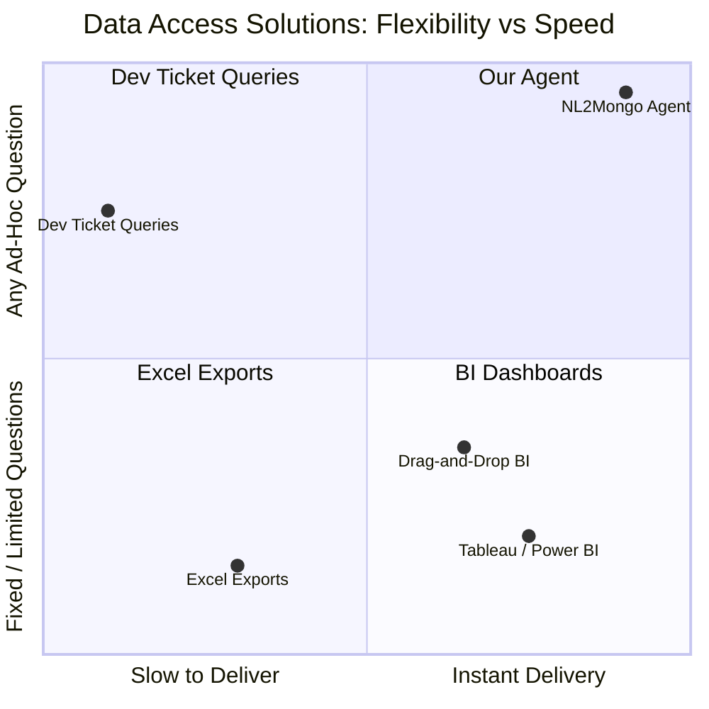
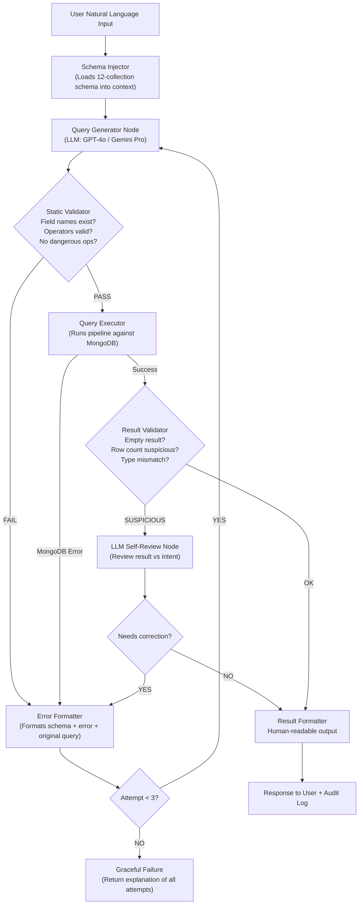
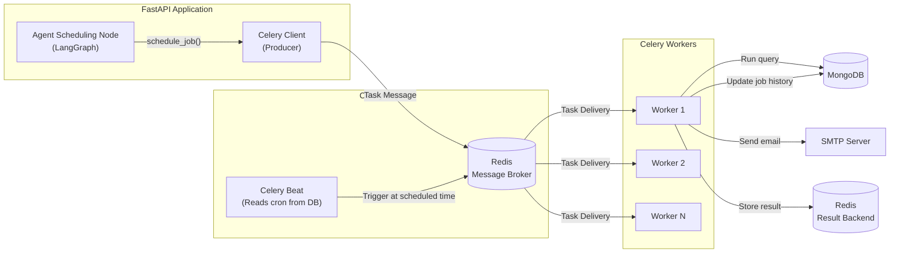
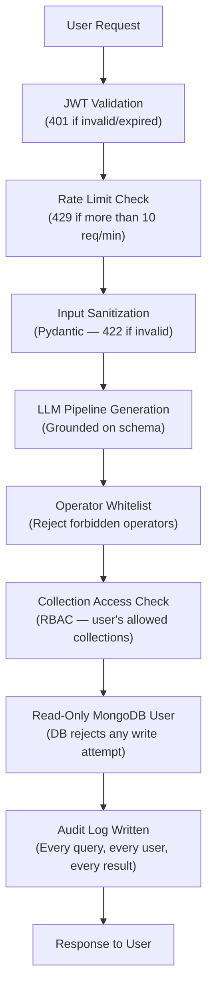
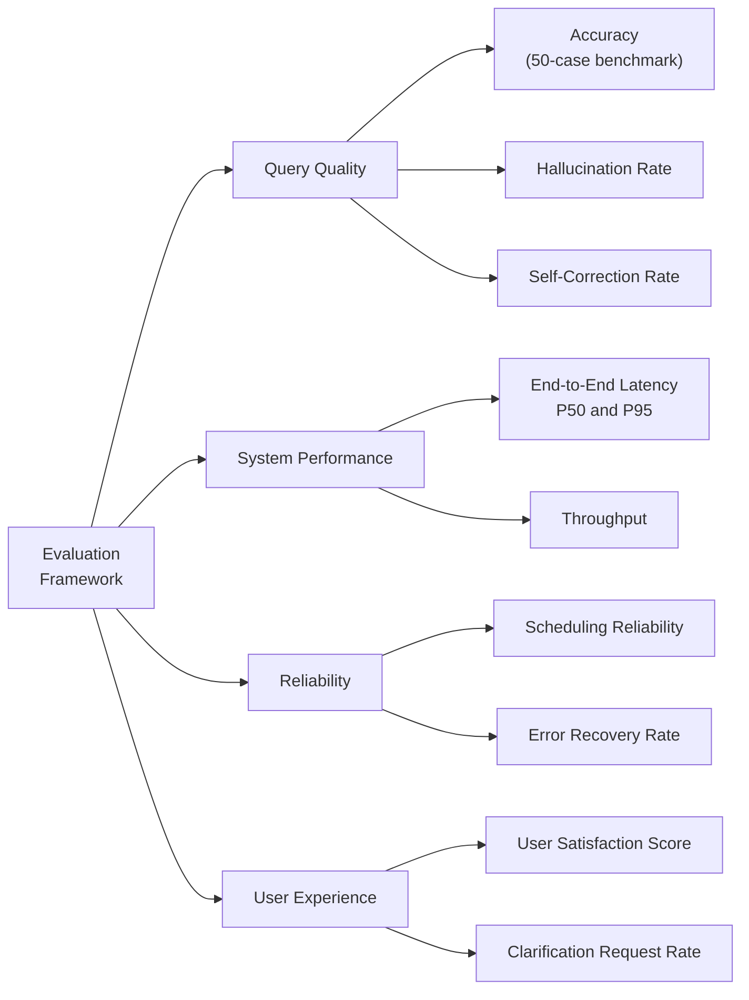

# The Problem, The Why, and The Stack — A Deep Dive

> **Project**: NL2Mongo — A Self-Correcting AI Agent for Natural Language Analytics in Fintech  
> **Mentor**: Goldman Sachs Engineer  
> **Stack**: LangGraph · FastAPI · React · MongoDB · Redis · Celery  
> **Domain**: Banking & Financial Operations

---

## Table of Contents

1. [What Problem Is the Company Actually Trying to Solve?](#1-what-problem-is-the-company-actually-trying-to-solve)
2. [How This Differs From Traditional Approaches](#2-how-this-differs-from-traditional-approaches)
3. [Why This Is Technically Difficult](#3-why-this-is-technically-difficult)
4. [How the Agent Self-Corrects](#4-how-the-agent-self-corrects-detailed)
5. [Why LangGraph](#5-why-langgraph-not-just-langchain-or-a-simple-loop)
6. [Why FastAPI](#6-why-fastapi-not-flask-django-or-express)
7. [Why MongoDB](#7-why-mongodb-not-postgresql-or-mysql)
8. [Why Celery + Redis](#8-why-celery--redis-not-cron-or-apscheduler-alone)
9. [Scheduling — Complete End-to-End Example](#9-scheduling--complete-end-to-end-example)
10. [Failure Cases and How the System Handles Them](#10-failure-cases-and-how-the-system-handles-them)
11. [Security Design](#11-security-design)
12. [Evaluation Measures](#12-evaluation-measures)

---

## 1. What Problem Is the Company Actually Trying to Solve?

### 1.1 The Operational Reality Inside a Bank

Banks and financial institutions are data-rich organisations. Every millisecond, transactions are recorded, risk events are flagged, account balances change, KYC statuses are updated, and loan repayments land in the system. The raw material for every business decision — who is a risky customer, which accounts are under-funded, which merchants have unusual activity — lives inside the database.

But here is the cruel irony: **the people who most need that data cannot access it**.

Operations teams, risk officers, compliance analysts, and business leads are domain experts. They understand the business intimately. What they do not understand is MongoDB aggregation pipelines. And so every data request — no matter how urgent, no matter how simple it sounds in English — must be converted into a formal engineering ticket and handed off to a developer or data engineer.

### 1.2 The Data Bottleneck: 1 Engineer Serving 20+ Analysts

In a typical mid-size fintech or neo-bank operations setup:

| Role | Count | What They Need |
|---|---|---|
| Data Engineers / Analysts | 1–2 | Writes and executes queries |
| Business Analysts | 15–25 | Needs query results to do their job |
| Risk Officers | 3–5 | Needs real-time risk data |
| Compliance Officers | 2–4 | Needs audit trails and transaction summaries |
| Product Managers | 4–8 | Needs KPI snapshots and funnel metrics |

A **single data engineer** is responsible for translating all incoming business questions into database queries. The queue of outstanding requests routinely stretches to dozens. Each ticket requires:

- Understanding the business context (which means a meeting or Slack thread)
- Writing the query
- Testing it against the correct dataset
- Communicating results back
- Iterating if the analyst's question changed

This is not an edge case. This is the day-to-day reality at hundreds of financial institutions worldwide.

### 1.3 Error-Prone: When Developers Misunderstand Business Questions

Business language and database logic do not always map cleanly. Consider these translations:

| Business Says | Developer Might Query | What Was Actually Meant |
|---|---|---|
| "recent transactions" | Last 30 days | Last 7 days (since last weekly report) |
| "failed transactions" | `status: "failed"` | `status: "failed"` OR `status: "declined"` OR `status: "reversed"` |
| "large transactions" | amount > $10,000 | amount > $5,000 (internal threshold) |
| "active customers" | `is_active: true` | Customers with at least 1 transaction in the past 90 days |
| "high-risk accounts" | `risk_score > 80` | `risk_score > 80` AND `kyc_status != "verified"` |

Each mistranslation means the analyst receives wrong data, makes a decision based on it, and potentially discovers the error only later — sometimes after reporting it to a regulator.

### 1.4 Audit Nightmare: Queries Run Ad-Hoc With No Logging

When a developer runs a query to answer a business question, they typically do so from:

- MongoDB Compass (a GUI)
- A Jupyter notebook
- A quick `mongosh` session in the terminal

None of these are logged in any business-readable way. This creates a series of serious problems:

- **Regulatory audits**: When a regulator asks "who ran what query on customer financial data on March 14th and why?" — the answer is often "we don't know"
- **Data lineage**: If a decision was made based on a query, there is no record linking the decision to the data that informed it
- **Reproducibility**: If an analyst asks the same question six months later, there is no way to know what query was run the first time
- **Security**: If a malicious insider exfiltrates data via a query, there may be no forensic trail

### 1.5 Missed Business Opportunities: The Window Closes

In financial services, timing is everything.

> **Scenario**: The risk team wants to proactively contact customers who have shown three or more failed payment attempts in the last 48 hours — before they default or churn. This is a retention and risk-mitigation opportunity.

Here is what happens under the current model:

```
Day 0, 10:00 AM  — Risk officer identifies the need and files a Jira ticket
Day 0, 10:15 AM  — Ticket is triaged, assigned to data engineer (already has 8 tickets)
Day 1, 02:00 PM  — Data engineer reads the ticket; emails to clarify "failed" definition
Day 1, 04:00 PM  — Risk officer replies with clarification
Day 2, 09:00 AM  — Data engineer writes and tests the query
Day 2, 11:00 AM  — Results are sent back via email as a CSV file
```

**Total wait: 2 business days.** The 48-hour window the risk officer was targeting has long since passed. The customer has either defaulted or churned. The intervention opportunity is gone.

### 1.6 The Real Example: A Risk Officer's Simple Question

Here is the exact query a risk officer at a bank might ask:

> *"Show me all customers who have had 3 or more failed transactions in the last 7 days, grouped by their account tier."*

In plain English, this is one sentence. In MongoDB, this becomes:

```javascript
db.transactions.aggregate([
  {
    $match: {
      status: { $in: ["failed", "declined"] },
      created_at: {
        $gte: new Date(new Date() - 7 * 24 * 60 * 60 * 1000)
      }
    }
  },
  {
    $group: {
      _id: "$customer_id",
      failed_count: { $sum: 1 }
    }
  },
  {
    $match: {
      failed_count: { $gte: 3 }
    }
  },
  {
    $lookup: {
      from: "customers",
      localField: "_id",
      foreignField: "_id",
      as: "customer_info"
    }
  },
  {
    $unwind: "$customer_info"
  },
  {
    $group: {
      _id: "$customer_info.account_tier",
      customer_count: { $sum: 1 },
      avg_failed_transactions: { $avg: "$failed_count" }
    }
  },
  {
    $sort: { customer_count: -1 }
  }
])
```

A risk officer cannot write this. A developer can, but it takes time. **This project makes the risk officer self-sufficient — instantly.**

---

## 2. How This Differs From Traditional Approaches

### 2.1 The Landscape of Existing Solutions



### 2.2 Traditional: Tableau / Power BI Dashboards

**How it works**: A BI developer builds a dashboard with pre-defined charts and filters. Business users interact with the dashboard via dropdown menus and date pickers.

**Strengths**:
- Beautiful visualisations
- Familiar to business users
- Fast for the pre-built questions

**Critical Weakness — Fixed Views**:

A dashboard can only answer questions it was designed to answer. If a risk officer wants to see "customers with 3+ failed transactions grouped by account tier", someone must have already built that exact chart. If they want "customers with 3+ failed transactions grouped by merchant category this week vs last week" — that is a new dashboard. Another ticket. Another sprint.

> [!WARNING]
> Every new business question that a dashboard cannot answer requires a developer to manually build a new view. This is not scalability — it is just slower bottlenecking.

**Cost**: Tableau licensing alone can run $70–$840 per user per year. Building and maintaining dashboards requires dedicated BI developers. Questions that fall outside the dashboard scope still require a dev ticket.

### 2.3 Traditional: Excel Exports

**How it works**: A developer runs a query and exports results to an Excel file, which is emailed to the business analyst.

**Problems**:
- **Stale data**: By the time the file arrives, the data is already outdated
- **No repeatability**: If the analyst wants the same report next week, another ticket is needed
- **Version confusion**: "Which version of the file is correct? analyst_data_v3_FINAL_revised2.xlsx?"
- **No scheduling**: Cannot be automated without significant additional tooling
- **No audit trail**: Who ran the query, when, and with what parameters — all lost

### 2.4 Traditional: Dev Ticket-Based Queries

**How it works**: Business user writes a Jira/Confluence ticket describing their data need. A developer reads it, interprets it, writes a query, and returns results.

**Problems**:
- **Bottleneck**: One developer serves dozens of requesters
- **Latency**: Average 2–3 day turnaround
- **Interpretation errors**: High rate of misunderstanding (see Section 1.3)
- **Not scalable**: Every new data need adds to the developer's backlog
- **Blocks engineering**: A senior engineer's time spent running ad-hoc queries is time not spent building product features

### 2.5 Traditional: Drag-and-Drop BI Tools (Metabase, Looker)

Tools like Metabase attempt to democratise data access via a visual query builder.

**Problems**:
- Still requires understanding of the data model (which tables/collections exist, what fields mean)
- Cannot answer questions involving complex multi-step logic (e.g., "customers who did X in period A but not in period B")
- Natural language question interfaces (like Metabase AI) still struggle with domain-specific fintech schemas
- Still requires setup by a data team to connect and define the schema

### 2.6 Our Approach: The Agent

| Dimension | Traditional Approach | NL2Mongo Agent |
|---|---|---|
| **Input** | Jira ticket, SQL, dashboard filter | One English sentence |
| **Time to answer** | Hours to days | Seconds |
| **Schema knowledge** | Developer must know schema | Agent infers from schema document |
| **Ad-hoc capable** | Rarely, requires dev work | Always, by design |
| **Scheduling** | Manual cron setup by DevOps | Agent registers job from user sentence |
| **Audit trail** | None or informal | Automatic — every query logged |
| **Error handling** | Developer debugs manually | Agent self-corrects iteratively |
| **Hallucination risk** | Developer knows field names | Agent validates against schema |
| **Access control** | Per-environment permissions | Per-role collection whitelist |

---

## 3. Why This Is Technically Difficult

### 3.1 MongoDB Has No Fixed Schema

Unlike PostgreSQL, where the schema is a rigid contract enforced by the database engine itself, MongoDB is schemaless by design. This means:

- Documents in the same collection can have different fields
- A `customers` document for one customer might have `kyc_level`, another might not
- Array fields can contain embedded documents of varying shape
- Field types can vary: `amount` might be `NumberDecimal` in some documents and `Double` in others

```javascript
// Document 1 in customers collection
{
  "_id": ObjectId("..."),
  "name": "Priya Sharma",
  "email": "priya@example.com",
  "account_tier": "premium",
  "kyc_level": 3,
  "risk_score": 72,
  "linked_accounts": ["acc_001", "acc_002"]
}

// Document 2 in same customers collection — different shape
{
  "_id": ObjectId("..."),
  "name": "Rahul Mehta",
  "email": "rahul@example.com",
  // NO account_tier field
  // NO kyc_level field
  "risk_score": 45,
  "linked_accounts": []
}
```

The agent must operate on a **schema document** — a manually curated or auto-inferred description of what fields typically exist. If a field exists in 60% of documents, the agent's query must handle the case where it is absent.

### 3.2 Aggregation Pipelines Are Complex and Non-Obvious

A MongoDB aggregation pipeline is a sequence of stages. Each stage transforms the data and passes it to the next. The stages themselves can be deeply nested:

```javascript
// A realistic pipeline the agent must generate
[
  { $match: { "transactions.status": "failed" } },          // Filter
  { $unwind: "$transactions" },                              // Flatten arrays
  { $match: { "transactions.created_at": { $gte: "..." } } }, // Filter again after unwind
  { $group: { _id: "$customer_id", total: { $sum: 1 } } },  // Aggregate
  { $lookup: { from: "customers", ... } },                   // JOIN
  { $unwind: "$customer_data" },                             // Flatten joined data
  { $project: { name: 1, email: 1, total: 1 } },            // Select fields
  { $sort: { total: -1 } },                                  // Sort
  { $limit: 100 }                                            // Limit
]
```

The order of stages matters. `$match` before `$unwind` is dramatically more efficient. `$lookup` on large collections without proper indexes causes full collection scans. Generating an *efficient* pipeline — not just a *correct* one — is an additional layer of difficulty.

### 3.3 Ambiguous Natural Language

Human language is inherently imprecise. Consider:

| User Says | Possible Interpretations |
|---|---|
| "recent transactions" | Last 24h? Last 7 days? Last 30 days? Since last login? |
| "large transactions" | > $1,000? > $10,000? > 3x account average? Regulatory threshold ($5,000)? |
| "active customers" | Logged in recently? Had a transaction recently? Account not suspended? |
| "failed payments" | `status: "failed"` only? Include `"declined"`, `"reversed"`, `"cancelled"`? |
| "top merchants" | By transaction count? By total volume? By unique customers? |
| "suspicious activity" | High amounts? Unusual hours? Geolocation anomalies? Velocity spikes? |

The agent must either:
1. Make a **reasonable assumption** (and state it clearly in the response)
2. Ask a **clarification question** before generating the query
3. Generate **multiple queries** for each interpretation and present options

Our system uses option 1 with explicit assumption logging — the agent tells the user exactly what it assumed so they can correct it.

### 3.4 Multiple Valid Query Interpretations

Sometimes there is no single correct query. Consider:

> *"Which customers have the most transactions?"*

**Interpretation A**: Most transactions by count (any status)  
**Interpretation B**: Most successful transactions (excluding failed)  
**Interpretation C**: Most transactions by monetary value  
**Interpretation D**: Most transactions in the last 30 days (vs all time)

All four are valid. The agent must pick one and be transparent about it, or surface the ambiguity to the user.

### 3.5 LLMs Hallucinate Field Names and Operators

Large Language Models are trained on general text, not your specific database schema. Without careful grounding, an LLM will confidently generate:

```javascript
// Hallucinated — these fields do not exist in the schema
{ $match: { "user_profile.credit_tier": "gold" } }
// Actual field name is: customer.account_tier

{ $group: { _id: "$merchant_id", total: { $count: {} } } }
// $count is not a valid accumulator inside $group — should be { $sum: 1 }
```

This is not the LLM "being wrong" — it is doing its best with incomplete context. The solution is to:
1. Always inject the full schema into the LLM's context window
2. Run static validation after generation to catch hallucinated field names
3. Feed validation errors back to the LLM with explicit correction instructions

### 3.6 Result Validation Without Ground Truth

How do you know an answer is correct when there is no pre-existing "right answer" to compare against? This is perhaps the deepest technical challenge.

Validation strategies used in this system:

| Strategy | Description | Detects |
|---|---|---|
| **Static schema validation** | Do all referenced fields exist in the schema? | Hallucinated field names |
| **Operator whitelist** | Are all used operators in the approved list? | Invalid/dangerous operators |
| **Row count sanity check** | Is the result count plausible for the query? | Catastrophically wrong logic |
| **Empty result check** | For queries with filters, is empty result expected? | Over-restrictive conditions |
| **Type consistency check** | Are returned field types consistent with schema? | Type mismatches |
| **LLM self-review** | Does the generated query match the stated intent? | Logical errors |

### 3.7 Scheduling Adds State Management Complexity

A query that runs once is relatively simple. A query that runs every Monday at 9 AM — across server restarts, crashes, and deployments — requires persistent state management, distributed job coordination, failure handling, retry logic, and notification plumbing.

This is why Celery + Redis is in the stack (see Section 8).

---

## 4. How the Agent Self-Corrects — Detailed

The self-correction loop is the most critical feature of the system. It is what separates this from a simple "LLM generates MongoDB query" demo.

### 4.1 Architecture Overview



### 4.2 Step-by-Step Walkthrough

#### Step 1: Query Generator — First Attempt

The LLM receives a carefully constructed prompt that includes:

```
SYSTEM: You are a MongoDB aggregation pipeline expert for a fintech database.
You have access to the following schema (12 collections):

SCHEMA:
  customers: { _id, name, email, phone, account_tier, risk_score, kyc_status,
                created_at, linked_accounts[], is_active }
  transactions: { _id, customer_id, merchant_id, amount, currency, status,
                   type, channel, created_at, metadata{} }
  accounts: { _id, customer_id, balance, currency, account_type,
               opened_at, is_frozen }
  ... (remaining 9 collections)

RULES:
  - Only use fields that exist in the schema above
  - Do not use $where, $eval, $function, or $accumulator
  - Always add { $limit: 10000 } as the final stage unless user asks for all results
  - For date comparisons, use ISODate format
  - State all assumptions you make about ambiguous terms

USER QUESTION: "Show me all customers with 3 or more failed transactions in the
               last 7 days, grouped by account tier"

Return ONLY a valid JSON aggregation pipeline array.
```

#### Step 2: Static Validator — Schema and Safety Checks

The static validator is a deterministic Python function (no LLM involved) that checks:

```python
class StaticValidator:
    FORBIDDEN_OPERATORS = {"$where", "$eval", "$function", "$accumulator"}

    def validate(self, pipeline: list, schema: dict) -> ValidationResult:
        errors = []

        # Check 1: Forbidden operators
        pipeline_str = json.dumps(pipeline)
        for op in self.FORBIDDEN_OPERATORS:
            if op in pipeline_str:
                errors.append(f"FORBIDDEN_OPERATOR: {op} is not permitted")

        # Check 2: Field name existence
        for stage in pipeline:
            referenced_fields = self._extract_field_refs(stage)
            for field in referenced_fields:
                collection, dot_path = self._resolve_field(field)
                if not self._field_exists_in_schema(collection, dot_path, schema):
                    errors.append(
                        f"UNKNOWN_FIELD: '{field}' not found in schema. "
                        f"Similar fields: {self._suggest_similar(field, schema)}"
                    )

        # Check 3: Stage order sanity
        if self._has_unwind_before_match(pipeline):
            errors.append(
                "INEFFICIENCY: $match should come before $unwind for performance"
            )

        # Check 4: Missing $limit
        if not self._has_limit_stage(pipeline):
            errors.append(
                "MISSING_LIMIT: No $limit stage found — could return unbounded results"
            )

        return ValidationResult(valid=len(errors) == 0, errors=errors)
```

**Example validator output** for a hallucinated field:

```json
{
  "valid": false,
  "errors": [
    "UNKNOWN_FIELD: 'transactions.payment_status' not found in schema. Similar fields: ['transactions.status', 'transactions.type']",
    "UNKNOWN_FIELD: 'customers.credit_tier' not found in schema. Similar fields: ['customers.account_tier', 'customers.risk_score']"
  ]
}
```

#### Step 3: Correction Prompt — Feeding Error Back to LLM

If the static validator fails, the agent constructs a correction prompt:

```
SYSTEM: You previously generated a MongoDB pipeline that failed validation.

ORIGINAL QUESTION: "Show me all customers with 3+ failed transactions in last 7 days"

YOUR PREVIOUS ATTEMPT (Attempt 1):
[
  { "$match": { "payment_status": "failed" } },  ← WRONG FIELD
  ...
]

VALIDATION ERRORS:
- UNKNOWN_FIELD: 'payment_status' not found in schema.
  The correct field is 'status'. Valid values: ["pending", "completed", "failed", "declined"]

SCHEMA REMINDER:
  transactions: { _id, customer_id, amount, status, created_at, ... }

Please generate a corrected pipeline. Use ONLY fields listed in the schema.
```

#### Step 4: Execution — Running Against MongoDB

If static validation passes, the pipeline executes:

```python
async def execute_pipeline(
    collection: str,
    pipeline: list,
    timeout_ms: int = 30000
) -> ExecutionResult:
    try:
        cursor = db[collection].aggregate(
            pipeline,
            maxTimeMS=timeout_ms,
            allowDiskUse=True
        )
        results = await cursor.to_list(length=10000)

        return ExecutionResult(
            success=True,
            data=results,
            count=len(results),
            truncated=len(results) == 10000
        )

    except OperationFailure as e:
        # MongoDB-level error (bad operator usage, index timeout, etc.)
        return ExecutionResult(success=False, mongo_error=str(e))

    except ExecutionTimeout:
        return ExecutionResult(
            success=False,
            error="Query timed out after 30 seconds. "
                  "Consider adding more specific filters."
        )
```

If MongoDB throws an error (e.g., wrong operator used in wrong context), that error message is fed back to the LLM for the next correction attempt.

#### Step 5: Empty Result Check

An empty result is not always wrong, but it needs to be examined:

```python
def check_empty_result(result: list, pipeline: list, intent: str) -> EmptyResultAnalysis:
    if len(result) > 0:
        return EmptyResultAnalysis(suspicious=False)

    prompt = f"""
    A MongoDB query returned 0 results. Is this expected or does it suggest
    an error in the query logic?

    User's intent: {intent}
    Pipeline: {json.dumps(pipeline, indent=2)}

    Consider:
    1. Are the filter conditions too restrictive?
    2. Are date ranges correctly calculated?
    3. Are status values correctly spelled?
    4. Is the logic correct for the business intent?

    Respond with: EXPECTED or INVESTIGATE, followed by reasoning.
    """

    response = llm.invoke(prompt)
    return parse_empty_result_response(response)
```

#### Step 6: Suspicious Result Check

If a query for "a specific customer" returns 500,000 rows, something is wrong:

```python
SUSPICION_RULES = [
    # If query has a customer_id filter, result should not be massive
    {"condition": "has_customer_id_filter", "max_expected_rows": 1000},
    # If query groups by customer, result count should not exceed customer collection size
    {"condition": "groups_by_customer_id", "max_expected_rows": "customers_collection_count"},
    # If query has very specific date range (< 1 day), limit expectations
    {"condition": "date_range_lt_1_day", "max_expected_rows": 5000},
]
```

#### Step 7: Maximum Correction Cycles and Graceful Failure

After 3 failed correction attempts, the agent gives up gracefully:

```json
{
  "success": false,
  "message": "I was unable to generate a correct query after 3 attempts.",
  "attempts": [
    {
      "attempt": 1,
      "pipeline": ["..."],
      "error": "UNKNOWN_FIELD: 'payment_status'"
    },
    {
      "attempt": 2,
      "pipeline": ["..."],
      "error": "MongoDB OperationFailure: $group accumulator '$count' requires no argument"
    },
    {
      "attempt": 3,
      "pipeline": ["..."],
      "error": "Empty result — likely too restrictive date filter"
    }
  ],
  "suggestion": "Please rephrase your question or provide more specific field names. The field for transaction outcome is 'status' with values: failed, declined, completed, pending."
}
```

#### Step 8: Audit Logging

Every attempt — success or failure — is logged in `query_history`:

```javascript
{
  "_id": ObjectId("..."),
  "session_id": "sess_abc123",
  "user_id": "usr_riskteam_01",
  "original_question": "Show me all customers with 3+ failed transactions in last 7 days",
  "final_pipeline": ["..."],
  "attempts": [
    { "attempt_number": 1, "pipeline": ["..."], "error": "UNKNOWN_FIELD: payment_status" },
    { "attempt_number": 2, "pipeline": ["..."], "result_count": 847, "success": true }
  ],
  "total_attempts": 2,
  "execution_time_ms": 1243,
  "result_count": 847,
  "result_truncated": false,
  "assumptions_made": [
    "'failed transactions' interpreted as status IN ['failed', 'declined']",
    "'last 7 days' interpreted as the 168 hours preceding query execution"
  ],
  "status": "success",
  "created_at": "2026-09-03T13:28:00Z"
}
```

---

## 5. Why LangGraph (Not Just LangChain or a Simple Loop)

### 5.1 What Is LangGraph?

LangGraph is a framework built on top of LangChain that enables the construction of **stateful, multi-actor computation graphs** where nodes are functions (or LLM calls) and edges define the flow of control — including **conditional branching** and **cycles**.

### 5.2 The Problem With a Simple Loop

A naive implementation might look like this:

```python
# Simple loop — NOT what we use
for attempt in range(3):
    pipeline = llm.generate_query(question, schema)
    errors = validate(pipeline)
    if not errors:
        result = execute(pipeline)
        break
```

This has serious problems:
- **No typed state**: State (the question, past attempts, errors) is managed by ad-hoc variables
- **No streaming**: The loop blocks — the frontend sees nothing until it's done
- **No branching**: Every failure goes through the same path, regardless of the *type* of failure
- **No observability**: There is no record of the computation graph — it is a black box
- **No checkpointing**: If the server crashes mid-loop, all state is lost

### 5.3 The LangGraph Solution: Typed State + Graph

```python
from langgraph.graph import StateGraph, END
from typing import TypedDict, List, Optional, Annotated
import operator

class AgentState(TypedDict):
    """Fully typed state that persists across all nodes in the graph."""
    question: str
    schema: dict
    current_pipeline: Optional[list]
    validation_errors: List[str]
    mongo_error: Optional[str]
    result: Optional[list]
    result_suspicious: bool
    attempt_count: int
    all_attempts: Annotated[List[dict], operator.add]  # Accumulates across nodes
    assumptions: List[str]
    final_answer: Optional[str]

# Build the graph
workflow = StateGraph(AgentState)

# Add nodes
workflow.add_node("schema_injector", schema_injector_node)
workflow.add_node("query_generator", query_generator_node)
workflow.add_node("static_validator", static_validator_node)
workflow.add_node("query_executor", query_executor_node)
workflow.add_node("result_validator", result_validator_node)
workflow.add_node("corrector", corrector_node)
workflow.add_node("formatter", formatter_node)

# Add edges with conditional routing
workflow.add_conditional_edges(
    "static_validator",
    route_after_validation,
    {
        "corrector": "corrector",
        "query_executor": "query_executor"
    }
)

workflow.add_conditional_edges(
    "query_executor",
    route_after_execution,
    {
        "corrector": "corrector",
        "result_validator": "result_validator"
    }
)

workflow.add_conditional_edges(
    "corrector",
    route_after_correction,
    {
        "query_generator": "query_generator",
        "end": END
    }
)
```

### 5.4 Concrete Advantages of LangGraph

| Feature | Simple Loop | LangChain Chain | LangGraph |
|---|---|---|---|
| **Typed state** | Ad-hoc variables | Dict-based | TypedDict schema |
| **Conditional branching** | Manual if/else | Not supported | First-class edges |
| **Cycles / retry loops** | Manual, fragile | Not supported | First-class |
| **Streaming output** | Blocked | Limited | Node-by-node streaming |
| **State memory across nodes** | Manual passing | Input/output only | Full state object |
| **Observability / tracing** | None | Callback-based | LangSmith native |
| **Checkpointing** | None | None | Built-in (SQLite/Redis) |
| **Parallelism** | Sequential | Sequential | Parallel node execution |

### 5.5 State Visibility in the Corrector Node

Because the entire `AgentState` is passed to every node, the corrector node sees:

```python
def corrector_node(state: AgentState) -> AgentState:
    # The corrector has FULL HISTORY of everything that happened
    correction_prompt = f"""
    Original question: {state['question']}
    Attempt {state['attempt_count']} of 3

    All previous attempts and their errors:
    {json.dumps(state['all_attempts'], indent=2)}

    Most recent error: {state['validation_errors'] or state['mongo_error']}

    Schema: {json.dumps(state['schema'], indent=2)}

    Generate a corrected pipeline that avoids ALL of the above errors.
    """

    return {
        "attempt_count": state["attempt_count"] + 1,
        "current_pipeline": None,
        "validation_errors": [],
        "mongo_error": None
    }
```

### 5.6 Streaming — Real-Time Frontend Updates

LangGraph supports streaming node-by-node updates to the frontend via WebSocket:

```python
@app.websocket("/ws/agent/{session_id}")
async def agent_stream(websocket: WebSocket, session_id: str):
    await manager.connect(websocket, session_id)
    try:
        data = await websocket.receive_json()
        async for event in graph.astream(
            {"question": data["question"], "schema": SCHEMA},
            stream_mode="updates"
        ):
            await websocket.send_json({
                "node": list(event.keys())[0],
                "status": "completed",
                "data": sanitize(event)
            })
    except WebSocketDisconnect:
        manager.disconnect(session_id)
```

The frontend then displays step-by-step progress:

```
✅ Schema loaded
⏳ Generating query...
✅ Query generated (Attempt 1)
❌ Validation failed: unknown field 'payment_status'
⏳ Correcting...
✅ Query corrected (Attempt 2)
✅ Executing query...
✅ 847 results returned
✅ Results validated
```

---

## 6. Why FastAPI (Not Flask, Django, or Express)

### 6.1 The Core Requirement: Non-Blocking Async

The agent's workflow involves multiple I/O-bound operations:

1. LLM API call (may take 2–10 seconds)
2. MongoDB aggregation (may take 0.5–5 seconds)
3. Redis/Celery job registration
4. SMTP email sending (for scheduled reports)
5. WebSocket streaming to frontend

If any of these block the server thread, every other user's request must wait. In a synchronous framework (Flask, Django), this is handled by spawning more threads — which is expensive and does not scale well.

**FastAPI is built on `asyncio` and `Starlette`**, meaning all of the above can run concurrently on a single thread:

```python
@app.post("/api/query")
async def run_query(
    request: QueryRequest,
    current_user: User = Depends(get_current_user)
):
    schema = await load_schema_from_cache()
    pipeline = await generate_pipeline(request.question, schema)
    result = await execute_pipeline(pipeline)
    await log_to_audit(current_user, request, result)

    return QueryResponse(data=result, metadata=build_metadata(result))
```

### 6.2 Built-in WebSocket Support

LangGraph's streaming output needs to reach the React frontend in real time. FastAPI has native WebSocket support — no additional library required:

```python
@app.websocket("/ws/query")
async def query_websocket(websocket: WebSocket):
    await websocket.accept()
    data = await websocket.receive_json()

    async for event in graph.astream(
        {"question": data["question"], "schema": SCHEMA},
        stream_mode="updates"
    ):
        await websocket.send_json({
            "node": list(event.keys())[0],
            "status": "completed",
            "data": sanitize(event)
        })
```

### 6.3 Pydantic Integration — Automatic Validation

Every request and response is automatically validated:

```python
from pydantic import BaseModel, Field, validator
from typing import Optional

class QueryRequest(BaseModel):
    question: str = Field(..., min_length=5, max_length=2000)
    collection_hint: Optional[str] = None
    max_results: int = Field(default=1000, le=10000)

    @validator('question')
    def sanitize_question(cls, v):
        if any(op in v for op in ['$where', '$eval', 'db.', 'system.']):
            raise ValueError("Question contains disallowed content")
        return v.strip()

class QueryResponse(BaseModel):
    success: bool
    data: list
    count: int
    truncated: bool
    assumptions: list[str]
    execution_time_ms: int
    attempts_required: int
```

FastAPI will automatically return a **422 Unprocessable Entity** with field-level error details if the request does not match the schema — before any LLM or database call is made.

### 6.4 Auto-Generated OpenAPI Documentation

FastAPI automatically generates interactive API documentation at `/docs` (Swagger UI) and `/redoc`. Every endpoint, request body, and response schema is documented without any extra effort.

For a capstone project mentored by a Goldman Sachs engineer, this is a significant advantage — the API is self-documenting and immediately explorable by any team member.

### 6.5 Performance Comparison

| Framework | Requests/sec (async I/O bound) | WebSocket | Pydantic | Auto-docs |
|---|---|---|---|---|
| **Flask** | ~500–800 | Needs Flask-SocketIO | Manual | Manual |
| **Django** | ~200–400 | Django Channels needed | DRF serializers | drf-spectacular |
| **Express.js** | ~3,000–5,000 | ws library | Joi/Yup manual | swagger-jsdoc |
| **FastAPI** | ~5,000–10,000 | Built-in | Native | Automatic |

> [!TIP]
> FastAPI's async performance is particularly critical here because LLM API calls (to OpenAI/Gemini) can take 3–8 seconds. In a synchronous framework, those 8 seconds would block all other users. In FastAPI, they are simply awaited while other requests are served concurrently.

---

## 7. Why MongoDB (Not PostgreSQL or MySQL)

### 7.1 The Fintech Schema Reality

Real enterprise fintech data does not fit neatly into rigid relational tables. Consider the `transactions` collection:

```javascript
// A basic debit card transaction
{
  "_id": ObjectId("..."),
  "type": "card_payment",
  "amount": 1250.00,
  "currency": "INR",
  "status": "completed",
  "customer_id": ObjectId("..."),
  "merchant": {
    "id": "merch_001",
    "name": "Zomato",
    "category": "food_delivery",
    "mcc_code": 5812
  },
  "created_at": "2026-09-03T07:15:00Z"
}

// A UPI transfer (different shape — no merchant)
{
  "_id": ObjectId("..."),
  "type": "upi_transfer",
  "amount": 50000.00,
  "currency": "INR",
  "status": "completed",
  "customer_id": ObjectId("..."),
  "upi_metadata": {
    "vpa": "recipient@okaxis",
    "reference_id": "ref_xyz789",
    "remarks": "Rent payment"
  },
  "created_at": "2026-09-03T09:00:00Z"
}

// A loan disbursement (completely different shape)
{
  "_id": ObjectId("..."),
  "type": "loan_disbursement",
  "amount": 500000.00,
  "currency": "INR",
  "status": "completed",
  "customer_id": ObjectId("..."),
  "loan_metadata": {
    "loan_id": "loan_abc123",
    "disbursement_account": "acc_saving_001",
    "interest_rate": 12.5,
    "tenure_months": 36
  },
  "created_at": "2026-09-03T11:00:00Z"
}
```

In PostgreSQL, storing these three transaction types would require either:
- A **single wide table** with many nullable columns (messy, wastes storage)
- **Multiple tables** with a polymorphic join pattern (complex queries, many JOINs)
- **JSONB columns** (which then loses type safety and query performance)

MongoDB stores all three naturally in the same collection.

### 7.2 Aggregation Pipeline Is LLM-Friendly

MongoDB aggregation pipelines are expressed as **JSON arrays**. LLMs are extremely good at generating JSON. SQL, by contrast, is a string language with complex syntax rules that LLMs struggle with for multi-table joins.

| Dimension | MongoDB Aggregation | SQL |
|---|---|---|
| **Format** | JSON array (LLM-native) | String language (syntax-sensitive) |
| **JOIN complexity** | `$lookup` is declarative | `JOIN ... ON` with aliases, subqueries |
| **Nested data** | `$unwind` handles arrays naturally | Requires UNNEST or lateral joins |
| **Intermediate state** | Each stage is explicit and readable | Subqueries/CTEs can be opaque |
| **LLM hallucination risk** | Lower (JSON schema is constraining) | Higher (SQL syntax is flexible/ambiguous) |

```javascript
// MongoDB — LLM generates clean JSON
[
  { "$match": { "status": "failed" } },
  { "$group": { "_id": "$customer_id", "count": { "$sum": 1 } } },
  { "$match": { "count": { "$gte": 3 } } }
]
```

```sql
-- SQL equivalent — more syntax for LLM to get wrong
SELECT customer_id, COUNT(*) as count
FROM transactions
WHERE status = 'failed'
GROUP BY customer_id
HAVING COUNT(*) >= 3;
```

While the SQL looks simpler in this example, for queries with multiple lookups across the 12-collection schema, MongoDB pipelines are more structured and less prone to LLM syntactic errors.

### 7.3 Horizontal Scalability

With 500,000+ documents per collection and potentially dozens of users running concurrent aggregations:

- **MongoDB** scales horizontally via sharding — data is partitioned across multiple servers
- **PostgreSQL** scales primarily vertically — adding more RAM/CPU to one server
- **MongoDB Atlas** (our hosting choice) provides auto-scaling, serverless tiers, and built-in monitoring

### 7.4 MongoDB Atlas — Cloud Hosting Benefits

| Feature | Benefit to This Project |
|---|---|
| Free M0 tier | Zero cost for development and demo |
| Built-in Performance Advisor | Suggests indexes for slow queries |
| Data Explorer GUI | Verify agent-generated queries visually |
| Atlas Charts | Quick visualisation of query results |
| Built-in monitoring | Track query performance over time |
| Connection pooling | Handles concurrent agent requests |

---

## 8. Why Celery + Redis (Not Cron or APScheduler Alone)

### 8.1 The Problem With Simple Alternatives

#### Python `schedule` library or bare `cron`

```python
# schedule library — runs inside the application process
import schedule

schedule.every().monday.at("09:00").do(run_risk_report)

while True:
    schedule.run_pending()
    time.sleep(1)
```

**Critical flaw**: This is an **in-process scheduler**. If the FastAPI server restarts (deployment, crash, memory error), all scheduled jobs are gone. There is no persistent state.

#### APScheduler (standalone)

APScheduler with a database store (SQLAlchemy) is better — jobs persist. But:
- Still runs inside the application process — a single point of failure
- Cannot distribute work across multiple worker processes
- No built-in retry logic for failed jobs
- No native support for priority queues or rate limiting

### 8.2 Celery + Redis Architecture



### 8.3 Why Redis as the Broker

- **Speed**: Redis is an in-memory data structure store — message enqueue/dequeue is sub-millisecond
- **Reliability**: Redis persistence (AOF/RDB) means messages survive broker restarts
- **Already in stack**: Redis serves double duty — also used for caching LLM responses and rate limiting
- **Celery-native**: Celery is designed to work with Redis with minimal configuration

### 8.4 Why Celery Beat for Scheduling

Celery Beat is a **dedicated process** (separate from workers) that reads cron schedules from a persistent store and enqueues tasks at the right time.

```python
# celery_app.py
from celery import Celery

app = Celery(
    "nl2mongo",
    broker="redis://localhost:6379/0",
    backend="redis://localhost:6379/1"
)

app.conf.update(
    task_serializer="json",
    result_serializer="json",
    accept_content=["json"],
    timezone="Asia/Kolkata",
    enable_utc=True,
    task_acks_late=True,           # Ack only after successful execution
    task_reject_on_worker_lost=True,   # Re-queue if worker dies
    worker_prefetch_multiplier=1,  # One task at a time per worker
)
```

### 8.5 Comparative Analysis

| Feature | `schedule` lib | APScheduler | Celery + Redis |
|---|---|---|---|
| **Job persistence across restarts** | No | Yes (with DB store) | Yes |
| **Distributed workers** | No | No | Yes |
| **Auto-retry on failure** | No | Manual | Built-in |
| **Priority queues** | No | No | Yes |
| **Job result storage** | No | Manual | Yes (result backend) |
| **Horizontal scaling** | No | No | Yes |
| **Monitoring (Flower)** | No | No | Yes |
| **Dead letter queue** | No | No | Yes |

> [!IMPORTANT]
> Celery Beat and Celery Workers are **separate processes**. Beat only schedules; workers only execute. This separation means you can scale workers independently and Beat never gets overloaded by task execution.

---

## 9. Scheduling — Complete End-to-End Example

### 9.1 The User's Request

The user types into the React frontend:

> *"Give me a weekly report every Monday 9am of all accounts with balance below 1000 dollars, and email it to riskteam@bank.com"*

### 9.2 Agent Step 1: Immediate Answer

Before setting up the schedule, the agent **runs the query immediately** so the user sees the data right now:

```javascript
// Pipeline generated for immediate execution
db.accounts.aggregate([
  { "$match": { "balance": { "$lt": 1000 }, "is_frozen": false } },
  {
    "$lookup": {
      "from": "customers",
      "localField": "customer_id",
      "foreignField": "_id",
      "as": "customer"
    }
  },
  { "$unwind": "$customer" },
  {
    "$project": {
      "account_id": "$_id",
      "customer_name": "$customer.name",
      "customer_email": "$customer.email",
      "balance": 1,
      "currency": 1,
      "account_type": 1,
      "opened_at": 1
    }
  },
  { "$sort": { "balance": 1 } },
  { "$limit": 10000 }
])
```

The result (e.g., 243 accounts) is displayed in the React table immediately.

### 9.3 Agent Step 2: Detect Scheduling Intent

The agent uses a **dedicated intent classifier** (a lightweight LLM call):

```python
def detect_scheduling_intent(question: str) -> SchedulingIntent:
    prompt = f"""
    Does this question request a recurring scheduled task?
    Question: "{question}"

    Look for: time expressions (every Monday, daily, weekly),
    notification channels (email, slack, send to), recurring language.

    Respond with JSON:
    {{
      "has_scheduling_intent": true,
      "confidence": 0.97,
      "scheduling_signals": ["every Monday", "9am", "email it to"]
    }}
    """
    return parse_scheduling_intent(llm.invoke(prompt))
```

**Output**: `has_scheduling_intent: true, confidence: 0.97`

### 9.4 Agent Step 3: Extract Schedule Parameters

**Extracted output**:

```json
{
  "cron_expression": "0 9 * * 1",
  "human_description": "Every Monday at 9:00 AM",
  "query_collection": "accounts",
  "query_pipeline": [
    { "$match": { "balance": { "$lt": 1000 }, "is_frozen": false } },
    { "$lookup": { "from": "customers", "localField": "customer_id", "foreignField": "_id", "as": "customer" } },
    { "$unwind": "$customer" },
    { "$project": { "account_id": "$_id", "customer_name": "$customer.name", "customer_email": "$customer.email", "balance": 1, "currency": 1 } },
    { "$sort": { "balance": 1 } },
    { "$limit": 10000 }
  ],
  "output_format": "email",
  "recipients": ["riskteam@bank.com"],
  "subject_template": "Weekly Low-Balance Accounts Report — {date}",
  "timezone": "UTC"
}
```

### 9.5 Agent Step 4: Create the Scheduled Job Document

```javascript
// Document inserted into scheduled_jobs collection
{
  "_id": ObjectId("66f7a2b3c4d5e6f7a8b9c0d1"),
  "job_id": "job_wkly_lowbal_001",
  "created_by": {
    "user_id": "usr_risk_officer_01",
    "username": "priya.sharma",
    "role": "risk_officer"
  },
  "original_question": "Give me a weekly report every Monday 9am of all accounts with balance below 1000 dollars, and email it to riskteam@bank.com",
  "schedule": {
    "cron_expression": "0 9 * * 1",
    "human_description": "Every Monday at 9:00 AM UTC",
    "timezone": "UTC",
    "next_run_at": "2026-09-07T09:00:00Z"
  },
  "query": {
    "collection": "accounts",
    "pipeline": [
      { "$match": { "balance": { "$lt": 1000 }, "is_frozen": false } },
      { "$lookup": { "from": "customers", "localField": "customer_id", "foreignField": "_id", "as": "customer" } },
      { "$unwind": "$customer" },
      { "$project": { "account_id": "$_id", "customer_name": "$customer.name", "customer_email": "$customer.email", "balance": 1, "currency": 1, "account_type": 1 } },
      { "$sort": { "balance": 1 } },
      { "$limit": 10000 }
    ]
  },
  "output": {
    "format": "email",
    "recipients": ["riskteam@bank.com"],
    "subject_template": "Weekly Low-Balance Accounts Report — {date}",
    "include_csv": true,
    "include_summary_stats": true
  },
  "status": "active",
  "consecutive_failures": 0,
  "run_history": [],
  "created_at": "2026-09-03T13:45:00Z",
  "updated_at": "2026-09-03T13:45:00Z"
}
```

### 9.6 Agent Step 5: Register With Celery Beat

```python
async def register_scheduled_job(job: ScheduledJob) -> str:
    cron_parts = job.schedule.cron_expression.split()

    PeriodicTask.objects.update_or_create(
        name=f"scheduled_report_{job.job_id}",
        defaults={
            "task": "tasks.run_scheduled_report",
            "crontab": CrontabSchedule.objects.get_or_create(
                minute=cron_parts[0],   # "0"
                hour=cron_parts[1],     # "9"
                day_of_week=cron_parts[4],  # "1" (Monday)
            )[0],
            "args": json.dumps([job.job_id]),
            "enabled": True,
            "description": job.schedule.human_description,
        }
    )

    return job.job_id
```

### 9.7 What Happens Every Monday at 9:00 AM

**Step A** — Celery Beat reads the cron schedule from the database, sees it is time to fire, and enqueues a task message to Redis.

**Step B** — A Celery worker picks up the message:

```python
@app.task(
    bind=True,
    max_retries=3,
    default_retry_delay=300,
    autoretry_for=(Exception,),
    retry_backoff=True,
    time_limit=300
)
def run_scheduled_report(self, job_id: str) -> dict:
    run_start = datetime.utcnow()

    # Step 1: Load job configuration from MongoDB
    job = db.scheduled_jobs.find_one({"job_id": job_id, "status": "active"})
    if not job:
        return {"status": "skipped", "reason": "job_not_found_or_inactive"}

    # Step 2: Execute the stored aggregation pipeline
    results = list(
        db[job["query"]["collection"]].aggregate(
            job["query"]["pipeline"],
            maxTimeMS=60000,
            allowDiskUse=True
        )
    )

    # Step 3: Format results as CSV
    csv_content = format_as_csv(results)

    # Step 4: Build email body with summary statistics
    summary_stats = compute_summary_stats(results)
    email_body = build_email_body(job=job, results=results,
                                   summary_stats=summary_stats, run_date=run_start)

    # Step 5: Send email via SMTP
    send_email(
        to=job["output"]["recipients"],
        subject=job["output"]["subject_template"].format(
            date=run_start.strftime("%B %d, %Y")
        ),
        body=email_body,
        attachments=[("low_balance_accounts.csv", csv_content)]
    )

    # Step 6: Update run_history in MongoDB
    run_record = {
        "run_id": f"run_{job_id}_{run_start.strftime('%Y%m%d_%H%M%S')}",
        "started_at": run_start,
        "completed_at": datetime.utcnow(),
        "status": "success",
        "result_count": len(results),
        "recipients_notified": job["output"]["recipients"]
    }

    db.scheduled_jobs.update_one(
        {"job_id": job_id},
        {
            "$push": {"run_history": {"$each": [run_record], "$slice": -50}},
            "$set": {
                "consecutive_failures": 0,
                "updated_at": datetime.utcnow(),
                "schedule.next_run_at": compute_next_run(job["schedule"]["cron_expression"])
            }
        }
    )

    return {"status": "success", "records_sent": len(results)}
```

### 9.8 The Email Output

```
FROM:    noreply@nl2mongo.bank.com
TO:      riskteam@bank.com
SUBJECT: Weekly Low-Balance Accounts Report — September 07, 2026

━━━━━━━━━━━━━━━━━━━━━━━━━━━━━━━━━━━━━━━━
  NL2Mongo Scheduled Report
  Generated: Monday, September 07, 2026 at 09:00 AM UTC
━━━━━━━━━━━━━━━━━━━━━━━━━━━━━━━━━━━━━━━━

QUERY: All accounts with balance below $1,000 (active accounts only)
PERIOD: Current snapshot as of report generation time

SUMMARY STATISTICS:
  Total accounts flagged:    243
  Average balance:           $412.50
  Lowest balance:            $0.00 (12 accounts)
  Total at-risk value:       $100,237.50
  vs Last Week:              ▲ +18 accounts (+8.0%)

TOP 5 LOWEST BALANCE ACCOUNTS:
  1. Anjali Verma      — Savings  — $0.00   — acc_00234
  2. Karthik Nair      — Current  — $2.50   — acc_00891
  3. Sneha Patel       — Savings  — $5.00   — acc_01023
  4. Rohan Gupta       — Savings  — $12.75  — acc_00445
  5. Divya Krishnan    — Current  — $15.20  — acc_00782

Full dataset attached as CSV (243 records).

━━━━━━━━━━━━━━━━━━━━━━━━━━━━━━━━━━━━━━━━
Scheduled by: priya.sharma | Job ID: job_wkly_lowbal_001
To modify or cancel this schedule, log in to the NL2Mongo portal.
━━━━━━━━━━━━━━━━━━━━━━━━━━━━━━━━━━━━━━━━
```

---

## 10. Failure Cases and How the System Handles Them

### 10.1 Failure Taxonomy

```mermaid
flowchart TD
    F["Failure Occurs"] --> F1["LLM-Side Failures"]
    F --> F2["Query-Side Failures"]
    F --> F3["Infrastructure Failures"]
    F --> F4["Result-Side Failures"]
    F --> F5["Scheduling Failures"]

    F1 --> F1a["Hallucinated field name"]
    F1 --> F1b["LLM API down / timeout"]
    F1 --> F1c["All 3 corrections exhausted"]

    F2 --> F2a["MongoDB query timeout"]
    F2 --> F2b["Invalid operator in wrong context"]
    F2 --> F2c["Index scan exceeds memory limit"]

    F3 --> F3a["Celery worker crash"]
    F3 --> F3b["Redis broker down"]
    F3 --> F3c["FastAPI server restart"]

    F4 --> F4a["Result too large > 10K rows"]
    F4 --> F4b["Empty result unexpectedly"]
    F4 --> F4c["Suspicious row count"]

    F5 --> F5a["Scheduled job fails 3x in a row"]
    F5 --> F5b["Email delivery fails"]
    F5 --> F5c["Cron expression invalid"]
```



### 10.2 Detailed Failure Handling Table

| Failure Scenario | Detection | Response | User Experience |
|---|---|---|---|
| **LLM generates wrong field name** | Static validator: field not in schema | Feed error + schema back to LLM, retry (up to 3x) | Progress bar shows "Correcting query..." |
| **MongoDB query times out** | `ExecutionTimeout` exception after 30s | Return partial result (if any) with timeout warning | "Query took too long — showing partial results. Consider narrowing your date range." |
| **Celery worker crashes mid-job** | `task_acks_late=True` — task remains in queue | Task automatically re-queued; next available worker picks it up | No user impact for scheduled jobs (transparent retry) |
| **LLM API (OpenAI/Gemini) is down** | `httpx.ConnectError` or 503 from API | FastAPI returns 503 with user-friendly message; logs incident | "The AI service is temporarily unavailable. Please try again in a few minutes." |
| **Result > 10,000 rows** | `len(results) == 10000` after capping | Return 10,000 rows with truncation warning | "Showing first 10,000 of 50,000+ results. Add a date range or customer filter to narrow results." |
| **All 3 correction attempts fail** | `attempt_count >= 3` in LangGraph state | Return structured error with all 3 attempts and their errors | "I couldn't generate a correct query after 3 attempts. Here's what I tried: [details]. Please rephrase." |
| **Scheduled job fails 3 consecutive times** | `consecutive_failures >= 3` counter | Job paused, email sent to job creator | "Your scheduled job has been paused after 3 consecutive failures. Log in to review." |
| **Redis broker goes down** | Celery cannot connect to broker | Workers go idle; Celery Beat queues tasks until Redis recovers | No data loss — tasks re-queue automatically when Redis recovers |
| **Empty result (unexpectedly)** | `len(result) == 0` + LLM self-review | LLM checks if filters are too restrictive, may retry with relaxed conditions | "Your query returned no results. This may be expected, or the filters may be too specific." |
| **Invalid cron expression** | Crontab parse error during registration | Registration fails immediately with descriptive error | "I couldn't understand the schedule. Please specify as 'every Monday' or provide a cron expression." |

### 10.3 Exponential Backoff for Celery Retries

```python
@app.task(
    bind=True,
    max_retries=3,
    retry_backoff=True,       # Exponential backoff
    retry_backoff_max=600,    # Max 10 minutes between retries
    retry_jitter=True         # Add randomness to avoid thundering herd
)
def run_scheduled_report(self, job_id: str):
    try:
        pass  # ... task logic
    except Exception as exc:
        # Retry schedule:
        # Attempt 1: immediate
        # Attempt 2: ~5 minutes later (with jitter)
        # Attempt 3: ~10 minutes later (with jitter)
        raise self.retry(exc=exc)
```

### 10.4 Circuit Breaker for LLM API

```python
from circuitbreaker import circuit

@circuit(
    failure_threshold=5,    # Open circuit after 5 consecutive failures
    recovery_timeout=60,    # Try to recover after 60 seconds
    expected_exception=LLMAPIException
)
async def call_llm(prompt: str) -> str:
    response = await openai_client.chat.completions.create(
        model="gpt-4o",
        messages=[{"role": "user", "content": prompt}],
        timeout=30.0
    )
    return response.choices[0].message.content
```

When the circuit is open (LLM API is down), all subsequent requests fail fast with a 503 — rather than waiting 30 seconds each for a timeout.

---

## 11. Security Design

### 11.1 Threat Model

The system is exposed to:
- **Injection attacks**: User input that tries to embed MongoDB operators directly
- **Unauthorised data access**: Users querying collections outside their role's scope
- **Data exfiltration**: Large-scale data dumps via unbounded queries
- **Privilege escalation**: Queries that attempt write operations (insert, update, delete)
- **Replay attacks**: Reusing stolen JWTs to access the API
- **Rate abuse**: Flooding the system with expensive aggregation requests

### 11.2 Read-Only MongoDB User

The agent connects to MongoDB using a **dedicated read-only user**:

```javascript
// MongoDB admin command — run once during setup
db.createUser({
  user: "nl2mongo_agent",
  pwd: "<strong_random_password>",
  roles: [
    { role: "read", db: "fintech_db" }
    // NO readWrite, NO dbAdmin, NO clusterAdmin
  ]
})
```

Even if an LLM generates a query with `$out` (which writes results to a new collection) or attempts an `insert` operation, the database will reject it with an authorisation error.

### 11.3 Operator Whitelist

Not all MongoDB operators are safe for user-generated queries:

```python
ALLOWED_PIPELINE_STAGES = {
    "$match", "$group", "$project", "$lookup", "$unwind",
    "$sort", "$limit", "$skip", "$count", "$addFields",
    "$replaceRoot", "$facet", "$bucket", "$bucketAuto",
    "$sortByCount", "$sample"
}

FORBIDDEN_PIPELINE_STAGES = {
    "$out",              # Writes results to a collection
    "$merge",            # Merges results into a collection
    "$indexStats",       # Exposes internal index statistics
    "$currentOp",        # Lists running operations
    "$listLocalSessions",    # Exposes session data
    "$planCacheStats"    # Exposes query plan cache
}

FORBIDDEN_QUERY_OPERATORS = {
    "$where",        # Executes arbitrary JavaScript
    "$eval",         # Evaluates arbitrary JavaScript
    "$function",     # Custom JavaScript aggregation (MongoDB 4.4+)
    "$accumulator"   # Custom JavaScript accumulator
}

def validate_operators(pipeline: list) -> list:
    violations = []
    pipeline_str = json.dumps(pipeline)

    for stage in FORBIDDEN_PIPELINE_STAGES:
        if stage in pipeline_str:
            violations.append(f"FORBIDDEN_STAGE: {stage}")

    for op in FORBIDDEN_QUERY_OPERATORS:
        if op in pipeline_str:
            violations.append(f"FORBIDDEN_OPERATOR: {op} (JavaScript execution risk)")

    return violations
```

### 11.4 JWT Authentication on All Endpoints

```python
from fastapi import Depends, HTTPException
from fastapi.security import HTTPBearer, HTTPAuthorizationCredentials
import jwt

security = HTTPBearer()

async def get_current_user(
    credentials: HTTPAuthorizationCredentials = Depends(security)
) -> User:
    token = credentials.credentials

    try:
        payload = jwt.decode(token, settings.JWT_SECRET_KEY, algorithms=["HS256"])
        user_id = payload.get("sub")
        role = payload.get("role")

        if not user_id:
            raise HTTPException(status_code=401, detail="Invalid token")

        return User(id=user_id, role=role,
                    allowed_collections=ROLE_COLLECTION_MAP[role])

    except jwt.ExpiredSignatureError:
        raise HTTPException(status_code=401, detail="Token expired")
    except jwt.InvalidTokenError:
        raise HTTPException(status_code=401, detail="Invalid token")
```

### 11.5 Role-Based Collection Access Control

```python
ROLE_COLLECTION_MAP = {
    "risk_officer": [
        "transactions", "accounts", "customers", "risk_flags",
        "suspicious_activity", "kyc_records"
    ],
    "compliance_officer": [
        "transactions", "customers", "audit_logs", "kyc_records",
        "regulatory_reports"
    ],
    "product_manager": [
        "transactions", "customers", "accounts", "product_metrics"
    ],
    "data_analyst": [
        "transactions", "accounts", "customers", "merchants",
        "product_metrics", "daily_summaries"
    ],
    "admin": ["*"]
}

def check_collection_access(user: User, collection: str) -> bool:
    if user.allowed_collections == ["*"]:
        return True
    return collection in user.allowed_collections
```

If a risk officer asks "show me audit_logs" — the static validator rejects the pipeline before it is executed, as `audit_logs` is not in their allowed collection list.

### 11.6 No Raw Input to MongoDB

The flow is strictly:

```
User Input (string)
    ↓
LLM (generates Python list — a pipeline)
    ↓
Static Validator (validates list structure, not string)
    ↓
MongoDB Driver (accepts Python list, not raw string)
```

At no point is the user's raw string ever concatenated into a MongoDB query string. The LLM output is a **Python data structure** — not a string — before it is passed to the MongoDB driver. This prevents injection by design.

### 11.7 Rate Limiting

```python
from fastapi_limiter.depends import RateLimiter
import redis.asyncio as redis

@app.on_event("startup")
async def startup():
    redis_client = redis.from_url("redis://localhost:6379")
    await FastAPILimiter.init(redis_client)

@app.post("/api/query")
async def run_query(
    request: QueryRequest,
    current_user: User = Depends(get_current_user),
    _: None = Depends(RateLimiter(times=10, seconds=60))  # 10 per minute per user
):
    pass
```

### 11.8 Security Architecture Summary



> [!CAUTION]
> The `$where` and `$function` operators allow arbitrary JavaScript execution inside MongoDB. They MUST be blocked at the validator level before any pipeline reaches the database, even though the read-only user would limit most damage. Defense in depth is mandatory in a fintech context.

---

## 12. Evaluation Measures

### 12.1 Why Evaluation Matters

An AI system that cannot be measured cannot be improved. Defining precise evaluation criteria before building is also a hallmark of professional software engineering — one that our Goldman Sachs mentor will specifically scrutinise.

### 12.2 Evaluation Framework



### 12.3 Metric 1: Query Accuracy

**Definition**: Does the generated MongoDB pipeline correctly answer the user's question?

**Method**: A **golden test set** of 50 carefully crafted (question, expected pipeline, expected result) triples, spanning:
- Simple single-collection queries (10 cases)
- Multi-collection joins with `$lookup` (15 cases)
- Complex aggregations with grouping and filtering (15 cases)
- Edge cases: empty results, date arithmetic, array operations (10 cases)

```python
class AccuracyEvaluator:
    def evaluate(self, test_case: TestCase, generated_pipeline: list) -> AccuracyResult:
        # Method 1: Exact match (pipeline structure identical)
        exact_match = (generated_pipeline == test_case.expected_pipeline)

        # Method 2: Semantic match (different pipeline, same result)
        generated_result = execute_pipeline(test_case.collection, generated_pipeline)
        expected_result = execute_pipeline(test_case.collection, test_case.expected_pipeline)
        semantic_match = (sorted(str(r) for r in generated_result) ==
                          sorted(str(r) for r in expected_result))

        # Method 3: LLM judge (when results differ, ask LLM if intent is captured)
        llm_judgment = None
        if not semantic_match:
            llm_judgment = self.llm_judge(
                question=test_case.question,
                generated_pipeline=generated_pipeline,
                generated_result=generated_result,
                expected_result=expected_result
            )

        return AccuracyResult(
            exact_match=exact_match,
            semantic_match=semantic_match,
            llm_judgment=llm_judgment
        )
```

**Target**: ≥ 80% semantic accuracy on the 50-case benchmark.

| Difficulty Level | Cases | Target Accuracy |
|---|---|---|
| Simple single-collection | 10 | ≥ 95% |
| Multi-collection join | 15 | ≥ 80% |
| Complex aggregation | 15 | ≥ 75% |
| Edge cases | 10 | ≥ 70% |
| **Overall** | **50** | **≥ 80%** |

### 12.4 Metric 2: Self-Correction Rate

**Definition**: Of all queries that fail on the first attempt, what percentage succeed after the correction loop?

```
Self-Correction Rate = (Queries that succeeded after 2nd or 3rd attempt) /
                       (Queries that failed on 1st attempt) × 100
```

This is measured automatically from the `query_history` collection:

```javascript
db.query_history.aggregate([
  { "$match": { "total_attempts": { "$gte": 2 } } },
  { "$group": {
      "_id": null,
      "total_multi_attempt": { "$sum": 1 },
      "eventually_succeeded": {
        "$sum": { "$cond": [{ "$eq": ["$status", "success"] }, 1, 0] }
      }
  }},
  { "$project": {
      "self_correction_rate": {
        "$multiply": [
          { "$divide": ["$eventually_succeeded", "$total_multi_attempt"] },
          100
        ]
      }
  }}
])
```

**Target**: ≥ 70% self-correction rate.

### 12.5 Metric 3: End-to-End Latency

**Definition**: Time from user submitting the question to receiving the final answer.

| Component | Expected P50 | Expected P95 |
|---|---|---|
| Schema loading (Redis cache hit) | 5 ms | 20 ms |
| LLM pipeline generation | 2,000 ms | 6,000 ms |
| Static validation | 10 ms | 50 ms |
| MongoDB execution | 300 ms | 3,000 ms |
| Result formatting | 20 ms | 100 ms |
| **Total (1st attempt)** | **~2.5 sec** | **~9 sec** |

**Measurement**: Every query stores timing breakdowns in `query_history.timing`.

**Target**: P50 < 4 seconds, P95 < 12 seconds.

### 12.6 Metric 4: Scheduling Reliability

**Definition**: Percentage of scheduled jobs that execute within 5 minutes of their scheduled time.

```
Scheduling Reliability = (Jobs fired within 5 min of schedule) /
                         (Total scheduled job fires) × 100
```

Computed from `scheduled_jobs.run_history`:

```javascript
db.scheduled_jobs.aggregate([
  { "$unwind": "$run_history" },
  { "$project": {
      "delay_seconds": {
        "$divide": [
          { "$subtract": ["$run_history.started_at", "$run_history.scheduled_at"] },
          1000
        ]
      }
  }},
  { "$group": {
      "_id": null,
      "total_runs": { "$sum": 1 },
      "on_time_runs": {
        "$sum": { "$cond": [{ "$lte": ["$delay_seconds", 300] }, 1, 0] }
      }
  }},
  { "$project": {
      "scheduling_reliability_pct": {
        "$multiply": [{ "$divide": ["$on_time_runs", "$total_runs"] }, 100]
      }
  }}
])
```

**Target**: ≥ 95% of scheduled jobs fire within 5 minutes of their cron schedule.

### 12.7 Metric 5: User Satisfaction

**Method**: Post-demo qualitative survey with 5-point Likert scale questions:

| Question | Scale |
|---|---|
| "The agent understood my question" | 1 (Never) → 5 (Always) |
| "The results were accurate" | 1 (Never) → 5 (Always) |
| "The response was fast enough" | 1 (Never) → 5 (Always) |
| "I would use this instead of filing a ticket" | 1 (Strongly Disagree) → 5 (Strongly Agree) |
| "The scheduling feature would be useful in my workflow" | 1 (Strongly Disagree) → 5 (Strongly Agree) |

**Participants**: 5–10 mock business users during the demo session.

**Target**: Average score ≥ 4.0/5.0.

### 12.8 Metric 6: Hallucination Rate

**Definition**: Percentage of generated pipelines that reference at least one field name that does not exist in the schema.

```
Hallucination Rate = (Pipelines with 1 or more unknown field references) /
                     (Total generated pipelines) × 100
```

Automatically computed by the static validator and logged in `query_history.validation_errors`.

```python
def compute_hallucination_rate(start_date: datetime, end_date: datetime) -> float:
    pipeline = [
        { "$match": { "created_at": { "$gte": start_date, "$lte": end_date } } },
        { "$project": {
            "has_unknown_field": {
                "$anyElementTrue": {
                    "$map": {
                        "input": "$attempts",
                        "as": "attempt",
                        "in": {
                            "$anyElementTrue": {
                                "$map": {
                                    "input": "$$attempt.validation_errors",
                                    "as": "err",
                                    "in": {
                                        "$regexMatch": {
                                            "input": "$$err",
                                            "regex": "UNKNOWN_FIELD"
                                        }
                                    }
                                }
                            }
                        }
                    }
                }
            }
        }},
        { "$group": {
            "_id": None,
            "total": { "$sum": 1 },
            "with_hallucination": { "$sum": { "$cond": ["$has_unknown_field", 1, 0] } }
        }},
        { "$project": {
            "rate": {
                "$multiply": [{ "$divide": ["$with_hallucination", "$total"] }, 100]
            }
        }}
    ]
    result = list(db.query_history.aggregate(pipeline))
    return result[0]["rate"] if result else 0.0
```

**Target**: Hallucination rate < 15%.

> [!NOTE]
> A hallucination rate below 15% does not mean 15% of queries fail — it means the static validator caught and corrected the error within the 3-attempt loop. The *user-visible* failure rate should be well under 5%.

### 12.9 Evaluation Dashboard — Summary Table

| Metric | Measurement Method | Data Source | Target | Frequency |
|---|---|---|---|---|
| **Query Accuracy** | 50-case golden benchmark | Manual + LLM judge | ≥ 80% | Pre-submission |
| **Self-Correction Rate** | Automatic from query_history | MongoDB `query_history` | ≥ 70% | Continuous |
| **P50 Latency** | Timing fields per query | MongoDB `query_history` | < 4 sec | Continuous |
| **P95 Latency** | Timing fields per query | MongoDB `query_history` | < 12 sec | Continuous |
| **Scheduling Reliability** | run_history analysis | MongoDB `scheduled_jobs` | ≥ 95% | Weekly |
| **User Satisfaction** | Post-demo Likert survey | Survey tool | ≥ 4.0/5.0 | Demo day |
| **Hallucination Rate** | Automatic from validator | MongoDB `query_history` | < 15% | Continuous |

> [!TIP]
> All continuous metrics can be visualised on a Grafana dashboard connected to MongoDB Atlas, providing real-time visibility into system health during the demo and live evaluation.

---

## Appendix: Collection Schema Reference

The system operates on a 12-collection MongoDB schema:

| Collection | Purpose | Key Fields |
|---|---|---|
| `customers` | Customer master records | `_id`, `name`, `email`, `account_tier`, `risk_score`, `kyc_status` |
| `accounts` | Bank accounts per customer | `_id`, `customer_id`, `balance`, `currency`, `account_type`, `is_frozen` |
| `transactions` | All financial transactions | `_id`, `customer_id`, `amount`, `status`, `type`, `channel`, `created_at` |
| `merchants` | Merchant directory | `_id`, `name`, `category`, `mcc_code`, `risk_level` |
| `kyc_records` | KYC verification events | `_id`, `customer_id`, `level`, `verified_at`, `documents[]` |
| `risk_flags` | Risk events and alerts | `_id`, `customer_id`, `flag_type`, `severity`, `resolved` |
| `loans` | Loan products and status | `_id`, `customer_id`, `principal`, `rate`, `status`, `tenure_months` |
| `audit_logs` | All agent query logs | `_id`, `user_id`, `question`, `pipeline`, `result_count`, `timestamp` |
| `query_history` | Agent attempt history | `_id`, `attempts[]`, `status`, `timing`, `assumptions` |
| `scheduled_jobs` | Recurring job definitions | `_id`, `cron`, `pipeline`, `recipients`, `run_history[]` |
| `notifications` | Alerts sent to users | `_id`, `user_id`, `type`, `content`, `read`, `sent_at` |
| `daily_summaries` | Pre-computed daily aggregates | `_id`, `date`, `total_tx`, `total_volume`, `new_customers` |

---

*Document prepared for capstone project review — Goldman Sachs Engineering Mentorship Programme*  
*Last updated: September 2026*
